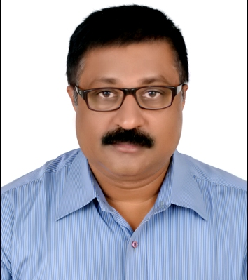

Dr. Asesh Kumar Tripathy

Associate Professor, Department of Computer Science and Engineering Koneru Lakshmaiah Education Foundation (K L Deemed to be University), Vaddeswaram, Andhra Pradesh, India

<ul class="profile-facts">
<li>PhD, Computer Science and Technology, Berhampur University</li>
<li>22 years of teaching</li>
<li>25+ peer-reviewed papers</li>
<li>Author of <a href="/research/#books"><em>Quantum Computing Made Clear</em></a> (2026)</li>
<li>Senior Member, IEEE · Member, ACM</li>
</ul>

I am an Associate Professor in the Department of Computer Science and Engineering at Koneru Lakshmaiah Education Foundation (K L Deemed to be University), where I teach Advanced Object‑Oriented Programming (25CS2205E). I hold a PhD in Computer Science and Technology from Berhampur University and have been teaching for 22 years.

### Research

My research interests include post‑quantum cryptography, decentralised system security, privacy‑preserving machine learning, and the energy and sustainability implications of digital infrastructure. I have published over 25 peer‑reviewed papers. I am a Senior Member of IEEE and a member of ACM.

[See my publications and patents →](/research/) · [Projects I guide →](/projects/)

### Why Y2HL Orbit

Y2HL Orbit ("Yes to Happy Learning") is where I publish my teaching materials. They are open to every student, at my university or any other, and to anyone teaching a similar course.

### Using these materials

- **Students:** follow the weeks in order. Each week builds on the last, and the worksheets are meant to be attempted before you look anything up.
- **Instructors:** you are welcome to use the materials with your own classes. Please credit Y2HL Orbit and link back to this site.
