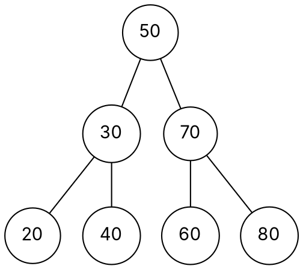
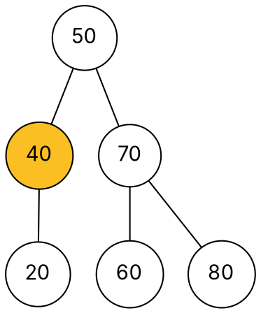
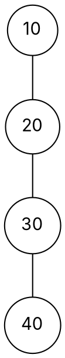

### Intuition

Think of a dictionary opened in the middle. If your word comes earlier, you only ever look in the left half; if later, the right half. A **binary search tree (BST)** builds that halving into the data structure itself:

> **BST property:** for every node, all keys in its **left** subtree are **smaller**, and all keys in its **right** subtree are **larger**.

Inserting 50, 30, 70, 20, 40, 60, 80 in that order gives this tree:



To find 60: 60 > 50, go right; 60 < 70, go left; found. **Every operation walks one root-to-leaf path**, so its cost is the tree's height h.

### How it works

**Search(k):** start at the root; if k is smaller go left, if larger go right; stop when you find k or fall off the tree.

**Insert(k):** search for k; the place where the search falls off the tree is exactly where k belongs. New keys always become **leaves**.

**Delete(k)** has three cases:

| Case | What to do |
| --- | --- |
| k is a leaf | just remove it |
| k has one child | replace k by that child |
| k has two children | replace k's key by its **inorder successor** (the smallest key in its right subtree), then delete that successor — which has at most one child |

Deleting 30 (two children) from the tree above: its inorder successor is 40, the leftmost node of 30's right subtree. Copy 40 into 30's place and remove the old 40:



**Traversals** of the original tree:

| Order | Rule | Result |
| --- | --- | --- |
| Inorder | left, node, right | 20 30 40 50 60 70 80 — always **sorted** |
| Preorder | node, left, right | 50 30 20 40 70 60 80 |
| Postorder | left, right, node | 20 40 30 60 80 70 50 |

**Shape depends on insertion order.** Inserting 10, 20, 30, 40 in sorted order gives a chain leaning right — height 3 for 4 keys, no better than a linked list:



That weakness is exactly what AVL, red-black and splay trees (topics 2–4) fix.

### Python implementation

```python
class Node:
    def __init__(self, key):
        self.key, self.left, self.right = key, None, None


def insert(root, key):
    """Insert key and return the (possibly new) root. Duplicates are ignored."""
    if root is None:
        return Node(key)
    if key < root.key:
        root.left = insert(root.left, key)
    elif key > root.key:
        root.right = insert(root.right, key)
    return root


def search(root, key):
    while root is not None and root.key != key:
        root = root.left if key < root.key else root.right
    return root is not None


def delete(root, key):
    """Delete key if present and return the new root."""
    if root is None:
        return None
    if key < root.key:
        root.left = delete(root.left, key)
    elif key > root.key:
        root.right = delete(root.right, key)
    else:
        if root.left is None:          # zero or one child
            return root.right
        if root.right is None:
            return root.left
        succ = root.right              # two children: inorder successor
        while succ.left is not None:
            succ = succ.left
        root.key = succ.key
        root.right = delete(root.right, succ.key)
    return root


def inorder(root):
    return inorder(root.left) + [root.key] + inorder(root.right) if root else []


def height(root):
    """Height in edges: an empty tree is -1, a single node is 0."""
    return -1 if root is None else 1 + max(height(root.left), height(root.right))


if __name__ == "__main__":
    root = None
    for k in [50, 30, 70, 20, 40, 60, 80]:
        root = insert(root, k)
    print(inorder(root), "height", height(root))   # [20, 30, 40, 50, 60, 70, 80] height 2
    root = delete(root, 30)
    print(inorder(root), root.left.key)            # [20, 40, 50, 60, 70, 80] 40
    print(search(root, 60), search(root, 30))      # True False
```

### Complexity

| Operation | Time | Why |
| --- | --- | --- |
| search, insert, delete | **O(h)** | one root-to-leaf path |
| balanced tree | h = O(log n) | each level doubles the number of nodes |
| worst case (sorted input) | h = n − 1, so **O(n)** | the tree becomes a chain |
| inorder traversal | O(n) | each node visited once |

Space is O(n) for the nodes, plus O(h) for the recursion stack.

### Common mistakes

- **Checking only children, not subtrees.** A node can be bigger than its left child yet smaller than some key deeper in its left subtree — that is not a BST. Validate with a range (low, high) passed down the tree.
- **Forgetting to return the root** from recursive insert/delete, so the parent's link is never updated.
- **Two-children delete:** use the inorder successor (or predecessor) — not "any child".
- **Assuming O(log n).** That needs balance; a plain BST gives no such guarantee.

### Problems

1. Insert 45, 15, 79, 90, 10, 55, 12, 20, 50 into an empty BST. Draw the tree and write its preorder and postorder traversals.
2. **Lab:** write `is_bst(root)` that checks the BST property correctly in O(n) time. Test it on a tree that fools the "check only children" approach.
3. **Lab:** write `kth_smallest(root, k)` using an inorder walk that stops early.
4. Write `lca(root, a, b)`, the lowest common ancestor of keys a and b, in O(h) time using the BST property.
5. Rebuild the BST whose preorder traversal is 30 20 10 25 40 35 50, and give its postorder.
6. How many structurally different BSTs can hold the keys 1, 2, 3, 4? (Hint: choose the root, then count left and right subtrees — Catalan numbers.)
