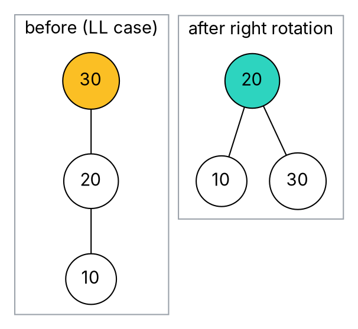
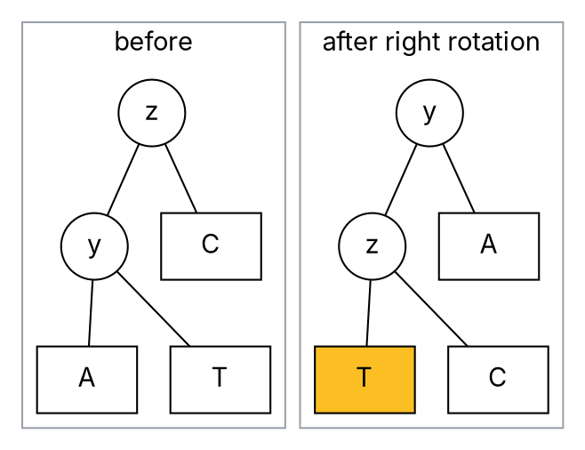
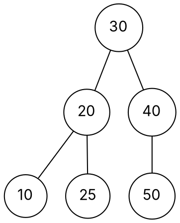

### Intuition

A plain BST can collapse into a chain (topic 1). An **AVL tree** refuses to let that happen. Each node keeps its **balance factor**:

> bf(node) = height(left subtree) − height(right subtree), and an AVL tree requires **bf ∈ {−1, 0, +1}** at every node.

When an insertion pushes some node to +2 or −2, the tree fixes it on the spot with a **rotation** — a local rearrangement of three nodes that keeps the BST order and shortens the tall side.



### How it works

After inserting a key, walk back up toward the root updating heights. At the **first (lowest) node z with |bf| = 2**, look at the path from z toward the new key:

| Case | Path from z | Fix |
| --- | --- | --- |
| **LL** | left, then left | single **right** rotation at z |
| **RR** | right, then right | single **left** rotation at z |
| **LR** | left, then right | left rotation at z.left, then right rotation at z |
| **RL** | right, then left | right rotation at z.right, then left rotation at z |

One fix at that lowest node is enough: the subtree goes back to its old height, so nothing above it changes.

**Right rotation at z** (z has left child y): y moves up, z becomes y's right child, and y's old right subtree T becomes z's left subtree. BST order is preserved because every key in T lies between y and z.



**Worked trace: insert 10, 20, 30, 40, 50, 25.**

| Insert | What happens | Root afterwards |
| --- | --- | --- |
| 10, 20 | no imbalance | 10 |
| 30 | 10 becomes −2, path right-right (**RR**) → left rotation at 10 | 20 |
| 40 | fine | 20 |
| 50 | 30 becomes −2 (**RR**) → left rotation at 30 | 20 |
| 25 | 20 becomes −2, path right-left (**RL**) → right rotate at 40, then left rotate at 20 | 30 |

Final tree:



### Python implementation

```python
class Node:
    def __init__(self, key):
        self.key, self.left, self.right, self.height = key, None, None, 0


def h(n):
    return n.height if n else -1


def update(n):
    n.height = 1 + max(h(n.left), h(n.right))


def bf(n):
    return h(n.left) - h(n.right)


def rotate_right(z):
    y = z.left
    z.left, y.right = y.right, z
    update(z); update(y)
    return y


def rotate_left(z):
    y = z.right
    z.right, y.left = y.left, z
    update(z); update(y)
    return y


def insert(node, key):
    if node is None:
        return Node(key)
    if key < node.key:
        node.left = insert(node.left, key)
    elif key > node.key:
        node.right = insert(node.right, key)
    else:
        return node                                  # no duplicates
    update(node)
    if bf(node) > 1:                                 # left side too tall
        if key > node.left.key:                      # LR: first straighten it
            node.left = rotate_left(node.left)
        return rotate_right(node)                    # LL
    if bf(node) < -1:                                # right side too tall
        if key < node.right.key:                     # RL
            node.right = rotate_right(node.right)
        return rotate_left(node)                     # RR
    return node


def preorder(n):
    return [n.key] + preorder(n.left) + preorder(n.right) if n else []


if __name__ == "__main__":
    root = None
    for k in [10, 20, 30, 40, 50, 25]:
        root = insert(root, k)
    print(preorder(root), "height", root.height)    # [30, 20, 10, 25, 40, 50] height 2
    root = None
    for k in range(1, 16):                          # sorted input: a plain BST would be a chain
        root = insert(root, k)
    print("15 sorted keys -> height", root.height)   # 15 sorted keys -> height 3
```

### Complexity

| Operation | Time | Why |
| --- | --- | --- |
| search | O(log n) | height is at most about 1.44 log₂ n |
| insert | O(log n) | one path down, one path up, at most 2 rotations |
| delete | O(log n) | like insert, but rotations may be needed at several ancestors |
| rotation | O(1) | a constant number of pointer changes |

**Why the height is logarithmic.** Let N(h) be the fewest nodes an AVL tree of height h can have. The sparsest tree has one subtree of height h − 1 and the other of height h − 2:

> N(h) = N(h − 1) + N(h − 2) + 1, with N(0) = 1, N(1) = 2, giving 1, 2, 4, 7, 12, 20, 33, …

This grows like the Fibonacci numbers, i.e. exponentially in h — so h = O(log n).

### Common mistakes

- **Rotating at the wrong node.** Fix the **lowest** node whose balance factor reaches ±2, not the root.
- **Using a single rotation for LR or RL.** A zig-zag needs the double rotation; a single one just moves the problem to the other side.
- **Forgetting to update heights** after a rotation — update the lower node first, then the new subtree root.
- **Sign confusion.** Fix one convention (here: left height minus right height) and stick to it.

### Problems

1. Insert 50, 20, 60, 10, 8, 15, 32, 46, 11, 48 into an empty AVL tree. Name every rotation (LL, RR, LR, RL) and draw the final tree.
2. Using N(h) = N(h−1) + N(h−2) + 1, find the minimum number of nodes in an AVL tree of height 6.
3. What is the maximum possible height of an AVL tree with 20 nodes?
4. **Lab:** add `delete(root, key)` to the implementation above. After a deletion, check every ancestor on the way up — more than one may need a rotation.
5. **Lab:** write `is_avl(root)` that checks both the BST property and the balance condition in O(n).
