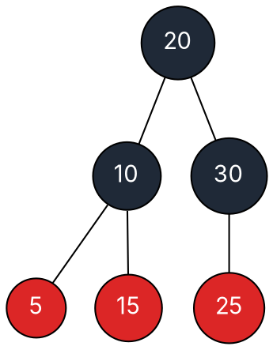

### Intuition

AVL trees track exact heights. **Red-black trees** settle for a looser promise that is cheaper to maintain: colour every node red or black and enforce

1. Every node is **red or black**.
2. The **root is black**.
3. Every leaf (the empty NIL children) is **black**.
4. A red node has **two black children** — no two reds in a row.
5. Every path from a node down to a NIL leaf contains the **same number of black nodes** (that node's *black-height*).

Rules 4 and 5 together mean the longest path (alternating red and black) is at most **twice** the shortest (all black). So the tree is never badly lopsided.



*A valid red-black tree (dark = black, red = red). Every root-to-NIL path has black-height 2.*

### How it works

**Insert** like a BST, colour the new node **red** (so black-heights are untouched), then repair any red-red violation between the new node x and its parent. Let the **uncle** be the parent's sibling:

| Case | Situation | Fix |
| --- | --- | --- |
| 1 | uncle is **red** | recolour: parent and uncle → black, grandparent → red; move x up to the grandparent and repeat |
| 2 | uncle black, x is an **inner** child (zig-zag) | rotate at the parent to turn it into case 3 |
| 3 | uncle black, x is an **outer** child (straight line) | rotate at the grandparent, swap the colours of parent and grandparent — done |

Finally colour the root black. Case 1 can bubble up the tree, but cases 2–3 happen at most once: **an insertion needs at most 2 rotations.**

**Worked trace: insert 10, 20, 30, 15, 25, 5.**

| Insert | Situation | Action |
| --- | --- | --- |
| 10 | first node | colour it black (root) |
| 20 | parent 10 is black | nothing to fix |
| 30 | parent 20 red, uncle NIL (black), outer | case 3: left-rotate at 10, recolour — root becomes 20 |
| 15 | parent 10 red, uncle 30 red | case 1: 10 and 30 black, 20 red, then root back to black |
| 25 | parent 30 is black | nothing to fix |
| 5 | parent 10 is black | nothing to fix |

The result is exactly the tree drawn above.

### Python implementation

```python
RED, BLACK = "R", "B"


class Node:
    def __init__(self, key, color=RED, nil=None):
        self.key, self.color = key, color
        self.left = self.right = self.parent = nil


class RBTree:
    def __init__(self):
        self.NIL = Node(None, BLACK)                     # one shared black sentinel leaf
        self.root = self.NIL

    def _rotate_left(self, x):
        y = x.right
        x.right = y.left
        if y.left is not self.NIL:
            y.left.parent = x
        y.parent = x.parent
        if x.parent is self.NIL:
            self.root = y
        elif x is x.parent.left:
            x.parent.left = y
        else:
            x.parent.right = y
        y.left, x.parent = x, y

    def _rotate_right(self, x):
        y = x.left
        x.left = y.right
        if y.right is not self.NIL:
            y.right.parent = x
        y.parent = x.parent
        if x.parent is self.NIL:
            self.root = y
        elif x is x.parent.right:
            x.parent.right = y
        else:
            x.parent.left = y
        y.right, x.parent = x, y

    def insert(self, key):
        z = Node(key, RED, self.NIL)
        parent, cur = self.NIL, self.root
        while cur is not self.NIL:                       # ordinary BST descent
            parent = cur
            cur = cur.left if key < cur.key else cur.right
        z.parent = parent
        if parent is self.NIL:
            self.root = z
        elif key < parent.key:
            parent.left = z
        else:
            parent.right = z
        self._fix(z)

    def _fix(self, z):
        while z.parent.color == RED:
            gp = z.parent.parent
            if z.parent is gp.left:
                uncle = gp.right
                if uncle.color == RED:                   # case 1: recolour, move up
                    z.parent.color = uncle.color = BLACK
                    gp.color, z = RED, gp
                else:
                    if z is z.parent.right:              # case 2: zig-zag -> straight
                        z = z.parent
                        self._rotate_left(z)
                    z.parent.color, gp.color = BLACK, RED   # case 3
                    self._rotate_right(gp)
            else:                                        # mirror image
                uncle = gp.left
                if uncle.color == RED:
                    z.parent.color = uncle.color = BLACK
                    gp.color, z = RED, gp
                else:
                    if z is z.parent.left:
                        z = z.parent
                        self._rotate_right(z)
                    z.parent.color, gp.color = BLACK, RED
                    self._rotate_left(gp)
        self.root.color = BLACK

    def preorder(self, n=None, first=True):
        n = self.root if first else n
        if n is self.NIL:
            return []
        return [f"{n.key}{n.color}"] + self.preorder(n.left, False) + self.preorder(n.right, False)


if __name__ == "__main__":
    t = RBTree()
    for k in [10, 20, 30, 15, 25, 5]:
        t.insert(k)
    print(t.preorder())     # ['20B', '10B', '5R', '15R', '30B', '25R']
```

### Complexity

| Operation | Time | Rotations |
| --- | --- | --- |
| search | O(log n) | — |
| insert | O(log n) | at most **2** |
| delete | O(log n) | at most **3** |

**Height bound.** A subtree rooted at x contains at least 2^bh(x) − 1 internal nodes (induction on height). By rule 4 at least half the nodes on any root-to-leaf path are black, so bh(root) ≥ h/2. Hence n ≥ 2^(h/2) − 1, i.e. **h ≤ 2·log₂(n + 1)**.

**Red-black vs AVL.** AVL trees are more tightly balanced (faster lookups); red-black trees do fewer rotations on updates. That is why language libraries (Java's `TreeMap`, C++'s `std::map`) use red-black trees.

### Common mistakes

- **Inserting the new node black.** That breaks rule 5 everywhere above it; always insert red.
- **Deciding the case from the parent instead of the uncle.** The uncle's colour chooses recolour (red) vs rotate (black).
- **Forgetting to recolour the root black** at the end of the fix-up.
- **Counting NIL leaves wrongly.** Black-height counts the black nodes below a node down to a NIL leaf, not counting the node itself.

### Problems

1. Insert 41, 38, 31, 12, 19, 8 into an empty red-black tree. Show the case used at each fix and draw the final coloured tree.
2. What is the largest possible number of internal nodes in a red-black tree of black-height 3? The smallest?
3. Can a red-black tree consist only of black nodes? Only of red nodes (apart from the root)? Explain.
4. **Lab:** write `check_rb(tree)` that verifies all five properties and returns the black-height.
5. Show that every AVL tree can be coloured to be a red-black tree. (Hint: colour by height parity.)
