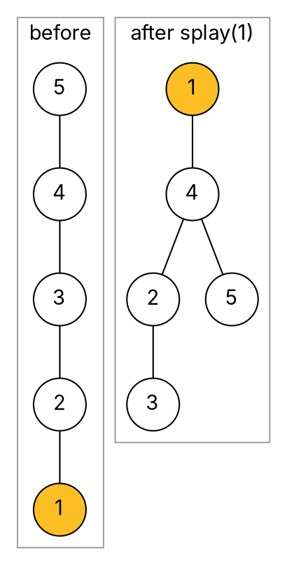

### Intuition

Libraries put popular books near the front desk. A **splay tree** does the same with keys: whenever you touch a key — search, insert or delete — it is moved to the **root** by a sequence of rotations called **splaying**. Keys you use often stay near the top; keys you never touch sink.

There is no height or colour stored in the nodes. A single operation can be slow (O(n)), but any sequence of m operations costs O(m log n) in total — **O(log n) amortised** per operation.

### How it works

Splaying node x repeats one of three steps until x is the root (p = parent, g = grandparent):

| Step | When | Rotations |
| --- | --- | --- |
| **zig** | p is the root | one rotation at p |
| **zig-zig** | x and p are both left children (or both right) | rotate at **g first**, then at p |
| **zig-zag** | x is a left child and p a right child (or vice versa) | rotate at p, then at g |

The order in zig-zig (grandparent first) is what makes splaying special: it roughly **halves the depth** of every node on the access path, not just x.

**Example: splay 1 in the chain 5–4–3–2–1** (what a plain BST gives after inserting 5, 4, 3, 2, 1):



The tree went from height 4 to height 3 and 1 is now at the root — and the next access to 2 or 3 is cheaper than before.

**Operations, all built on splay:**

- **search(k):** splay k (or the last node reached) to the root; k is present if the root holds it.
- **insert(k):** splay k's neighbour to the root, then make k the new root with the old tree split around it.
- **delete(k):** splay k to the root, remove it, splay the largest key of the left subtree, and attach the right subtree to it.

### Python implementation

```python
class Node:
    def __init__(self, key):
        self.key, self.left, self.right = key, None, None


def rot_right(x):
    y = x.left
    x.left, y.right = y.right, x
    return y


def rot_left(x):
    y = x.right
    x.right, y.left = y.left, x
    return y


def splay(root, key):
    """Bring key (or the last node on its search path) to the root."""
    if root is None or root.key == key:
        return root
    if key < root.key:
        if root.left is None:
            return root
        if key < root.left.key:                          # zig-zig (left-left)
            root.left.left = splay(root.left.left, key)
            root = rot_right(root)
        elif key > root.left.key:                        # zig-zag (left-right)
            root.left.right = splay(root.left.right, key)
            if root.left.right:
                root.left = rot_left(root.left)
        return rot_right(root) if root.left else root    # final zig
    else:
        if root.right is None:
            return root
        if key > root.right.key:                         # zig-zig (right-right)
            root.right.right = splay(root.right.right, key)
            root = rot_left(root)
        elif key < root.right.key:                       # zig-zag (right-left)
            root.right.left = splay(root.right.left, key)
            if root.right.left:
                root.right = rot_right(root.right)
        return rot_left(root) if root.right else root


def insert(root, key):
    if root is None:
        return Node(key)
    root = splay(root, key)
    if root.key == key:
        return root
    node = Node(key)
    if key < root.key:
        node.left, node.right, root.left = root.left, root, None
    else:
        node.right, node.left, root.right = root.right, root, None
    return node


def delete(root, key):
    root = splay(root, key)
    if root is None or root.key != key:
        return root
    if root.left is None:
        return root.right
    left = splay(root.left, key)                         # largest key of the left part
    left.right = root.right
    return left


def preorder(n):
    return [n.key] + preorder(n.left) + preorder(n.right) if n else []


if __name__ == "__main__":
    root = None
    for k in [5, 4, 3, 2, 1]:
        root = insert(root, k)
    print(preorder(root))                 # [1, 2, 3, 4, 5]
    root = splay(root, 5)
    print(preorder(root))                 # [5, 2, 1, 4, 3]
    root = delete(root, 5)
    print(preorder(root), root.key)       # [4, 2, 1, 3] 4
```

### Complexity

| Operation | Worst case (single) | Amortised |
| --- | --- | --- |
| search / insert / delete | O(n) | **O(log n)** |
| space per node | no extra fields | — |

The amortised bound comes from a potential function — the sum of log(subtree size) over all nodes — which the zig-zig step reduces enough to pay for the rotations. Splay trees also adapt to the workload: if a few keys are accessed repeatedly, those accesses become close to O(1).

### Common mistakes

- **Zig-zig in the wrong order.** Rotating at the parent first (like a plain "move to root") does *not* give the O(log n) amortised bound. Rotate at the **grandparent** first.
- **Expecting every operation to be fast.** One access can cost O(n); only the average over a sequence is guaranteed.
- **Forgetting to splay on an unsuccessful search.** Splay the last node reached — otherwise repeated failed searches stay expensive.

### Problems

1. Insert 10, 20, 30, 40, 50 into an empty splay tree, splaying each new key to the root. Draw the tree, then splay 10 and draw it again.
2. For the tree in problem 1, list which of zig, zig-zig, zig-zag occur when splaying 30.
3. **Lab:** add `search(root, key)` that returns the new root and whether the key was found.
4. Explain, with an example, why a sequence of n accesses in increasing order (1, 2, …, n) costs only O(n) in total in a splay tree.
5. Compare AVL, red-black and splay trees: storage per node, worst-case and amortised time, and a workload where each is best.
