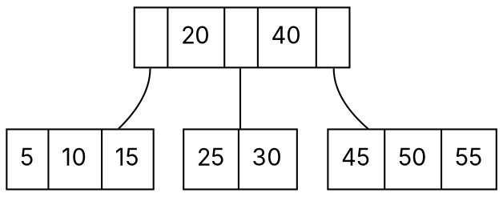

### Intuition

Reading one block from a disk takes as long as millions of CPU steps. A binary tree with a million keys has height about 20 — that is 20 disk reads per search. A **B-tree** packs many keys into each node (one node = one disk block), so a node with 100 keys has 101 children and a million keys fit in a tree of height 2 or 3.



*A B-tree with minimum degree t = 2 (a 2-3-4 tree): every node has 1–3 keys, keys between the parent's keys go to the child between them, and all leaves are on the same level.*

### How it works

**B-tree of minimum degree t ≥ 2:**

| Rule | Detail |
| --- | --- |
| keys per node | every node except the root has **t − 1 to 2t − 1** keys (the root has 1 to 2t − 1) |
| children | an internal node with k keys has **k + 1** children |
| order | keys in a node are sorted; the keys in child i lie between key i−1 and key i |
| balance | **all leaves are at the same depth** |

(Books that use the **order m** — the maximum number of children — write m = 2t: each node has at most m − 1 keys and at least ⌈m/2⌉ children.)

**Search:** at each node, scan (or binary-search) its keys, then descend into the one child whose range contains the key.

**Insert (split on the way down):** insertion always goes into a **leaf**. On the way down, whenever you meet a **full** node (2t − 1 keys), **split** it: its middle key moves up into the parent, and the remaining keys form two nodes of t − 1 keys each. Because full nodes are split before you enter them, the parent always has room. When the root is full, splitting it creates a new root — **the only way a B-tree grows taller**, so all leaves stay at the same depth.

**Worked example (t = 2, so at most 3 keys per node): insert 10, 20, 30, 40, 50, 60.**

| Insert | Action | Tree (levels) |
| --- | --- | --- |
| 10, 20, 30 | fill the root leaf | [10 20 30] |
| 40 | root full → split: 20 moves up | [20] / [10] [30 40] |
| 50 | goes to [30 40] | [20] / [10] [30 40 50] |
| 60 | [30 40 50] full → split: 40 moves up | [20 40] / [10] [30] [50 60] |

**B+ tree:** a variation used by almost every database and file system.

- **All records live in the leaves**; internal nodes hold only copies of keys used for routing.
- Leaves are **linked left to right**, so a range query ("all keys from 30 to 70") finds the first key, then walks the leaf list.
- Internal nodes hold no data, so more keys fit per block — the tree is even shallower.

```dot
digraph {
  rankdir=TB; node [shape=record, fontname="Inter"]; edge [dir=none];
  r [label="<a> | 30 | <b> | 50 | <c>"];
  l1 [label="10 | 20"]; l2 [label="30 | 40"]; l3 [label="50 | 60 | 70"];
  r:a -> l1; r:b -> l2; r:c -> l3;
  l1 -> l2 [dir=forward, style=dashed, constraint=false]; l2 -> l3 [dir=forward, style=dashed, constraint=false];
}
```

*A B+ tree: 30 and 50 appear both as routing keys and in the leaves; dashed arrows link the leaves.*

### Python implementation

```python
class BNode:
    def __init__(self, leaf=True):
        self.keys, self.children, self.leaf = [], [], leaf


class BTree:
    def __init__(self, t):
        self.t, self.root = t, BNode()

    def search(self, key, node=None):
        node = node or self.root
        i = 0
        while i < len(node.keys) and key > node.keys[i]:
            i += 1
        if i < len(node.keys) and node.keys[i] == key:
            return True
        return False if node.leaf else self.search(key, node.children[i])

    def _split_child(self, parent, i):
        t, full = self.t, parent.children[i]
        right = BNode(full.leaf)
        parent.keys.insert(i, full.keys[t - 1])          # middle key moves up
        right.keys, full.keys = full.keys[t:], full.keys[:t - 1]
        if not full.leaf:
            right.children, full.children = full.children[t:], full.children[:t]
        parent.children.insert(i + 1, right)

    def insert(self, key):
        if len(self.root.keys) == 2 * self.t - 1:         # full root: grow upwards
            old, self.root = self.root, BNode(leaf=False)
            self.root.children.append(old)
            self._split_child(self.root, 0)
        node = self.root
        while not node.leaf:
            i = sum(1 for k in node.keys if key > k)
            if len(node.children[i].keys) == 2 * self.t - 1:
                self._split_child(node, i)
                if key > node.keys[i]:
                    i += 1
            node = node.children[i]
        node.keys.insert(sum(1 for k in node.keys if key > k), key)

    def levels(self):
        out, level = [], [self.root]
        while level:
            out.append([n.keys for n in level])
            level = [c for n in level for c in n.children]
        return out


if __name__ == "__main__":
    tree = BTree(t=2)
    for k in [10, 20, 30, 40, 50, 60]:
        tree.insert(k)
    print(tree.levels())                    # [[[20, 40]], [[10], [30], [50, 60]]]
    print(tree.search(50), tree.search(35))  # True False
```

### Complexity

With n keys and minimum degree t, the height is at most **log_t((n + 1)/2)**.

| Operation | Disk reads | CPU time |
| --- | --- | --- |
| search | O(h) = O(log_t n) | O(t log_t n) |
| insert | O(log_t n) | O(t log_t n) |
| delete | O(log_t n) | O(t log_t n) |

**Key counts for height h (root at depth 0):**
- maximum: every node has 2t − 1 keys → **(2t)^(h+1) − 1** keys;
- minimum: root has 1 key, every other node t − 1 keys → **2t^h − 1** keys.

### Common mistakes

- **Splitting after inserting** (bottom-up) and then forgetting that the split can cascade to the root. The top-down method avoids that by splitting full nodes on the way down.
- **Wrong middle key.** In a full node of 2t − 1 keys, the key at index t − 1 (0-based) moves up.
- **Mixing order m and minimum degree t.** Check which one the question uses: order m means at most m children (m − 1 keys).
- **B+ trees: deleting the routing key.** In a B+ tree a key can remain in an internal node after its record is deleted from the leaf — it is only a signpost.

### Problems

1. Insert 5, 3, 21, 9, 1, 13, 2, 7, 10, 12, 4, 8 into a B-tree with t = 2. Draw the tree after each split.
2. A B-tree of order m = 5 (at most 4 keys per node) has height 2. What is the largest number of keys it can hold? The smallest?
3. **Lab:** extend the `BTree` class with `inorder()` and a range query `between(lo, hi)`.
4. A disk block holds 4096 bytes; a key takes 8 bytes and a child pointer 8 bytes. What is the largest minimum degree t a node can have? How many levels does a B-tree need for 10⁹ keys?
5. Explain why a B+ tree is better than a B-tree for the SQL query `SELECT * FROM marks WHERE score BETWEEN 60 AND 80`.
