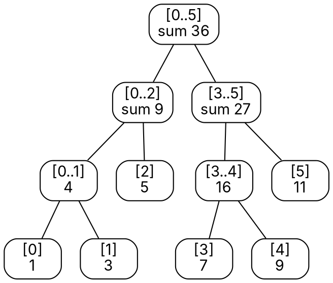

### Intuition

You keep daily sales for a year in an array and are asked, thousands of times, "what were the total sales from day l to day r?" — while some days' figures keep getting corrected.

- Adding up a[l..r] each time costs O(n) per query.
- A prefix-sum array answers in O(1), but one correction costs O(n) to rebuild.
- A **segment tree** answers **both** in **O(log n)**.

Each node stores the sum of a segment of the array; the root covers everything, its children cover the two halves, and so on down to single elements.



*Segment tree for a = [1, 3, 5, 7, 9, 11]. The query sum(1..4) = 3 + 5 + 7 + 9 = 24 is assembled from just three nodes, [1], [2] and [3..4]: 3 + 5 + 16.*

### How it works

**Query(l, r)** at a node covering [lo..hi]:

- no overlap with [l..r] → contribute 0;
- **completely inside** [l..r] → contribute the stored value, don't go further;
- partial overlap → ask both children and add.

At most about 4 nodes per level are visited, so a query costs **O(log n)**.

**Update(i, value):** change the leaf for position i, then recompute the sums on the path back up to the root — O(log n).

The same structure works for any **associative** operation: min, max, gcd, product. Only the combine step changes.

**Range trees (2-D range counting).** Given n points (x, y), count how many lie in a rectangle [x₁, x₂] × [y₁, y₂].

1. Build a balanced tree on the **x**-coordinates (like a segment tree over the points sorted by x).
2. At every node, also store the **y**-coordinates of all points in its subtree, **sorted**.
3. A query splits [x₁, x₂] into O(log n) canonical nodes; in each, binary-search the sorted y-list to count points with y₁ ≤ y ≤ y₂.

That gives **O(log² n)** per query using **O(n log n)** space (each point appears in one y-list per level).

### Python implementation

```python
from bisect import bisect_left, bisect_right


class SegmentTree:
    """Range sums with point updates. tree[1] is the root; node i has children 2i and 2i+1."""

    def __init__(self, a):
        self.n = len(a)
        self.tree = [0] * (4 * self.n)
        self._build(a, 1, 0, self.n - 1)

    def _build(self, a, node, lo, hi):
        if lo == hi:
            self.tree[node] = a[lo]
            return
        mid = (lo + hi) // 2
        self._build(a, 2 * node, lo, mid)
        self._build(a, 2 * node + 1, mid + 1, hi)
        self.tree[node] = self.tree[2 * node] + self.tree[2 * node + 1]

    def query(self, l, r, node=1, lo=0, hi=None):
        hi = self.n - 1 if hi is None else hi
        if r < lo or hi < l:
            return 0                                     # no overlap
        if l <= lo and hi <= r:
            return self.tree[node]                       # fully inside
        mid = (lo + hi) // 2
        return self.query(l, r, 2 * node, lo, mid) + self.query(l, r, 2 * node + 1, mid + 1, hi)

    def update(self, i, value, node=1, lo=0, hi=None):
        hi = self.n - 1 if hi is None else hi
        if lo == hi:
            self.tree[node] = value
            return
        mid = (lo + hi) // 2
        if i <= mid:
            self.update(i, value, 2 * node, lo, mid)
        else:
            self.update(i, value, 2 * node + 1, mid + 1, hi)
        self.tree[node] = self.tree[2 * node] + self.tree[2 * node + 1]


class RangeTree2D:
    """Static 2-D range counting: a tree over x, each node keeping its points' y-values sorted."""

    def __init__(self, points):
        self.pts = sorted(points)
        self.xs = [p[0] for p in self.pts]
        self.n = len(self.pts)
        self.ys = [[] for _ in range(4 * self.n)]
        self._build(1, 0, self.n - 1)

    def _build(self, node, lo, hi):
        if lo == hi:
            self.ys[node] = [self.pts[lo][1]]
            return
        mid = (lo + hi) // 2
        self._build(2 * node, lo, mid)
        self._build(2 * node + 1, mid + 1, hi)
        self.ys[node] = sorted(self.ys[2 * node] + self.ys[2 * node + 1])

    def count(self, x1, x2, y1, y2):
        l, r = bisect_left(self.xs, x1), bisect_right(self.xs, x2) - 1
        return self._count(1, 0, self.n - 1, l, r, y1, y2) if l <= r else 0

    def _count(self, node, lo, hi, l, r, y1, y2):
        if r < lo or hi < l:
            return 0
        if l <= lo and hi <= r:                          # canonical node: binary search on y
            ys = self.ys[node]
            return bisect_right(ys, y2) - bisect_left(ys, y1)
        mid = (lo + hi) // 2
        return (self._count(2 * node, lo, mid, l, r, y1, y2) +
                self._count(2 * node + 1, mid + 1, hi, l, r, y1, y2))


if __name__ == "__main__":
    st = SegmentTree([1, 3, 5, 7, 9, 11])
    print(st.query(1, 4), st.query(0, 5))      # 24 36
    st.update(2, 10)                           # a[2]: 5 -> 10
    print(st.query(1, 4))                      # 29
    rt = RangeTree2D([(1, 5), (2, 2), (3, 8), (5, 4), (6, 7), (8, 1)])
    print(rt.count(2, 6, 2, 7))                # 3
```

### Complexity

| Structure | Build | Query | Update | Space |
| --- | --- | --- | --- | --- |
| prefix sums | O(n) | O(1) | O(n) | O(n) |
| segment tree | O(n) | **O(log n)** | **O(log n)** | O(n) (array of size 4n) |
| 2-D range tree (as above) | O(n log n) | **O(log² n)** | static | O(n log n) |

### Common mistakes

- **Array too small.** A segment tree stored in an array needs up to 4n slots, not 2n, when n is not a power of two.
- **Mixing inclusive and exclusive ends.** Decide whether r is included and stay consistent in query and update.
- **Using a segment tree for a non-associative operation** such as "average" directly — store sum and count instead, and divide at the end.
- **Range trees: searching y in every node.** Only the O(log n) canonical nodes need a binary search.

### Problems

1. For a = [2, 4, 6, 8, 10, 12, 14], draw the segment tree of sums and list the nodes used to answer sum(2..5).
2. **Lab:** change `SegmentTree` to answer **range minimum** queries. What should "no overlap" return?
3. **Lab:** using a segment tree, answer: "how many elements in a[l..r] are greater than k?" for many queries on a fixed array. (Hint: store sorted lists, as in the range tree.)
4. For the points (1, 5), (2, 2), (3, 8), (5, 4), (6, 7), (8, 1), count by hand the points in [2, 6] × [2, 7] and check the program's answer.
5. Why is a segment tree with **lazy propagation** needed when updates change a whole range at once? Sketch the idea.
