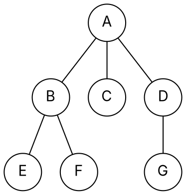
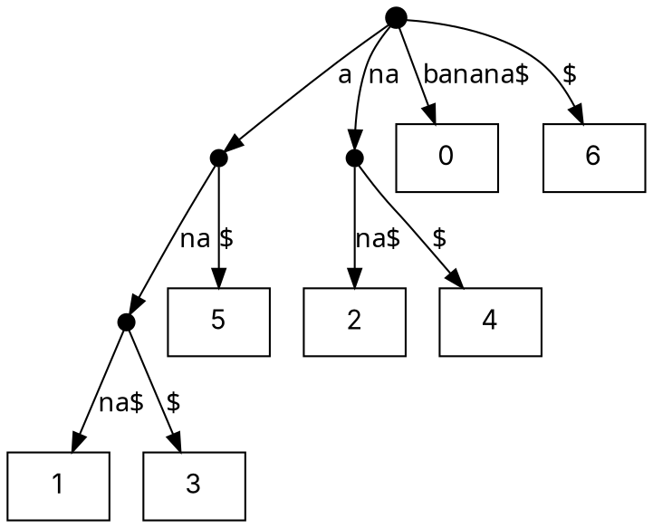

### Intuition

**N-ary trees.** Many real hierarchies are not binary: folders in a file system, an organisation chart, the moves in a game. An **N-ary tree** lets each node have any number of children. Two common representations:

- **child list:** each node keeps a list of its children — simple and direct;
- **left-child right-sibling:** each node keeps just two pointers, *first child* and *next sibling* — turning any N-ary tree into a binary tree.



*An N-ary tree: A has three children. In left-child right-sibling form, A points to B; B's sibling pointer goes to C, C's to D.*

**Suffix trees.** A search engine is asked thousands of times whether a word occurs in one long text. Scanning the text each time costs O(n) per query. Instead, preprocess the text once into a tree of **all its suffixes**. Every substring of T is a *prefix of some suffix*, so "does P occur?" becomes "can I walk P down from the root?" — **O(m)** time for a pattern of length m, independent of the text length.

Suffixes of `banana$` (the `$` marks the end, so no suffix is a prefix of another):

| Start | Suffix |
| --- | --- |
| 0 | banana$ |
| 1 | anana$ |
| 2 | nana$ |
| 3 | ana$ |
| 4 | na$ |
| 5 | a$ |
| 6 | $ |

### How it works

1. **Suffix trie:** insert every suffix, one character per edge. Simple, but it can have O(n²) nodes.
2. **Compress** every chain of single-child nodes into one edge labelled with a substring. The result is the **suffix tree**: exactly **n leaves** (one per suffix) and **at most n − 1 internal nodes**, so O(n) nodes in total.

Suffix tree of `banana$` (each leaf is labelled with the start position of its suffix):



**What it answers:**

| Question | How |
| --- | --- |
| does P occur in T? | walk P from the root |
| how many times? | number of leaves below where P ends |
| where? | the leaf labels below that point |
| longest repeated substring | the deepest **internal** node (by string length): `ana` |
| number of distinct substrings | total length of all edge labels (excluding `$`) |

Building by inserting suffixes one by one takes O(n²); **Ukkonen's algorithm** builds it in **O(n)** for a fixed alphabet.

### Python implementation

```python
class Nary:
    def __init__(self, label, children=()):
        self.label, self.children = label, list(children)


def preorder(node):
    """Visit a node, then each child left to right."""
    out = [node.label]
    for child in node.children:
        out += preorder(child)
    return out


def to_lcrs(node):
    """Left-child right-sibling form: (label, first_child, next_sibling)."""
    first = None
    for child in reversed(node.children):
        first = (child.label, to_lcrs(child)[1], first)
    return (node.label, first, None)


class SuffixTree:
    """Compressed suffix tree, built by inserting suffixes one at a time (O(n^2))."""

    def __init__(self, text):
        self.text = text + "$"
        self.root = {}                                   # edge label -> child dict (leaves: {"#": start})
        for i in range(len(self.text)):
            self._insert(i)

    def _insert(self, start):
        node, s = self.root, self.text[start:]
        while True:
            edge = next((e for e in node if e != "#" and e[0] == s[0]), None)
            if edge is None:
                node[s] = {"#": start}                   # new leaf edge
                return
            k = 0                                        # length of common prefix with the edge
            while k < len(edge) and edge[k] == s[k]:
                k += 1
            if k == len(edge):                           # edge fully matched: go down
                node, s = node[edge], s[k:]
                continue
            child = node.pop(edge)                       # split the edge at position k
            node[edge[:k]] = {edge[k:]: child, s[k:]: {"#": start}}
            return

    def _find(self, p):
        node = self.root
        while p:
            edge = next((e for e in node if e != "#" and e[0] == p[0]), None)
            if edge is None:
                return None
            if not (edge.startswith(p) or p.startswith(edge)):
                return None
            if len(p) <= len(edge):
                return node[edge]
            node, p = node[edge], p[len(edge):]
        return node

    def occurrences(self, p):
        node = self._find(p)
        if node is None:
            return []
        starts, stack = [], [node]
        while stack:
            n = stack.pop()
            for e, child in n.items():
                if e == "#":
                    starts.append(child)
                else:
                    stack.append(child)
        return sorted(starts)

    def longest_repeat(self):
        best, stack = "", [(self.root, "")]
        while stack:
            node, path = stack.pop()
            for e, child in node.items():
                if e != "#" and "#" not in child:        # internal node: occurs at least twice
                    if len(path + e) > len(best):
                        best = path + e
                    stack.append((child, path + e))
        return best


if __name__ == "__main__":
    tree = Nary("A", [Nary("B", [Nary("E"), Nary("F")]), Nary("C"), Nary("D", [Nary("G")])])
    print(preorder(tree))                                  # ['A', 'B', 'E', 'F', 'C', 'D', 'G']
    st = SuffixTree("banana")
    print(st.occurrences("ana"), st.occurrences("nab"))     # [1, 3] []
    print(st.longest_repeat())                             # ana
```

### Complexity

| Task | Time | Space |
| --- | --- | --- |
| build suffix tree (insertion, as above) | O(n²) | O(n) nodes |
| build with Ukkonen's algorithm | O(n) | O(n) nodes |
| does P occur? | O(m) | — |
| report all k occurrences | O(m + k) | — |
| longest repeated substring | O(n) after building | — |

### Common mistakes

- **Forgetting the end marker `$`.** Without it, a suffix such as `a` in `banana` is a prefix of `ana` and never gets its own leaf.
- **Counting nodes of the trie, not the tree.** The uncompressed suffix trie can have O(n²) nodes; the compressed tree has O(n).
- **Longest repeated substring = deepest leaf?** No — leaves are single suffixes. Repetition means two suffixes share a path: look at **internal** nodes.
- **LCRS confusion:** the right pointer in left-child right-sibling form points to a **sibling**, not to a child.

### Problems

1. Draw the suffix trie and the compressed suffix tree of `abab$`. How many leaves and internal nodes does each have?
2. **Lab:** using the `SuffixTree` class, write `count_distinct_substrings(text)` and check it against a brute-force set of substrings.
3. Find the longest repeated substring of `mississippi` with a suffix tree. (Answer it by hand, then by program.)
4. **Lab:** write `height(node)` and `count_leaves(node)` for the `Nary` class, and convert the example tree to left-child right-sibling form by hand.
5. Explain how a suffix tree of `T1 # T2 $` finds the **longest common substring** of two texts T1 and T2.
