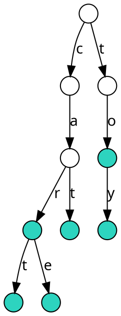

### Intuition

Type "alg" into a search box and it instantly suggests *algebra, algorithm, algorithms*. Storing the words in a **trie** (from re*trie*val) makes that easy: words that share a prefix share the path for that prefix, so all words starting with "alg" hang below a single node.



*A trie for {car, cart, care, cat, to, toy}. Filled nodes mark the end of a word — note that "car" ends at an internal node, because "cart" and "care" continue below it.*

### How it works

Each node has a map from characters to children and an **end-of-word flag**.

- **insert(w):** walk down from the root, creating missing children; set the flag at the last node.
- **search(w):** walk down; succeed only if the path exists **and** the last node's flag is set.
- **starts_with(p):** walk down; succeed if the path exists (flag not needed).
- **delete(w):** clear the flag; then remove nodes on the way back up that have no children and no flag.
- **autocomplete(p):** walk to p's node, then list every word in its subtree.

**Types of tries:**

| Type | Idea | Why |
| --- | --- | --- |
| **standard trie** | one character per edge | simplest; can waste nodes on long unshared tails |
| **compressed trie** (radix tree / Patricia) | merge chains of single-child nodes into one edge labelled with a string | O(number of words) nodes instead of O(total characters) |
| **suffix trie / suffix tree** | a trie of all suffixes of one text | substring search (topic 7) |
| **ternary search trie** | each node has a character and three links: less, equal, greater | uses far less memory per node than a 26-way array |
| **bitwise trie** | branch on bits of a binary key | IP routing (longest-prefix match), XOR problems |

### Python implementation

```python
class TrieNode:
    def __init__(self):
        self.children, self.end, self.count = {}, False, 0   # count = words passing through


class Trie:
    def __init__(self):
        self.root = TrieNode()

    def insert(self, word):
        if self.search(word):
            return
        node = self.root
        for ch in word:
            node = node.children.setdefault(ch, TrieNode())
            node.count += 1
        node.end = True

    def _walk(self, s):
        node = self.root
        for ch in s:
            node = node.children.get(ch)
            if node is None:
                return None
        return node

    def search(self, word):
        node = self._walk(word)
        return node is not None and node.end

    def count_prefix(self, prefix):
        node = self._walk(prefix)
        return 0 if node is None else (node.count if prefix else self.size())

    def size(self):
        return sum(child.count for child in self.root.children.values()) + self.root.end

    def autocomplete(self, prefix):
        node, out = self._walk(prefix), []

        def collect(n, path):
            if n.end:
                out.append(path)
            for ch in sorted(n.children):
                collect(n.children[ch], path + ch)

        if node is not None:
            collect(node, prefix)
        return out

    def delete(self, word):
        if not self.search(word):
            return
        node = self.root
        for ch in word:
            child = node.children[ch]
            child.count -= 1
            if child.count == 0:                     # nothing else passes here: cut the branch
                del node.children[ch]
                return
            node = child
        node.end = False


if __name__ == "__main__":
    t = Trie()
    for w in ["car", "cart", "care", "cat", "to", "toy"]:
        t.insert(w)
    print(t.search("car"), t.search("ca"))            # True False
    print(t.autocomplete("car"), t.count_prefix("ca"))  # ['car', 'care', 'cart'] 4
    t.delete("car")
    print(t.search("car"), t.search("cart"))          # False True
```

### Complexity

For a word or prefix of length m, with alphabet Σ:

| Operation | Time |
| --- | --- |
| insert, search, delete, starts_with | **O(m)** — independent of how many words are stored |
| autocomplete | O(m + size of the output subtree) |
| space (standard trie) | O(total characters) nodes; each node needs up to |Σ| child links |

**Trie vs hash table vs BST** for n words of length m: a hash table also gives O(m) expected lookups but **cannot** answer prefix queries or list words in order; a balanced BST needs O(m log n) because each of its log n comparisons may read the whole word.

### Common mistakes

- **No end-of-word flag.** Without it, "ca" would be found just because "car" was inserted.
- **Deleting shared nodes.** Delete only nodes that no other word passes through (here tracked by `count`).
- **Fixed 26-element arrays everywhere.** Fine for lowercase letters; wasteful for Unicode — use a dictionary or a ternary search trie.
- **Confusing tries with suffix tries.** A trie stores a set of words; a suffix trie stores all suffixes of one text.

### Problems

1. Draw the standard trie and the compressed trie for {bear, bell, bid, bull, buy, sell, stock, stop}. Count the nodes in each.
2. **Lab:** add `longest_common_prefix()` to the `Trie` class (the longest prefix shared by all stored words).
3. **Lab:** implement a phone-book search: as each character of a name is typed, print the matching contacts.
4. Given a list of words, use a trie to find all pairs (a, b) where a is a prefix of b.
5. Explain how a bitwise trie of IP prefixes performs **longest-prefix matching** for a router.
