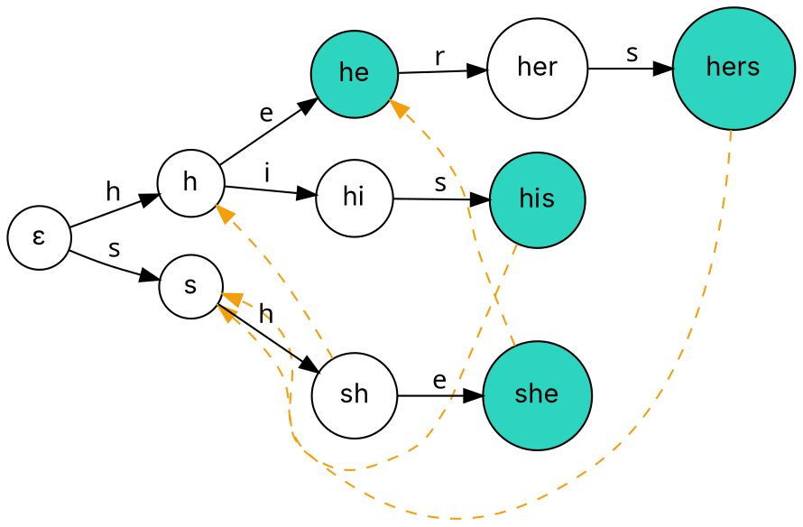

### Intuition

An antivirus program checks a file against **thousands** of virus signatures. Running KMP once per signature would read the file thousands of times. **Aho–Corasick** reads the text **once** and reports every occurrence of every pattern.

1. Put all patterns into a **trie** (topic 8).
2. Add a **failure link** to each node: where to continue if the next character has no edge — exactly KMP's "longest proper suffix that is also a prefix", but across all patterns.
3. Add **output links** so that when you reach a node, you also report shorter patterns that end there (e.g. reaching `she` also means `he` just occurred).

Patterns {he, she, his, hers}:



*Solid edges: the trie. Dashed orange edges: some failure links (all other nodes fail back to the root ε). From `she`, the failure link to `he` is how the algorithm also reports "he".*

### How it works

**Building failure links (breadth-first):**

- children of the root fail to the root;
- for a node u reached by character c from parent p: follow p's failure chain until some node has a c-edge; u's failure link is that c-child (or the root).
- **output(u)** = patterns ending at u, plus output(fail(u)).

**Searching:** start at the root; for each text character c, follow failure links until a c-edge exists (or you are at the root), take it, and report everything in output(current node).

**Trace on `ushers`:**

| i | char | node after | reported |
| --- | --- | --- | --- |
| 0 | u | ε | — |
| 1 | s | s | — |
| 2 | h | sh | — |
| 3 | e | she | **she** (at 1), **he** (at 2) via output link |
| 4 | r | she has no r-edge → fail to he → her | — |
| 5 | s | hers | **hers** (at 2) |

### Python implementation

```python
from collections import deque


class AhoCorasick:
    def __init__(self, patterns):
        self.goto, self.fail, self.out = [{}], [0], [[]]
        for p in patterns:                                 # 1. trie of all patterns
            node = 0
            for ch in p:
                if ch not in self.goto[node]:
                    self.goto.append({}); self.fail.append(0); self.out.append([])
                    self.goto[node][ch] = len(self.goto) - 1
                node = self.goto[node][ch]
            self.out[node].append(p)
        queue = deque(self.goto[0].values())               # 2. failure links, breadth-first
        while queue:
            u = queue.popleft()
            for ch, v in self.goto[u].items():
                f = self.fail[u]
                while f and ch not in self.goto[f]:
                    f = self.fail[f]
                self.fail[v] = self.goto[f].get(ch, 0) if self.goto[f].get(ch, 0) != v else 0
                self.out[v] = self.out[v] + self.out[self.fail[v]]   # 3. output links
                queue.append(v)

    def search(self, text):
        """List of (start, pattern) for every occurrence, in order of their end position."""
        node, found = 0, []
        for i, ch in enumerate(text):
            while node and ch not in self.goto[node]:
                node = self.fail[node]
            node = self.goto[node].get(ch, 0)
            for p in self.out[node]:
                found.append((i - len(p) + 1, p))
        return found


if __name__ == "__main__":
    ac = AhoCorasick(["he", "she", "his", "hers"])
    print(len(ac.goto))                    # 10
    print(ac.search("ushers"))             # [(1, 'she'), (2, 'he'), (2, 'hers')]
```

### Complexity

Let n = text length, M = total length of all patterns, z = number of matches reported.

| Phase | Time |
| --- | --- |
| build trie | O(M) |
| failure and output links | O(M · |Σ|) worst case, O(M) amortised with a dictionary |
| search | **O(n + z)** |
| total | **O(n + M + z)** |

Compare with running KMP once per pattern: O(k·n + M) for k patterns — Aho–Corasick removes the factor k.

### Common mistakes

- **Building failure links depth-first.** A node's failure link depends on shallower nodes, so build level by level (BFS).
- **Forgetting output links.** Without them, `ushers` would report `she` and `hers` but miss `he`.
- **Resetting to the root on a mismatch.** Follow the failure chain — resetting loses partial matches, like a naive matcher.
- **Counting the root as a pattern node.** The root stands for the empty string.

### Problems

1. Build the Aho–Corasick automaton for {a, ab, bab, bc, bca, c, caa}. Draw the trie and every failure link.
2. Trace your automaton on `abccab` and list all matches with their positions.
3. **Lab:** write a profanity filter that replaces every occurrence of any word from a list with `***`, scanning the message once.
4. **Lab:** count how many times each of 1000 DNA motifs occurs in a genome string, and compare the time with calling KMP 1000 times.
5. Show that if there is only one pattern, the Aho–Corasick failure links are exactly KMP's prefix function.
