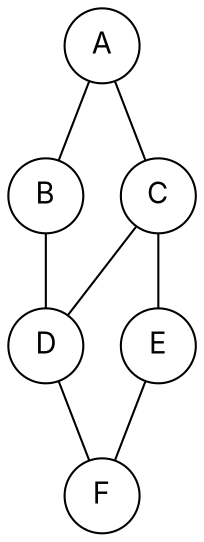

### Intuition

Drop a stone in a pond: the ripples reach everything one step away, then two steps, then three. That is **breadth-first search (BFS)** — it visits vertices in order of their distance from the start, so the first time it reaches a vertex it has found a **shortest path** (counting edges).

Explore a maze with one hand on the wall: go as deep as you can, and only back up when you hit a dead end. That is **depth-first search (DFS)** — and the moments when you back up tell you about cycles, components and dependency order.



*Example graph (undirected). Neighbours are visited in alphabetical order.*

### How it works

**BFS from A** (queue, first in first out):

| Step | Dequeue | Enqueue (new neighbours) | Queue after |
| --- | --- | --- | --- |
| 1 | A (dist 0) | B, C (dist 1) | B C |
| 2 | B | D (dist 2) | C D |
| 3 | C | E (dist 2) — D already seen | D E |
| 4 | D | F (dist 3) | E F |
| 5 | E | — (F seen) | F |
| 6 | F | — | empty |

BFS order **A B C D E F**; distances A 0, B 1, C 1, D 2, E 2, F 3. The edges used to discover vertices form the **BFS tree** of shortest paths.

**DFS from A** (go deep, back up when stuck): A → B → D → C → E → F, then back up all the way. DFS order **A B D C E F**.

Record a **discovery time** when you first reach a vertex and a **finish time** when you have explored everything below it. In a directed graph every edge (u, v) is then one of:

| Edge type | Meaning | Tells you |
| --- | --- | --- |
| tree | v discovered from u | the DFS forest |
| **back** | v is an ancestor of u (still open) | **a cycle exists** |
| forward | v is a finished descendant of u | — |
| cross | everything else | — |

**Topological sort** (for a directed acyclic graph): list the vertices in **decreasing finish time**. Every edge then points from earlier to later in the list.

### Python implementation

```python
from collections import deque


def bfs(graph, s):
    """Return (visit order, distance from s) for every reachable vertex."""
    dist, order, queue = {s: 0}, [], deque([s])
    while queue:
        u = queue.popleft()
        order.append(u)
        for v in graph[u]:
            if v not in dist:
                dist[v] = dist[u] + 1
                queue.append(v)
    return order, dist


def dfs(graph, s, seen=None, order=None):
    seen = set() if seen is None else seen
    order = [] if order is None else order
    seen.add(s)
    order.append(s)
    for v in graph[s]:
        if v not in seen:
            dfs(graph, v, seen, order)
    return order


def topological_sort(dag):
    """Vertices in decreasing DFS finish time; raises ValueError on a cycle."""
    state, out = {}, []                       # state: 1 = open, 2 = finished

    def visit(u):
        state[u] = 1
        for v in dag[u]:
            if state.get(v) == 1:
                raise ValueError("cycle: back edge %s -> %s" % (u, v))
            if v not in state:
                visit(v)
        state[u] = 2
        out.append(u)                         # finished

    for u in dag:
        if u not in state:
            visit(u)
    return out[::-1]


if __name__ == "__main__":
    g = {"A": ["B", "C"], "B": ["A", "D"], "C": ["A", "D", "E"],
         "D": ["B", "C", "F"], "E": ["C", "F"], "F": ["D", "E"]}
    print(bfs(g, "A"))       # (['A', 'B', 'C', 'D', 'E', 'F'], {'A': 0, 'B': 1, 'C': 1, 'D': 2, 'E': 2, 'F': 3})
    print(dfs(g, "A"))       # ['A', 'B', 'D', 'C', 'E', 'F']
    courses = {"maths": ["dsa"], "python": ["dsa"], "dsa": ["aads"], "aads": []}
    print(topological_sort(courses))   # ['python', 'maths', 'dsa', 'aads']
```

### Complexity

| | Adjacency list | Adjacency matrix |
| --- | --- | --- |
| BFS / DFS time | **O(V + E)** | O(V²) |
| space for the graph | O(V + E) | O(V²) |
| "is (u, v) an edge?" | O(degree of u) | O(1) |

Use lists for sparse graphs (most real graphs), a matrix for dense graphs or constant-time edge tests.

### Common mistakes

- **Marking visited when dequeued instead of when enqueued** in BFS — a vertex can then be added to the queue many times.
- **Expecting BFS to give shortest paths in weighted graphs.** It counts edges, not weights; use Dijkstra (topic 13).
- **Treating any revisit as a cycle in DFS.** In a directed graph only a **back edge** (to a vertex still open) means a cycle; in an undirected graph, ignore the edge back to the parent.
- **Topological order = discovery order.** It is the **reverse of finish order**.

### Problems

1. For the example graph, start BFS and DFS from F (alphabetical neighbours). Write both orders and the BFS distances.
2. **Lab:** count the connected components of an undirected graph given as an edge list.
3. **Lab:** a maze is a grid of `#` walls and `.` cells. Find the length of the shortest path from the top-left to the bottom-right cell with BFS.
4. **Lab:** given course prerequisites, print a valid order to take all courses, or report that it is impossible (cycle).
5. Show that a graph is bipartite exactly when BFS never finds an edge between two vertices at the same distance.
