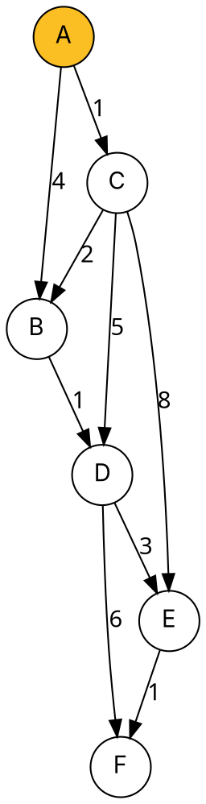

### Intuition

Imagine water spreading from the source through pipes whose lengths are the edge weights. The water reaches the nearest junction first, then the next nearest, and so on. **Dijkstra's algorithm** simulates exactly that: it keeps a tentative distance d[v] for every vertex and repeatedly **settles** the unsettled vertex with the smallest d. Once settled, a vertex's distance is final.

The core step is **relaxation**: if going through u gives a shorter route to v, take it.

> if d[u] + w(u, v) < d[v]: d[v] ← d[u] + w(u, v), and remember u as v's parent



### How it works

1. Set d[source] = 0 and every other d[v] = ∞.
2. Repeat V times: pick the unsettled vertex u with the smallest d[u], settle it, and relax every edge (u, v).

**Trace from A** (each row shows the table **after** settling the vertex and relaxing its edges; bold = changed):

| Settle | A | B | C | D | E | F |
| --- | --- | --- | --- | --- | --- | --- |
| A | 0 | **4** | **1** | ∞ | ∞ | ∞ |
| C | 0 | **3** | 1 | **6** | **9** | ∞ |
| B | 0 | 3 | 1 | **4** | 9 | ∞ |
| D | 0 | 3 | 1 | 4 | **7** | **10** |
| E | 0 | 3 | 1 | 4 | 7 | **8** |
| F | 0 | 3 | 1 | 4 | 7 | 8 |

Shortest path to F: A → C → B → D → E → F, total 1 + 2 + 1 + 3 + 1 = **8**. Notice how B's distance improved from 4 to 3 once C was settled — the direct edge is not always the best route.

**Why it is correct:** when u has the smallest d among unsettled vertices, any other route to u must leave the settled set through some vertex with d ≥ d[u], and the remaining edges can only add **non-negative** weight. So nothing can beat d[u].

**Why negative edges break it:** edges S→A (2), S→B (3), B→A (−2). Dijkstra settles A with d = 2 before looking at B, but the true shortest distance to A is 3 + (−2) = 1. Use Bellman–Ford (topic 14) when weights can be negative.

### Python implementation

```python
import heapq


def dijkstra(graph, source):
    """graph: {u: [(v, weight), ...]} with weights >= 0. Returns (dist, parent)."""
    dist = {v: float("inf") for v in graph}
    parent = {v: None for v in graph}
    dist[source] = 0
    heap = [(0, source)]
    settled = set()
    while heap:
        d, u = heapq.heappop(heap)
        if u in settled:
            continue                           # stale heap entry
        settled.add(u)
        for v, w in graph[u]:
            if d + w < dist[v]:                # relax (u, v)
                dist[v], parent[v] = d + w, u
                heapq.heappush(heap, (dist[v], v))
    return dist, parent


def path_to(parent, v):
    out = []
    while v is not None:
        out.append(v)
        v = parent[v]
    return out[::-1]


if __name__ == "__main__":
    g = {"A": [("B", 4), ("C", 1)], "B": [("D", 1)], "C": [("B", 2), ("D", 5), ("E", 8)],
         "D": [("E", 3), ("F", 6)], "E": [("F", 1)], "F": []}
    dist, parent = dijkstra(g, "A")
    print(dist)                    # {'A': 0, 'B': 3, 'C': 1, 'D': 4, 'E': 7, 'F': 8}
    print(path_to(parent, "F"))    # ['A', 'C', 'B', 'D', 'E', 'F']
```

### Complexity

| Priority queue | Time | Best for |
| --- | --- | --- |
| plain array (scan for the minimum) | O(V²) | dense graphs |
| binary heap (as above) | **O((V + E) log V)** | sparse graphs |
| Fibonacci heap | O(E + V log V) | theory |

### Common mistakes

- **Negative edge weights.** Dijkstra's greedy choice is only safe when all weights are ≥ 0.
- **Settling a vertex more than once** with a lazy heap — skip stale entries (`if u in settled: continue`).
- **Stopping at the first time a vertex is reached** (as in BFS). A vertex's distance is final only when it is **removed** from the priority queue.
- **Confusing it with Prim's algorithm.** Prim picks the cheapest edge into the tree; Dijkstra picks the smallest total distance from the source.

### Problems

1. Run Dijkstra from C on the example graph. Which vertices are unreachable?
2. **Lab:** given a road map as a list of (city, city, km) edges, print the shortest route and its length between two cities.
3. **Lab:** modify the code to count the **number of different shortest paths** from the source to each vertex.
4. Give a graph with a negative edge (but no negative cycle) on which Dijkstra returns a wrong distance, and show the correct one.
5. If every edge weight is increased by 1, do shortest paths stay the same? Prove or give a counterexample.
