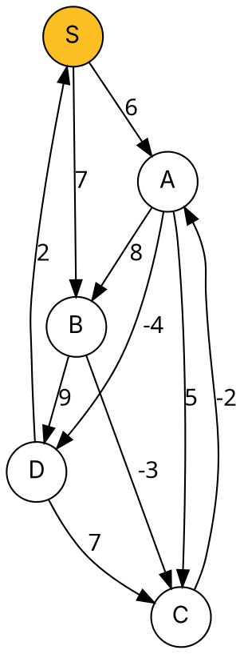

### Intuition

Dijkstra's greedy choice breaks as soon as an edge can be negative (topic 13). **Bellman–Ford** gives up being clever: it simply **relaxes every edge, over and over**.

Why does that work? A shortest path never repeats a vertex (if there is no negative cycle), so it has at most **V − 1 edges**. After round 1, every shortest path that uses 1 edge is correct; after round 2, every one using 2 edges; … after round V − 1, all of them.

If a **V-th** round still improves some distance, the only explanation is a **negative-weight cycle** — going round it again and again makes paths shorter forever, so shortest paths are undefined.



### How it works

Edge order used in every pass: S→A, S→B, A→B, A→C, A→D, B→C, B→D, C→A, D→S, D→C.

| After pass | S | A | B | C | D |
| --- | --- | --- | --- | --- | --- |
| start | 0 | ∞ | ∞ | ∞ | ∞ |
| 1 | 0 | **2** | **7** | **4** | **2** |
| 2 | 0 | 2 | 7 | 4 | **−2** |
| 3 | 0 | 2 | 7 | 4 | −2 |

Pass 1 in detail — later edges in the same pass already see values updated earlier in that pass:

- S→A: A = 6; S→B: B = 7; A→B: 14, no change; A→C: C = 11; A→D: D = 2;
- B→C: C = 7 − 3 = **4**; B→D: 16, no change; C→A: A = 4 − 2 = **2**; D→S, D→C: no change.

Pass 2: A→D now gives D = 2 − 4 = **−2**. Pass 3 changes nothing, so the algorithm can stop early, and the final checking pass finds no improvement: **no negative cycle**.

With a less lucky edge order the same values take more passes (try the reverse order in problem 1) — but never more than V − 1 = 4.

Final distances: A 2, B 7, C 4, D −2 (path to D: S → B → C → A → D = 7 − 3 − 2 − 4).

### Python implementation

```python
def bellman_ford(vertices, edges, source):
    """edges: list of (u, v, w). Returns (dist, parent), or raises ValueError on a negative cycle."""
    dist = {v: float("inf") for v in vertices}
    parent = {v: None for v in vertices}
    dist[source] = 0
    for _ in range(len(vertices) - 1):
        changed = False
        for u, v, w in edges:
            if dist[u] + w < dist[v]:
                dist[v], parent[v] = dist[u] + w, u
                changed = True
        if not changed:                     # early exit: already optimal
            break
    for u, v, w in edges:                   # one more pass: still improving?
        if dist[u] + w < dist[v]:
            raise ValueError("negative-weight cycle reachable from the source")
    return dist, parent


if __name__ == "__main__":
    V = ["S", "A", "B", "C", "D"]
    E = [("S", "A", 6), ("S", "B", 7), ("A", "B", 8), ("A", "C", 5), ("A", "D", -4),
         ("B", "C", -3), ("B", "D", 9), ("C", "A", -2), ("D", "S", 2), ("D", "C", 7)]
    print(bellman_ford(V, E, "S")[0])   # {'S': 0, 'A': 2, 'B': 7, 'C': 4, 'D': -2}
    try:
        bellman_ford(["X", "Y", "Z"], [("X", "Y", 1), ("Y", "Z", -2), ("Z", "Y", 1)], "X")
    except ValueError as e:
        print(e)                         # negative-weight cycle reachable from the source
```

### Complexity

| | Bellman–Ford | Dijkstra (binary heap) |
| --- | --- | --- |
| time | **O(V·E)** | O((V + E) log V) |
| negative edges | ✓ allowed | ✗ |
| negative-cycle detection | ✓ | ✗ |

Bellman–Ford is slower, but it is the right tool when weights can be negative — for example, currency exchange (log of rates), or distance-vector routing protocols (RIP), where each router only knows its neighbours.

### Common mistakes

- **Doing only one pass.** You need up to V − 1 passes; one pass only fixes paths whose edges happen to appear in the right order.
- **Skipping the final check** — then a negative cycle silently produces garbage distances.
- **Thinking any negative edge is a problem.** Negative edges are fine; only negative **cycles** make shortest paths undefined.
- **Undirected graphs with a negative edge.** An undirected negative edge u–v is itself a negative cycle u→v→u.

### Problems

1. Re-run the trace with the edge order reversed. Do you get the same final distances? The same number of passes?
2. **Lab:** detect arbitrage: given exchange rates between currencies, decide whether a sequence of trades can turn 1 unit into more than 1. (Hint: weights −log(rate).)
3. **Lab:** after detecting a negative cycle, print the vertices on it. (Hint: follow parent pointers V times from a vertex that was still relaxed.)
4. Why can't we just add a large constant to every edge to make the weights non-negative and then use Dijkstra?
5. In a DAG with negative edges, shortest paths can be found in O(V + E). How? (Hint: topological order.)
