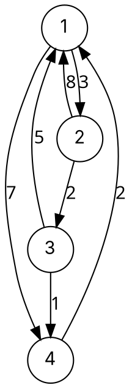

### Intuition

You want a table of road distances between **every pair** of cities. Floyd–Warshall builds it gradually:

- **D₀**: only direct roads allowed.
- **D₁**: routes may also pass through city 1.
- **D₂**: routes may pass through cities 1 and 2.
- … **Dₙ**: routes may pass through any city — the final answer.

Going from D_{k−1} to D_k asks one question for every pair (i, j): **is it shorter to go via k?**

> D_k[i][j] = min( D_{k−1}[i][j], D_{k−1}[i][k] + D_{k−1}[k][j] )



### How it works

Matrices for the graph above (row = from, column = to; bold = changed in that step):

**D₀** (direct edges)

| | 1 | 2 | 3 | 4 |
| --- | --- | --- | --- | --- |
| 1 | 0 | 3 | ∞ | 7 |
| 2 | 8 | 0 | 2 | ∞ |
| 3 | 5 | ∞ | 0 | 1 |
| 4 | 2 | ∞ | ∞ | 0 |

**D₁** (via 1): 2→4 = 8 + 7 = **15**, 3→2 = 5 + 3 = **8**, 4→2 = 2 + 3 = **5**.

**D₂** (via 1, 2): 1→3 = 3 + 2 = **5**, 4→3 = 5 + 2 = **7**.

**D₃** (via 1, 2, 3): 1→4 = 5 + 1 = **6**, 2→1 = 2 + 5 = **7**, 2→4 = 2 + 1 = **3**.

**D₄** — final (via any vertex): 2→1 = 3 + 2 = **5**, 3→1 = 1 + 2 = **3**, 3→2 = 1 + 5 = **6**.

| | 1 | 2 | 3 | 4 |
| --- | --- | --- | --- | --- |
| 1 | 0 | 3 | 5 | 6 |
| 2 | 5 | 0 | 2 | 3 |
| 3 | 3 | 6 | 0 | 1 |
| 4 | 2 | 5 | 7 | 0 |

**Negative cycles:** if some diagonal entry D[i][i] becomes **negative**, vertex i lies on a negative cycle.

**Transitive closure (Warshall's algorithm):** replace min/+ with or/and to answer "is there **any** path from i to j?":

> R_k[i][j] = R_{k−1}[i][j] or (R_{k−1}[i][k] and R_{k−1}[k][j])

### Python implementation

```python
INF = float("inf")


def floyd_warshall(n, edges):
    """Vertices 0..n-1; edges: list of (u, v, w). Returns the distance matrix."""
    d = [[0 if i == j else INF for j in range(n)] for i in range(n)]
    for u, v, w in edges:
        d[u][v] = min(d[u][v], w)
    for k in range(n):                       # allow k as an intermediate vertex
        for i in range(n):
            for j in range(n):
                if d[i][k] + d[k][j] < d[i][j]:
                    d[i][j] = d[i][k] + d[k][j]
    if any(d[i][i] < 0 for i in range(n)):
        raise ValueError("negative-weight cycle")
    return d


def transitive_closure(n, edges):
    r = [[i == j for j in range(n)] for i in range(n)]
    for u, v in edges:
        r[u][v] = True
    for k in range(n):
        for i in range(n):
            for j in range(n):
                r[i][j] = r[i][j] or (r[i][k] and r[k][j])
    return r


if __name__ == "__main__":
    edges = [(0, 1, 3), (0, 3, 7), (1, 0, 8), (1, 2, 2), (2, 0, 5), (2, 3, 1), (3, 0, 2)]
    for row in floyd_warshall(4, edges):
        print(row)
    # [0, 3, 5, 6]
    # [5, 0, 2, 3]
    # [3, 6, 0, 1]
    # [2, 5, 7, 0]
    print(transitive_closure(3, [(0, 1), (1, 2)])[0])   # [True, True, True]
```

(Vertices 1–4 of the drawing are 0–3 in the code.)

### Complexity

| Approach for all pairs | Time | Negative edges |
| --- | --- | --- |
| **Floyd–Warshall** | **Θ(V³)**, Θ(V²) space | ✓ (detects negative cycles) |
| Dijkstra from every vertex (binary heap) | O(V·(V + E) log V) | ✗ |
| Bellman–Ford from every vertex | O(V²·E) | ✓ |

Floyd–Warshall is the simplest and best for **dense** graphs; for large sparse graphs with non-negative weights, V runs of Dijkstra are faster.

### Common mistakes

- **Putting k in the inner loop.** The loop over the intermediate vertex k must be the **outermost** — otherwise you use paths through k before they are computed.
- **Initialising the diagonal to ∞.** D[i][i] must start at 0.
- **Overflow with ∞ + ∞** in languages with fixed-size integers — use a large constant and check before adding. (Python's `float('inf')` is safe.)
- **Reading a negative diagonal as a distance.** It means a negative cycle, not "−5 from i to itself".

### Problems

1. Compute D₁ … D₄ for the graph with edges 1→2 (4), 1→3 (11), 2→3 (−2), 2→4 (6), 3→4 (3), 3→1 (7), 4→1 (1).
2. **Lab:** extend `floyd_warshall` to return a `next` matrix and print the actual shortest path between any two vertices.
3. **Lab:** a small network's links are given as (router, router, delay). Print the full delay table and the router whose worst delay to any other router is smallest (the best place for a server).
4. Use Warshall's algorithm to find which pairs of courses are related by a chain of prerequisites.
5. Why does Floyd–Warshall still work when edge weights are negative but no cycle is negative?
