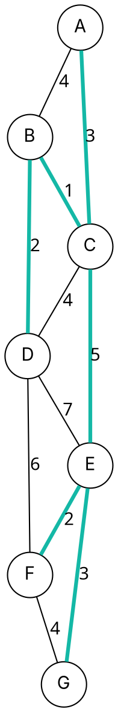

### Intuition

A city must lay fibre cable so that every building is connected, digging as little as possible. The buildings are vertices, possible trenches are weighted edges. The cheapest way to connect everything is a **minimum spanning tree (MST)**: a set of V − 1 edges that connects all vertices, has no cycle, and has the smallest total weight.

**Prim's algorithm** grows the network from one building: at every step, add the **cheapest edge that connects the tree to a building not yet connected**.



*The example graph; the thick teal edges form its MST (total weight 16).*

### How it works

**Cut property** (why greedy works): split the vertices into any two groups. The cheapest edge crossing between the groups belongs to some MST. Prim always takes the cheapest edge crossing between "in the tree" and "not yet in the tree", so every edge it adds is safe.

**Trace from A:**

| Step | Tree vertices | Cheapest crossing edge | Added weight |
| --- | --- | --- | --- |
| 1 | A | A–C (3) | 3 |
| 2 | A, C | C–B (1) | 1 |
| 3 | A, B, C | B–D (2) | 2 |
| 4 | A, B, C, D | C–E (5) — cheaper than D–F (6), D–E (7) | 5 |
| 5 | + E | E–F (2) | 2 |
| 6 | + F | E–G (3) — cheaper than F–G (4) | 3 |

Total weight **3 + 1 + 2 + 5 + 2 + 3 = 16**, with 6 edges for 7 vertices.

### Python implementation

```python
import heapq


def prim(graph, start):
    """graph: {u: [(v, w), ...]} undirected. Returns (list of MST edges, total weight)."""
    in_tree = {start}
    heap = [(w, start, v) for v, w in graph[start]]
    heapq.heapify(heap)
    mst, total = [], 0
    while heap and len(in_tree) < len(graph):
        w, u, v = heapq.heappop(heap)
        if v in in_tree:
            continue                          # edge leads back into the tree: skip
        in_tree.add(v)
        mst.append((u, v, w))
        total += w
        for x, wx in graph[v]:
            if x not in in_tree:
                heapq.heappush(heap, (wx, v, x))
    return mst, total


if __name__ == "__main__":
    edges = [("A", "B", 4), ("A", "C", 3), ("B", "C", 1), ("B", "D", 2), ("C", "D", 4), ("C", "E", 5),
             ("D", "E", 7), ("D", "F", 6), ("E", "F", 2), ("E", "G", 3), ("F", "G", 4)]
    g = {}
    for u, v, w in edges:
        g.setdefault(u, []).append((v, w))
        g.setdefault(v, []).append((u, w))
    mst, total = prim(g, "A")
    print(mst)     # [('A', 'C', 3), ('C', 'B', 1), ('B', 'D', 2), ('C', 'E', 5), ('E', 'F', 2), ('E', 'G', 3)]
    print(total)   # 16
```

### Complexity

| Priority queue | Time | Best for |
| --- | --- | --- |
| adjacency matrix + array scan | O(V²) | dense graphs |
| binary heap (as above) | **O(E log V)** | sparse graphs |
| Fibonacci heap | O(E + V log V) | theory |

An MST always has exactly **V − 1 edges**. If all edge weights are **distinct**, the MST is **unique**.

### Common mistakes

- **Adding an edge to a vertex already in the tree** — that creates a cycle. Skip edges whose other end is already in the tree.
- **Confusing Prim with Dijkstra.** Prim compares single edge weights into the tree; Dijkstra compares total distances from the source. Their trees usually differ.
- **Disconnected graphs.** Prim only spans the start vertex's component; the result is a spanning *forest* only if you restart from each component.
- **Thinking the MST gives shortest paths.** The MST path between two vertices can be much longer than their shortest path.

### Problems

1. Run Prim on the example graph starting from G. Is the set of edges the same? The order?
2. **Lab:** read a list of (village, village, cost) for possible roads and print the cheapest road network connecting all villages.
3. **Lab:** implement the O(V²) array version of Prim for an adjacency matrix and compare its speed with the heap version on a dense graph.
4. Prove that if all edge weights are distinct, the MST is unique. (Hint: cut property.)
5. Give a graph where the MST path between two vertices is longer than their shortest path.
