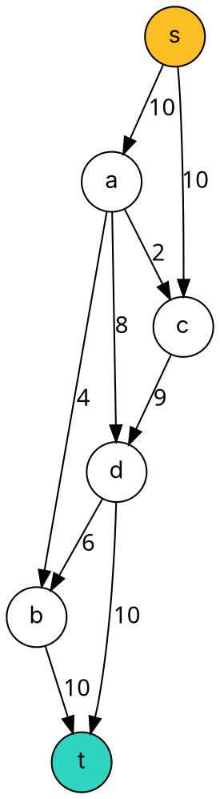

### Intuition

Water pipes run from a reservoir **s** to a city **t**. Each pipe has a **capacity** (litres per second). How much water per second can reach the city?

A **flow** assigns an amount to each pipe so that

- no pipe carries more than its capacity, and
- at every junction except s and t, **flow in = flow out** (water is not created or lost).

Its **value** is the total leaving s. We want the **maximum flow**.



### How it works

**Residual graph.** For the current flow f, each pipe (u, v) with capacity c offers

- a **forward** residual edge u→v with capacity c − f(u, v) (room left), and
- a **backward** residual edge v→u with capacity f(u, v) (flow that can be **cancelled**).

Backward edges are the clever part: they let a later path reroute flow that an earlier path sent the wrong way.

**Ford–Fulkerson method:** while the residual graph has a path from s to t (an **augmenting path**), push as much as its smallest residual capacity (the **bottleneck**) along it.

**Edmonds–Karp** = Ford–Fulkerson where each augmenting path is found by **BFS** (fewest edges). That single choice bounds the number of augmentations by O(V·E).

**Edmonds–Karp trace** on the network above:

| # | Augmenting path (BFS) | Bottleneck | Total flow |
| --- | --- | --- | --- |
| 1 | s → a → b → t | 4 (a→b) | 4 |
| 2 | s → a → d → t | 6 (s→a has 6 left) | 10 |
| 3 | s → c → d → t | 4 (d→t has 4 left) | 14 |
| 4 | s → c → d → b → t | 5 (c→d has 5 left) | **19** |

After step 4 no augmenting path exists: s→a is full (10/10) and c→d is full (9/9), so nothing more can leave {s, c}. The **maximum flow is 19** — and topic 19 explains why the full edges s→a and c→d prove it.

### Python implementation

```python
from collections import deque


def edmonds_karp(capacity, s, t):
    """capacity: {(u, v): c}. Returns (max flow value, flow on each original edge)."""
    residual, adj = {}, {}
    for (u, v), c in capacity.items():
        residual[(u, v)] = residual.get((u, v), 0) + c
        residual.setdefault((v, u), 0)                     # backward edge
        adj.setdefault(u, set()).add(v)
        adj.setdefault(v, set()).add(u)
    total = 0
    while True:
        parent, queue = {s: None}, deque([s])              # BFS for a shortest augmenting path
        while queue and t not in parent:
            u = queue.popleft()
            for v in sorted(adj.get(u, ())):
                if v not in parent and residual[(u, v)] > 0:
                    parent[v] = u
                    queue.append(v)
        if t not in parent:
            break                                          # no augmenting path: flow is maximum
        path, v = [], t
        while parent[v] is not None:
            path.append((parent[v], v))
            v = parent[v]
        bottleneck = min(residual[e] for e in path)
        for u, v in path:
            residual[(u, v)] -= bottleneck
            residual[(v, u)] += bottleneck
        total += bottleneck
    # net flow on each edge (if both u->v and v->u exist, opposite flows cancel)
    flow = {e: max(0, c - residual[e]) for e, c in capacity.items()}
    return total, flow


if __name__ == "__main__":
    cap = {("s", "a"): 10, ("s", "c"): 10, ("a", "b"): 4, ("a", "c"): 2, ("a", "d"): 8,
           ("c", "d"): 9, ("d", "b"): 6, ("b", "t"): 10, ("d", "t"): 10}
    value, flow = edmonds_karp(cap, "s", "t")
    print(value)                                  # 19
    print(flow[("s", "a")], flow[("c", "d")])     # 10 9
```

### Complexity

| Algorithm | Augmenting path choice | Time |
| --- | --- | --- |
| Ford–Fulkerson | any path (e.g. DFS) | O(E · \|f*\|) for integer capacities — can be huge |
| **Edmonds–Karp** | shortest path by BFS | **O(V · E²)** — independent of capacities |

With integer capacities, Ford–Fulkerson always ends with an **integer** maximum flow. With irrational capacities and bad path choices, plain Ford–Fulkerson may not even terminate — another reason to use BFS.

### Common mistakes

- **Forgetting backward edges.** Without them a greedy first path can block the true maximum (try it on the example: s→a→c→d→t first).
- **Bottleneck from the original capacities.** Use **residual** capacities, which change after every augmentation.
- **Flow conservation at s and t.** Conservation applies only to intermediate vertices.
- **Stopping when one path is blocked.** Stop only when **no** s–t path exists in the **residual** graph.

### Problems

1. Run Ford–Fulkerson on the example, but always choose the path s→a→c→d→t first. Show how a backward edge is used later, and check that you still reach 19.
2. **Lab:** read a network as (u, v, capacity) lines and print the maximum flow and the flow on every edge.
3. Construct a network on 4 vertices where DFS-based Ford–Fulkerson needs 2000 augmentations but Edmonds–Karp needs 2.
4. **Lab:** several sources and sinks — add a super-source and a super-sink, and compute the maximum total flow.
5. Prove that the value of any flow equals the net flow across any s–t cut.
