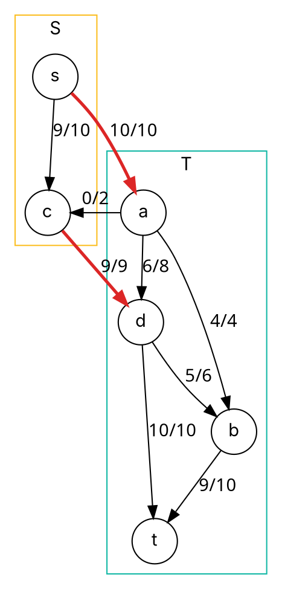

### Intuition

To stop water from reaching the city, you must cut some pipes. Cut a set of pipes that separates s from t, and **no** flow can get through except what those pipes carried. So:

> every flow value ≤ capacity of every cut.

The remarkable fact — the **max-flow min-cut theorem** — is that the best flow **exactly equals** the cheapest cut. When Edmonds–Karp stops, the vertices still reachable from s in the residual graph form the source side of a minimum cut.

### How it works

An **s–t cut** (S, T) splits the vertices into S (containing s) and T (containing t). Its **capacity** is the sum of capacities of edges going **from S to T** (edges from T back to S are not counted).

**Theorem.** These three statements are equivalent:

1. f is a maximum flow;
2. the residual graph has **no augmenting path**;
3. |f| = c(S, T) for some cut (S, T).

**Finding the minimum cut.** After the maximum flow is found, let S = vertices reachable from s in the residual graph. Every edge from S to T is saturated (full), every edge from T to S carries no flow, so the flow across the cut equals its capacity.

For the network of topic 18 (max flow 19): S = {s, c}. The edges leaving S are

| Edge | Capacity | Flow |
| --- | --- | --- |
| s → a | 10 | 10 (full) |
| c → d | 9 | 9 (full) |

Cut capacity = 10 + 9 = **19 = max flow**. (The edge a → c points into S, so it is not counted.)



*Flow/capacity on every edge at the maximum. Red edges cross the minimum cut.*

**Application — bipartite matching.** Students want projects; each can take at most one. Build a network: s → every student (capacity 1), student → each acceptable project (capacity 1), every project → t (capacity 1). The maximum flow = the **maximum number of student–project pairs**, and the edges carrying flow give the matching.

### Python implementation

```python
from collections import deque


def max_flow_min_cut(capacity, s, t):
    """Edmonds-Karp, then the minimum cut from residual reachability."""
    residual, adj = {}, {}
    for (u, v), c in capacity.items():
        residual[(u, v)] = residual.get((u, v), 0) + c
        residual.setdefault((v, u), 0)
        adj.setdefault(u, set()).add(v)
        adj.setdefault(v, set()).add(u)

    def bfs():
        parent, queue = {s: None}, deque([s])
        while queue:
            u = queue.popleft()
            for v in sorted(adj.get(u, ())):
                if v not in parent and residual[(u, v)] > 0:
                    parent[v] = u
                    queue.append(v)
        return parent

    total = 0
    while True:
        parent = bfs()
        if t not in parent:
            break
        path, v = [], t
        while parent[v] is not None:
            path.append((parent[v], v))
            v = parent[v]
        b = min(residual[e] for e in path)
        for u, v in path:
            residual[(u, v)] -= b
            residual[(v, u)] += b
        total += b
    source_side = set(bfs())                     # reachable from s in the final residual graph
    cut = [(u, v) for (u, v) in capacity if u in source_side and v not in source_side]
    return total, source_side, cut


def max_matching(pairs):
    """pairs: list of (left, right) acceptable pairs. Size of a maximum matching."""
    cap = {}
    for l, r in pairs:
        cap[("S", "L" + l)] = 1
        cap[("L" + l, "R" + r)] = 1
        cap[("R" + r, "T")] = 1
    return max_flow_min_cut(cap, "S", "T")[0]


if __name__ == "__main__":
    cap = {("s", "a"): 10, ("s", "c"): 10, ("a", "b"): 4, ("a", "c"): 2, ("a", "d"): 8,
           ("c", "d"): 9, ("d", "b"): 6, ("b", "t"): 10, ("d", "t"): 10}
    value, S, cut = max_flow_min_cut(cap, "s", "t")
    print(value, sorted(S), cut)        # 19 ['c', 's'] [('s', 'a'), ('c', 'd')]
    print(max_matching([("Asha", "P1"), ("Asha", "P2"), ("Ravi", "P1"), ("Meena", "P2"), ("Meena", "P3")]))   # 3
```

### Complexity

Finding the minimum cut costs only one extra BFS after the maximum flow — **O(V + E)** on top of Edmonds–Karp's O(V·E²). Bipartite matching on n + m vertices and E edges by Ford–Fulkerson takes O(V·E), because the flow value is at most min(n, m).

### Common mistakes

- **Counting edges in both directions across the cut.** Only S→T edges count toward cut capacity.
- **Taking S from the original graph.** S is "reachable from s in the **residual** graph after the maximum flow".
- **Assuming the minimum cut is unique.** Several cuts may share the minimum capacity.
- **Matching without unit capacities.** Every edge in the matching network must have capacity 1, or a student could take two projects.

### Problems

1. For the network of topic 18, list three different s–t cuts and their capacities. Which is minimum?
2. **Lab:** given which workers can do which jobs, assign as many jobs as possible (one job per worker) using `max_flow_min_cut`.
3. **Lab:** a city's road network has a capacity on each road. Find the smallest total capacity of roads that, if closed, would cut the city centre off from the airport.
4. Explain why the max-flow min-cut theorem implies that integer capacities give an integer maximum flow.
5. Show how to find the maximum number of **edge-disjoint** paths from s to t with a flow network.
