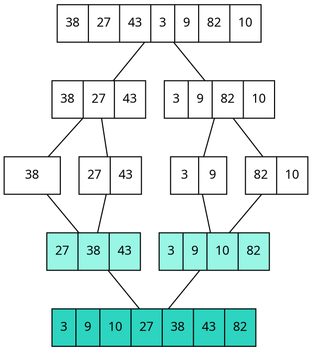

### Intuition

Sorting 1,000 exam scripts alone is slow. Split the pile in two, give each half to a friend (who splits theirs again …), and when two sorted piles come back, **merge** them by repeatedly taking the smaller top script. That is **divide and conquer**:

1. **Divide** the problem into smaller subproblems of the same kind.
2. **Conquer** them recursively (tiny ones are solved directly).
3. **Combine** their answers.



*Splitting down to small pieces, then merging back up (smaller pieces such as [27 43] are sorted by the same process).*

### How it works

**Merge** two sorted lists: compare their front elements, move the smaller one to the output, repeat; when one list empties, copy the rest of the other.

Merging [27, 38, 43] and [3, 9, 10, 82]:

| Compare | Take | Output so far |
| --- | --- | --- |
| 27 vs 3 | 3 | 3 |
| 27 vs 9 | 9 | 3 9 |
| 27 vs 10 | 10 | 3 9 10 |
| 27 vs 82 | 27 | 3 9 10 27 |
| 38 vs 82 | 38 | … 38 |
| 43 vs 82 | 43 | … 43 |
| (left empty) | 82 | 3 9 10 27 38 43 82 |

Merging lists of sizes m and n uses **at most m + n − 1 comparisons**.

**Recurrence.** Merge sort on n items does two half-size sorts plus a linear merge:

> T(n) = 2T(n/2) + cn, T(1) = c

**Recursion tree:** every level does cn work in total, and there are log₂ n levels, so T(n) = **Θ(n log n)**.

**Master theorem** for T(n) = aT(n/b) + f(n): compare f(n) with n^(log_b a).

| Case | Condition | Result | Example |
| --- | --- | --- | --- |
| 1 | f(n) = O(n^(log_b a − ε)) | Θ(n^(log_b a)) | T(n) = 8T(n/2) + n² → Θ(n³) |
| 2 | f(n) = Θ(n^(log_b a)) | Θ(n^(log_b a) log n) | merge sort: a = 2, b = 2, f = n → Θ(n log n) |
| 3 | f(n) = Ω(n^(log_b a + ε)), plus regularity | Θ(f(n)) | T(n) = 2T(n/2) + n² → Θ(n²) |

### Python implementation

```python
def merge(left, right):
    out, i, j = [], 0, 0
    while i < len(left) and j < len(right):
        if left[i] <= right[j]:              # <= keeps equal keys in order: stable
            out.append(left[i]); i += 1
        else:
            out.append(right[j]); j += 1
    return out + left[i:] + right[j:]


def merge_sort(a):
    if len(a) <= 1:
        return a
    mid = len(a) // 2
    return merge(merge_sort(a[:mid]), merge_sort(a[mid:]))


def count_inversions(a):
    """Number of pairs i < j with a[i] > a[j], in O(n log n), using merge sort."""
    if len(a) <= 1:
        return a, 0
    mid = len(a) // 2
    left, x = count_inversions(a[:mid])
    right, y = count_inversions(a[mid:])
    merged, i, j, cross = [], 0, 0, 0
    while i < len(left) and j < len(right):
        if left[i] <= right[j]:
            merged.append(left[i]); i += 1
        else:
            merged.append(right[j]); j += 1
            cross += len(left) - i              # right[j] is smaller than every remaining left item
    merged += left[i:] + right[j:]
    return merged, x + y + cross


if __name__ == "__main__":
    print(merge_sort([38, 27, 43, 3, 9, 82, 10]))   # [3, 9, 10, 27, 38, 43, 82]
    print(count_inversions([2, 4, 1, 3, 5])[1])     # 3
```

### Complexity

| | Merge sort |
| --- | --- |
| time (best, average, worst) | **Θ(n log n)** — the split never depends on the data |
| extra space | Θ(n) for the merge buffers |
| stable? | yes (equal keys keep their order) |
| in-place? | no (standard array version) |

### Common mistakes

- **Using `<` instead of `<=` in merge** — still sorts, but loses stability.
- **Forgetting the leftovers** after one list runs out.
- **Master theorem misuse.** It needs subproblems of **equal** size n/b; it does not apply to T(n) = T(n−1) + n (that is Θ(n²)).
- **Claiming merge sort is in-place.** The usual version needs Θ(n) extra memory.

### Problems

1. Trace merge sort on [12, 11, 13, 5, 6, 7], drawing the split and merge tree.
2. Solve with the master theorem: T(n) = 4T(n/2) + n, T(n) = 4T(n/2) + n², T(n) = 3T(n/4) + n log n.
3. **Lab:** count inversions in an array of 10⁵ numbers in O(n log n) and compare with the O(n²) double loop.
4. **Lab:** merge k sorted lists of total size N in O(N log k).
5. How many comparisons does merge sort make in the worst case for n = 8? (Hint: a merge of m + n items needs at most m + n − 1.)
