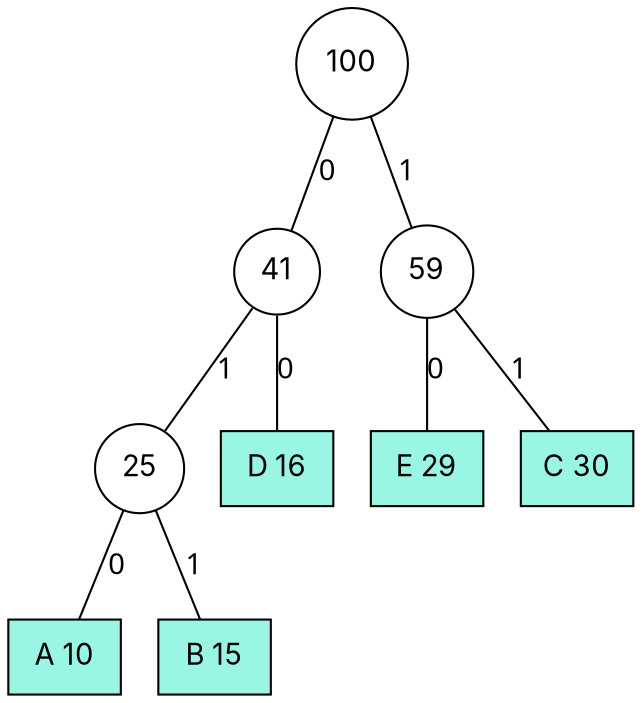

### Intuition

**Huffman coding.** ASCII spends 8 bits on every character, whether it is `e` (very common) or `z` (rare). Give common symbols **short** codes and rare ones **long** codes, and files shrink — this is how ZIP, JPEG and MP3 squeeze data. The codes must be **prefix-free** (no code is the start of another), so a stream of bits decodes without separators.

Huffman's greedy idea: the two **rarest** symbols should be the deepest leaves, as siblings. So **merge the two smallest frequencies** into one node, and repeat.

**Borůvka's algorithm.** Picture every city as its own island. In each round, **every island simultaneously builds its cheapest bridge** to another island. Islands joined by bridges merge, and the number of islands at least halves each round — so at most log₂ V rounds are needed.

### How it works

**Huffman example:** frequencies A 10, B 15, C 30, D 16, E 29 (total 100).

| Step | Two smallest | Merged |
| --- | --- | --- |
| 1 | A 10, B 15 | AB 25 |
| 2 | D 16, AB 25 | DAB 41 |
| 3 | E 29, C 30 | EC 59 |
| 4 | DAB 41, EC 59 | root 100 |



Reading 0 for left and 1 for right gives the codes:

| Symbol | A | B | C | D | E |
| --- | --- | --- | --- | --- | --- |
| frequency | 10 | 15 | 30 | 16 | 29 |
| code | 010 | 011 | 11 | 00 | 10 |
| bits | 30 | 45 | 60 | 32 | 58 |

Total **225 bits**, versus 3 × 100 = **300 bits** with a fixed 3-bit code — a 25% saving. (The total also equals the sum of all internal node weights: 25 + 41 + 59 + 100 = 225.)

**Borůvka example** on the graph of topics 16–17 (A–B 4, A–C 3, B–C 1, B–D 2, C–D 4, C–E 5, D–E 7, D–F 6, E–F 2, E–G 3, F–G 4):

| Round | Cheapest edge chosen by each component | Components after |
| --- | --- | --- |
| 1 | A: A–C 3, B: B–C 1, C: B–C 1, D: B–D 2, E: E–F 2, F: E–F 2, G: E–G 3 | {A, B, C, D}, {E, F, G} |
| 2 | {A,B,C,D}: C–E 5; {E,F,G}: C–E 5 | one component |

Edges: B–C, A–C, B–D, E–F, E–G, C–E — total **16**, the same MST as Prim and Kruskal, in just 2 rounds.

### Python implementation

```python
import heapq
from itertools import count


def huffman(freq):
    """freq: {symbol: frequency}. Returns {symbol: code}."""
    tie = count()                                   # keeps heap entries comparable on equal frequencies
    heap = [(f, next(tie), [s]) for s, f in freq.items()]
    heapq.heapify(heap)
    codes = {s: "" for s in freq}
    if len(heap) == 1:
        return {s: "0" for s in freq}
    while len(heap) > 1:
        f1, _, left = heapq.heappop(heap)           # the two rarest subtrees
        f2, _, right = heapq.heappop(heap)
        for s in left:
            codes[s] = "0" + codes[s]
        for s in right:
            codes[s] = "1" + codes[s]
        heapq.heappush(heap, (f1 + f2, next(tie), left + right))
    return codes


def boruvka(vertices, edges):
    comp = {v: v for v in vertices}

    def find(x):
        while comp[x] != x:
            comp[x] = comp[comp[x]]
            x = comp[x]
        return x

    mst, total, components = [], 0, len(vertices)
    while components > 1:
        cheapest = {}
        for u, v, w in edges:
            cu, cv = find(u), find(v)
            if cu != cv:
                for c in (cu, cv):                  # each component remembers its cheapest exit
                    if c not in cheapest or w < cheapest[c][2]:
                        cheapest[c] = (u, v, w)
        if not cheapest:
            break                                   # graph is disconnected
        for u, v, w in cheapest.values():
            cu, cv = find(u), find(v)
            if cu != cv:
                comp[cu] = cv
                mst.append((u, v, w))
                total += w
                components -= 1
    return mst, total


if __name__ == "__main__":
    codes = huffman({"A": 10, "B": 15, "C": 30, "D": 16, "E": 29})
    print(codes)                                   # {'A': '010', 'B': '011', 'C': '11', 'D': '00', 'E': '10'}
    edges = [("A", "B", 4), ("A", "C", 3), ("B", "C", 1), ("B", "D", 2), ("C", "D", 4), ("C", "E", 5),
             ("D", "E", 7), ("D", "F", 6), ("E", "F", 2), ("E", "G", 3), ("F", "G", 4)]
    print(boruvka("ABCDEFG", edges)[1])            # 16
```

### Complexity

| Algorithm | Time |
| --- | --- |
| Huffman with a binary heap, n symbols | **O(n log n)** |
| Borůvka | **O(E log V)** — at most log₂ V rounds, each scanning all E edges |

Borůvka's rounds are independent per component, which makes it the MST algorithm of choice for **parallel** and distributed computing.

### Common mistakes

- **Merging the two largest** instead of the two smallest frequencies.
- **Non-prefix codes.** Codes such as {0, 01, 1} are ambiguous: `01` could be "0 then 1" or "01".
- **Expecting a unique Huffman code.** Ties and left/right choices give different codes with the **same** total length.
- **Borůvka with equal weights.** Break ties consistently (e.g. by edge index), or two components may choose different equal-weight edges and form a cycle.

### Problems

1. Build the Huffman code for frequencies a 45, b 13, c 12, d 16, e 9, f 5. What is the total length in bits for 100 characters?
2. **Lab:** compress a text file: count character frequencies, build the Huffman code, write the bit-string, and decode it back.
3. Decode `0100011` with the code table above.
4. Run Borůvka on the graph P–Q 6, P–R 1, Q–R 5, Q–S 3, R–S 5, R–T 6, S–T 4, S–U 2, T–U 6. How many rounds does it take?
5. Prove that in an optimal prefix code, the two least frequent symbols can be siblings at the deepest level.
