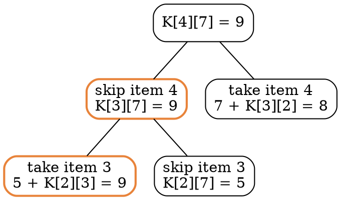

### Intuition

A thief has a bag that holds at most **W** kg. Each item i has a weight wᵢ and a value vᵢ, and must be taken **whole or not at all** (0 or 1). Which items give the most value?

The greedy idea "take the best value per kg first" works for the *fractional* knapsack (topic 23), but **fails** here. With W = 50 and items (10 kg, ₹60), (20 kg, ₹100), (30 kg, ₹120), greedy by ratio takes the first two for ₹160 and has 20 kg left that the third item cannot use. The best answer is the second and third items: ₹220.

DP works because of a simple choice about the **last item**: either it is in the bag or it is not.

### How it works

Let K[i][c] = the best value using only the first i items with capacity c:

> K[0][c] = 0  
> if wᵢ > c: K[i][c] = K[i−1][c]  (item i does not fit)  
> otherwise: K[i][c] = max( K[i−1][c], vᵢ + K[i−1][c − wᵢ] )  (skip it, or take it)

**Example:** W = 7, items (weight, value): 1 → (1, 1), 2 → (3, 4), 3 → (4, 5), 4 → (5, 7).

| items \ capacity | 0 | 1 | 2 | 3 | 4 | 5 | 6 | 7 |
| --- | --- | --- | --- | --- | --- | --- | --- | --- |
| none | 0 | 0 | 0 | 0 | 0 | 0 | 0 | 0 |
| 1: (1, 1) | 0 | 1 | 1 | 1 | 1 | 1 | 1 | 1 |
| 2: (3, 4) | 0 | 1 | 1 | 4 | 5 | 5 | 5 | 5 |
| 3: (4, 5) | 0 | 1 | 1 | 4 | 5 | 6 | 6 | **9** |
| 4: (5, 7) | 0 | 1 | 1 | 4 | 5 | 7 | 8 | **9** |

The answer is K[4][7] = **9**.

**Trace back** from K[4][7]: it equals K[3][7], so item 4 is **not** taken. K[3][7] = 9 ≠ K[2][7] = 5, so item 3 **is** taken; move to capacity 7 − 4 = 3. K[2][3] = 4 ≠ K[1][3] = 1, so item 2 is taken; capacity 0. Chosen: **items 2 and 3**, weight 7, value 9.

Note that greedy by ratio would take item 4 (ratio 1.4) first and end with 7 + 1 = 8.



### Python implementation

```python
def knapsack(weights, values, W):
    """Return (best value, sorted list of chosen item indices)."""
    n = len(weights)
    K = [[0] * (W + 1) for _ in range(n + 1)]
    for i in range(1, n + 1):
        w, v = weights[i - 1], values[i - 1]
        for c in range(W + 1):
            K[i][c] = K[i - 1][c]                       # skip item i
            if w <= c and v + K[i - 1][c - w] > K[i][c]:
                K[i][c] = v + K[i - 1][c - w]           # take item i
    chosen, c = [], W                                   # trace back
    for i in range(n, 0, -1):
        if K[i][c] != K[i - 1][c]:
            chosen.append(i - 1)
            c -= weights[i - 1]
    return K[n][W], sorted(chosen)


if __name__ == "__main__":
    print(knapsack([1, 3, 4, 5], [1, 4, 5, 7], 7))          # (9, [1, 2])
    print(knapsack([10, 20, 30], [60, 100, 120], 50))       # (220, [1, 2])
```

### Complexity

| | Time | Space |
| --- | --- | --- |
| brute force (all subsets) | O(2ⁿ · n) | O(n) |
| DP table | **Θ(n · W)** | Θ(n · W) |
| value only, one row updated right to left | Θ(n · W) | **Θ(W)** |

Θ(n · W) looks polynomial, but W is a **number**, written with only log W bits. Doubling the number of bits squares W, so the running time is exponential in the input size. Such an algorithm is called **pseudo-polynomial**, and 0/1 knapsack is NP-complete (topic 34).

### Common mistakes

- **Using greedy by value/weight.** It is optimal only for the fractional knapsack.
- **Updating a single row left to right.** Then item i can be taken twice (that is the *unbounded* knapsack). Go from c = W down to wᵢ.
- **Forgetting the "does not fit" case.** c − wᵢ becomes negative and Python silently indexes from the end of the list.
- **Calling O(n·W) polynomial.** It is pseudo-polynomial.

### Problems

1. Fill the table for W = 5 and items (2, 3), (3, 4), (4, 5), (5, 6). Which items are chosen?
2. Give an example with three items where greedy by value/weight is wrong for 0/1 knapsack.
3. **Lab:** rewrite `knapsack` to use a single list of size W + 1, and explain the loop direction.
4. **Lab:** solve the *unbounded* knapsack (each item may be taken any number of times) and compare the answers on the same input.
5. **Subset sum:** given positive integers and a target T, decide whether some subset adds up to exactly T. Show it is a special case of 0/1 knapsack.
