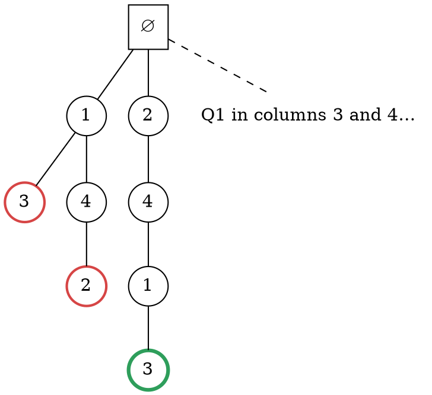

### Intuition

Place **n queens** on an n × n chessboard so that no two attack each other: no two in the same row, column or diagonal.

Trying every way to put 8 queens on 64 squares means C(64, 8) ≈ 4.4 billion boards. **Backtracking** is smarter. Put one queen per row, row by row, and the moment a new queen is attacked, **stop**: no board that extends this partial board can be valid, so skip all of them and try the next square. When a row has no safe square left, go **back** one row and move that queen.

The choices form a **state space tree**: the root is the empty board, level r holds boards with r queens, and leaves at level n are solutions. Backtracking is a depth-first walk of this tree that **prunes** every node failing the *bounding function* (here: "is the new queen safe?").

### How it works

Queen r goes in row r, so rows never clash. A new queen at (r, c) is safe if, for every earlier queen at (r′, c′):

> c ≠ c′  (different column)  
> |c − c′| ≠ r − r′  (different diagonal)

**The 4-Queens search** (the left half of the tree, first queen in column 1 or 2). Numbers are the column of the queen placed at that level; red nodes are dead ends, green is a solution:



1. Q1 in column 1. Q2 can go in column 3 or 4.
2. Q2 in column 3: every square in row 3 is attacked → **backtrack**.
3. Q2 in column 4, Q3 in column 2: row 4 is fully attacked → backtrack twice, all the way to Q1.
4. Q1 in column 2 → Q2 in 4 → Q3 in 1 → Q4 in 3. **Solution (2, 4, 1, 3).**

Continuing finds the mirror image (3, 1, 4, 2). 4-Queens has exactly **2** solutions, and the whole search visits only 17 nodes (including the root) instead of 4⁴ = 256 full placements.

| n | 4 | 5 | 6 | 7 | 8 |
| --- | --- | --- | --- | --- | --- |
| solutions | 2 | 10 | 4 | 40 | 92 |

(2- and 3-Queens have none.)

### Python implementation

```python
def n_queens(n):
    """Return all solutions; solution[r] = column (0-based) of the queen in row r."""
    solutions, cols = [], []
    used_cols, diag1, diag2 = set(), set(), set()   # c, r - c, r + c

    def place(r):
        if r == n:
            solutions.append(cols.copy())
            return
        for c in range(n):
            if c in used_cols or r - c in diag1 or r + c in diag2:
                continue                              # bounding function: prune
            cols.append(c); used_cols.add(c); diag1.add(r - c); diag2.add(r + c)
            place(r + 1)
            cols.pop(); used_cols.remove(c); diag1.remove(r - c); diag2.remove(r + c)  # undo

    place(0)
    return solutions


if __name__ == "__main__":
    print(n_queens(4))          # [[1, 3, 0, 2], [2, 0, 3, 1]]
    print(len(n_queens(8)))     # 92
```

The three sets make the safety test O(1): all squares on one "\" diagonal share r − c, and all squares on one "/" diagonal share r + c.

### Complexity

| | Work |
| --- | --- |
| all ways to place n queens on n² squares | C(n², n) |
| one queen per row, no pruning | nⁿ leaves |
| one per row and column (permutations) | n! leaves |
| backtracking | far fewer nodes in practice (2,057 for n = 8) but still exponential in the worst case |

Backtracking does not change the worst case; it makes the search practical by cutting off hopeless branches early.

### Common mistakes

- **Forgetting to undo.** Every change made before the recursive call must be reversed after it, or later branches see a wrong board.
- **Checking only one diagonal.** Both r − c and r + c are needed.
- **Testing safety only at the leaves.** That is brute force; the point is to prune as early as possible.
- **Counting symmetric solutions once.** The 92 solutions for n = 8 include rotations and reflections; there are 12 essentially different ones.

### Problems

1. Draw the full state space tree for 4-Queens, marking each dead end. Check that it has 17 nodes.
2. **Lab:** modify `n_queens` to stop after the first solution, and print the board with `Q` and `.`.
3. **Lab:** count the solutions for n = 1 to 10 and time each run.
4. Write the bounding function for the **sum of subsets** problem: choose numbers from a set so that they add up to a target m.
5. Explain how backtracking differs from depth-first search on an ordinary graph.
