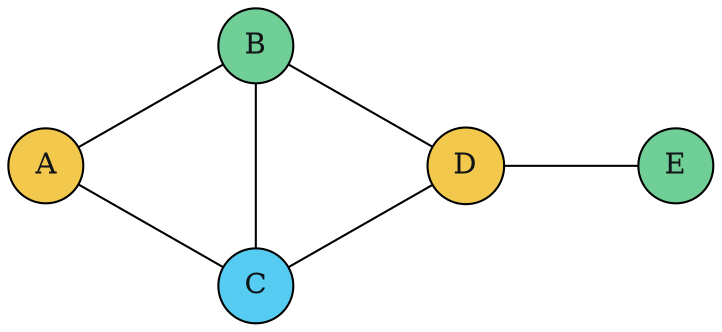

### Intuition

**Graph colouring:** give every vertex a colour so that the two ends of every edge differ. With **m** colours available, can it be done? The smallest m that works is the **chromatic number χ(G)**. Timetabling is the classic use: courses are vertices, an edge joins two courses that share a student, and colours are exam slots.

**Sudoku** is the same problem in disguise. Each of the 81 cells is a vertex; two cells are joined if they share a row, a column or a 3 × 3 box; the digits 1–9 are the colours, and some vertices come pre-coloured.

Both are solved the same way: give the next vertex (cell) the first value that does not clash with its already-coloured neighbours, and **backtrack** when no value fits.

### How it works

**m-colouring by backtracking.** Number the vertices 1 … n. Try colours 1 … m for vertex k; colour c is allowed if no neighbour of k already has c. If some colour works, move on to vertex k + 1; if none does, go back to vertex k − 1 and try its next colour.

**Example** with m = 3:



| vertex | neighbours already coloured | colour |
| --- | --- | --- |
| A | — | 1 (yellow) |
| B | A = 1 | 2 (green) |
| C | A = 1, B = 2 | 3 (blue) |
| D | B = 2, C = 3 | 1 (yellow) |
| E | D = 1 | 2 (green) |

No backtracking was needed here. With only m = 2 colours the triangle A, B, C cannot be coloured, so the search fails at C, backtracks through every choice and reports "no". χ(G) = 3. In total this graph has **12** different 3-colourings.

**Sudoku by backtracking.** Find the first empty cell, try digits 1 … n that do not appear in its row, column or box, recurse, and clear the cell if the recursion fails. A 4 × 4 example (2 × 2 boxes):

| puzzle | | | | → | solution | | | |
| --- | --- | --- | --- | --- | --- | --- | --- | --- |
| **1** | · | · | · | | **1** | 3 | 2 | 4 |
| · | · | **3** | · | | 4 | 2 | **3** | 1 |
| · | **4** | · | · | | 2 | **4** | 1 | 3 |
| · | · | · | **2** | | 3 | 1 | 4 | **2** |

### Python implementation

```python
def m_colouring(adj, m):
    """adj: dict vertex -> neighbours. Return a colouring dict, or None if m colours are not enough."""
    order = list(adj)
    colour = {}

    def go(k):
        if k == len(order):
            return True
        v = order[k]
        for c in range(1, m + 1):
            if all(colour.get(u) != c for u in adj[v]):   # bounding function
                colour[v] = c
                if go(k + 1):
                    return True
                del colour[v]                              # backtrack
        return False

    return dict(colour) if go(0) else None


def solve_sudoku(grid):
    """Fill grid (n x n lists, 0 = empty) in place; return True if solved."""
    n = len(grid)
    b = int(n ** 0.5)                                      # box size
    for r in range(n):
        for c in range(n):
            if grid[r][c] == 0:
                for d in range(1, n + 1):
                    br, bc = r - r % b, c - c % b
                    if (d not in grid[r]
                            and all(grid[i][c] != d for i in range(n))
                            and all(grid[i][j] != d for i in range(br, br + b) for j in range(bc, bc + b))):
                        grid[r][c] = d
                        if solve_sudoku(grid):
                            return True
                        grid[r][c] = 0                     # backtrack
                return False                               # no digit fits this cell
    return True                                            # no empty cell left


if __name__ == "__main__":
    adj = {"A": "BC", "B": "ACD", "C": "ABD", "D": "BCE", "E": "D"}
    print(m_colouring(adj, 3))   # {'A': 1, 'B': 2, 'C': 3, 'D': 1, 'E': 2}
    print(m_colouring(adj, 2))   # None
    g = [[1, 0, 0, 0], [0, 0, 3, 0], [0, 4, 0, 0], [0, 0, 0, 2]]
    solve_sudoku(g)
    print(g)                     # [[1, 3, 2, 4], [4, 2, 3, 1], [2, 4, 1, 3], [3, 1, 4, 2]]
```

### Complexity

| | Worst case |
| --- | --- |
| m-colouring, n vertices | O(mⁿ) colourings tried, each check O(n) → **O(n · mⁿ)** |
| n × n Sudoku with e empty cells | O(nᵉ) |

Deciding whether a graph is **3-colourable is NP-complete** (topic 34), so no polynomial algorithm is known. 2-colourability, in contrast, is easy: a graph is 2-colourable exactly when it is bipartite, which BFS checks in O(V + E).

### Common mistakes

- **Not undoing the colour** after a failed recursive call, so later checks see a stale colour.
- **Thinking greedy colouring gives χ(G).** Colouring each vertex with the smallest free colour, in a fixed order, can use far more colours than needed.
- **Forgetting the box constraint** in Sudoku, or computing the box corner wrongly (it is r − r mod b, not r / b).
- **Confusing "m-colourable" with "needs exactly m colours".** A 2-colourable graph is also 3-colourable.

### Problems

1. Find χ(G) for: a cycle with 5 vertices; a cycle with 6 vertices; the complete graph K₅; a wheel (a 5-cycle plus a centre joined to every vertex).
2. **Lab:** extend `m_colouring` to count **all** m-colourings. Check that the example graph has 12 with m = 3.
3. **Lab:** solve a 9 × 9 newspaper Sudoku and count how many cells the search filled (including those later cleared).
4. Model an exam timetable as a colouring problem: subjects A–F, where A clashes with B and C, B with D, C with D and E, and E with F. How many slots are needed?
5. Improve the Sudoku solver by always choosing the empty cell with the **fewest** allowed digits. Compare the number of recursive calls.
