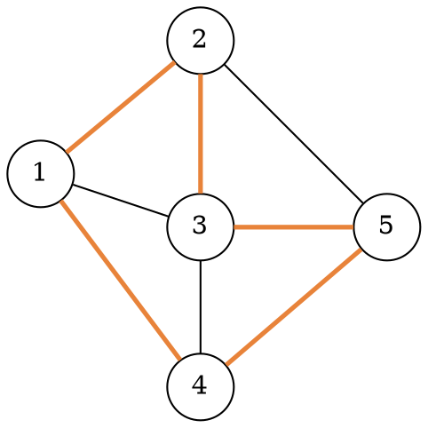

### Intuition

A **Hamiltonian cycle** visits **every vertex exactly once** and comes back to where it started. (A Hamiltonian *path* does the same without returning.) Think of a salesperson who must visit each city once and come home. Topic 32 adds distances to that picture.

It sounds like an **Euler circuit**, which uses every *edge* once. Euler circuits are easy: a connected graph has one exactly when every vertex has even degree. For Hamiltonian cycles **no such simple test is known**; the problem is NP-complete (topic 34). So we search.

### How it works

Start at vertex 1 and keep a path. At each step, extend the path with a neighbour of the last vertex that is **not yet on the path** (the bounding function). When the path holds all n vertices, it is a Hamiltonian cycle if the last vertex is adjacent to vertex 1. Either way, **backtrack** and try the next neighbour.

**Example:**



Trying neighbours in increasing order:

| path | what happens |
| --- | --- |
| 1 → 2 → 3 → 4 → 5 | all 5 vertices, but 5 is not adjacent to 1 → backtrack |
| 1 → 2 → 3 → 5 → 4 | 4 is adjacent to 1 → **cycle 1-2-3-5-4-1** (orange) |
| 1 → 2 → 5 → 3 → 4 | cycle 1-2-5-3-4-1 |
| 1 → 2 → 5 → 4 → 3 | cycle 1-2-5-4-3-1 |
| 1 → 3 → 2 → 5 → 4 | cycle 1-3-2-5-4-1 |
| … | the rest are the same four cycles traversed backwards |

This graph has exactly **4** Hamiltonian cycles (counting each cycle once, not once per direction).

**Counting in complete graphs.** In Kₙ every ordering of the vertices works. Fix the start, order the other n − 1 vertices in (n − 1)! ways, and divide by 2 for direction:

> number of Hamiltonian cycles in Kₙ = (n − 1)! / 2  K₄: 3, K₅: 12, K₆: 60

### Python implementation

```python
def hamiltonian_cycles(adj, start):
    """All Hamiltonian cycles (each listed in one direction only). adj: dict vertex -> set of neighbours."""
    n = len(adj)
    path, on_path, found = [start], {start}, []

    def extend():
        v = path[-1]
        if len(path) == n:
            if start in adj[v] and path[1] < path[-1]:   # closes the cycle; skip the mirror image
                found.append(path + [start])
            return
        for u in sorted(adj[v]):
            if u not in on_path:                          # bounding function
                path.append(u); on_path.add(u)
                extend()
                path.pop(); on_path.remove(u)             # backtrack

    extend()
    return found


if __name__ == "__main__":
    edges = [(1, 2), (1, 3), (1, 4), (2, 3), (2, 5), (3, 4), (3, 5), (4, 5)]
    adj = {v: set() for v in range(1, 6)}
    for a, b in edges:
        adj[a].add(b); adj[b].add(a)
    cycles = hamiltonian_cycles(adj, 1)
    print(len(cycles))   # 4
    print(cycles[0])     # [1, 2, 3, 5, 4, 1]
```

The code assumes n ≥ 3, since a cycle needs at least three vertices.

### Complexity

The search can try every ordering of the other vertices: **O(n!)** paths in the worst case, each step O(1) with the set. Dynamic programming over subsets (Held–Karp style) brings this down to **O(2ⁿ · n²)**, which is still exponential but far smaller than n! for n around 20.

### Common mistakes

- **Mixing up Hamiltonian and Euler.** Vertices once (hard) versus edges once (easy degree test).
- **Forgetting the closing edge.** A path through all vertices is not a cycle unless the last vertex is adjacent to the first.
- **Counting each cycle twice.** Every cycle appears once in each direction; fix the start vertex and keep only one direction.
- **Assuming high degree is needed.** A cycle graph Cₙ has degree 2 everywhere and is Hamiltonian.

### Problems

1. List all Hamiltonian cycles of K₄, and check the formula (n − 1)! / 2.
2. Show that the complete bipartite graph K₂,₃ has no Hamiltonian cycle. (Hint: a cycle in a bipartite graph alternates sides.)
3. **Lab:** run `hamiltonian_cycles` on the 3-dimensional cube graph (8 vertices; two are adjacent if their 3-bit labels differ in one bit). How many cycles are there?
4. **Lab:** change the function to find a Hamiltonian **path** between two given vertices.
5. A knight's tour visits every square of a chessboard once using knight moves. Explain how this is a Hamiltonian path problem, and why plain backtracking struggles on an 8 × 8 board.
