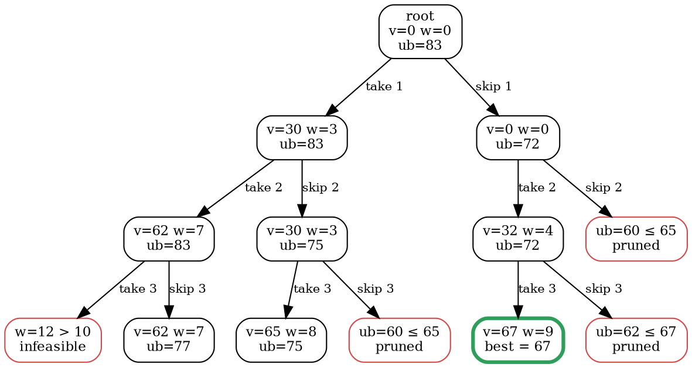

### Intuition

Backtracking prunes a node when it is **infeasible**. Branch and bound also prunes a node when it is **not promising**: for each node it computes a **bound**, the best value any solution below that node could possibly reach. If that bound is no better than the best complete solution already found, the whole subtree is skipped.

For the 0/1 knapsack (maximise value), a good optimistic bound is the **fractional knapsack**: fill the remaining capacity with the remaining items in value/weight order, and allow a fraction of the last item. No 0/1 solution can do better than that, because it obeys more rules.

Nodes are also explored in a smarter order. Instead of depth-first, branch and bound keeps a list of **live nodes** and picks the next one to expand:

- **FIFO branch and bound:** a queue, so the tree is explored level by level (breadth-first);
- **least-cost (LC) branch and bound:** a priority queue, always expanding the live node with the **best bound** first.

### How it works

Sort the items by value/weight. At level k, decide on item k: the left child **takes** it (if it fits), the right child **skips** it.

> bound(node) = value so far + the fractional-knapsack value of the remaining items in the remaining capacity

**Example:** W = 10, items (weight, value): 1 → (3, 30), 2 → (4, 32), 3 → (5, 35), 4 → (6, 30). The ratios 10, 8, 7 and 5 are already in decreasing order.

The root bound: take items 1 and 2 (weight 7, value 62), then 3/5 of item 3 → 62 + 21 = **83**.

LC branch and bound, expanding the live node with the largest bound each time:



| step | expand (bound) | what happens | best after |
| --- | --- | --- | --- |
| 1 | root (83) | take 1 → v = 30 (ub 83); skip 1 (ub 72) | 30 |
| 2 | take 1 (83) | take 2 → v = 62 (ub 83); skip 2 (ub 75) | 62 |
| 3 | take 1, 2 (83) | item 3 does not fit (w = 12); skip 3 (ub 77) | 62 |
| 4 | take 1, 2, skip 3 (77) | item 4 does not fit; skipping it gives only 62 | 62 |
| 5 | take 1, skip 2 (75) | take 3 → v = 65 (ub 75); skip 3 has ub 60 ≤ 65 → pruned | **65** |
| 6 | take 1, skip 2, take 3 (75) | item 4 does not fit | 65 |
| 7 | skip 1 (72) | take 2 → v = 32 (ub 72); skip 2 has ub 60 ≤ 65 → pruned | 65 |
| 8 | skip 1, take 2 (72) | take 3 → v = 67; skip 3 has ub 62 ≤ 67 → pruned | **67** |
| 9 | skip 1, take 2, take 3 (72) | item 4 does not fit | 67 |

No live node has a bound above 67, so the answer is **67**: items 2 and 3 (weight 9). Greedy by ratio would stop at items 1 and 2 with value 62.

### Python implementation

```python
import heapq


def knapsack_bb(items, W):
    """items: list of (weight, value). Least-cost (best-first) branch and bound.
    Return (best value, sorted indices of the chosen items)."""
    order = sorted(range(len(items)), key=lambda i: items[i][1] / items[i][0], reverse=True)

    def bound(k, w, v):                       # fractional knapsack on order[k:]
        for i in order[k:]:
            wt, val = items[i]
            if w + wt <= W:
                w, v = w + wt, v + val
            else:
                return v + (W - w) * val / wt
        return v

    best, best_set = 0, []
    live = [(-bound(0, 0, 0), 0, 0, 0, [])]   # max-heap on the bound
    while live:
        neg_ub, k, w, v, taken = heapq.heappop(live)
        if -neg_ub <= best or k == len(order):
            continue                          # cannot beat the best: prune
        i = order[k]
        wt, val = items[i]
        if w + wt <= W:                       # child 1: take item i
            if v + val > best:
                best, best_set = v + val, taken + [i]
            heapq.heappush(live, (-bound(k + 1, w + wt, v + val), k + 1, w + wt, v + val, taken + [i]))
        if bound(k + 1, w, v) > best:         # child 2: skip item i
            heapq.heappush(live, (-bound(k + 1, w, v), k + 1, w, v, taken))
    return best, sorted(best_set)


if __name__ == "__main__":
    print(knapsack_bb([(3, 30), (4, 32), (5, 35), (6, 30)], 10))   # (67, [1, 2])
    print(knapsack_bb([(10, 60), (20, 100), (30, 120)], 50))       # (220, [1, 2])
```

Replacing the heap with a `collections.deque` (append at the back, pop from the front) gives **FIFO** branch and bound.

### Complexity

The tree has up to 2ⁿ⁺¹ − 1 nodes, so the worst case is still **exponential**. Each bound costs O(n), and each heap operation O(log of the number of live nodes). In practice a tight bound prunes most of the tree. Unlike the DP of topic 27, the running time does not depend on the size of W.

| | Search order | Prunes on |
| --- | --- | --- |
| backtracking | depth-first | infeasibility |
| FIFO branch and bound | breadth-first (queue) | infeasibility and bound |
| LC branch and bound | best bound first (priority queue) | infeasibility and bound |

### Common mistakes

- **Forgetting to sort by value/weight** before computing the fractional bound; otherwise the bound may be too low and prune the optimum.
- **Pruning with "<" instead of "≤".** Both give the right value, but "<" wastes time exploring nodes whose bound only ties the best.
- **Not updating the best value at the take child.** Every feasible partial selection is already a valid solution.
- **Thinking branch and bound is polynomial.** It is still exponential in the worst case.

### Problems

1. For W = 16 and items (2, 40), (5, 30), (10, 50), (5, 10), compute the root bound and draw the LC branch and bound tree.
2. **Lab:** change `knapsack_bb` to FIFO order and count the nodes expanded on the example. Which order expands fewer?
3. **Lab:** generate random instances with 25 items and compare the time of branch and bound with the DP of topic 27 as W grows.
4. Textbook 2 phrases the knapsack as a *minimisation* problem with negative profits. Rewrite the bound in that form.
5. Explain why the fractional knapsack value is always at least the 0/1 optimum.
