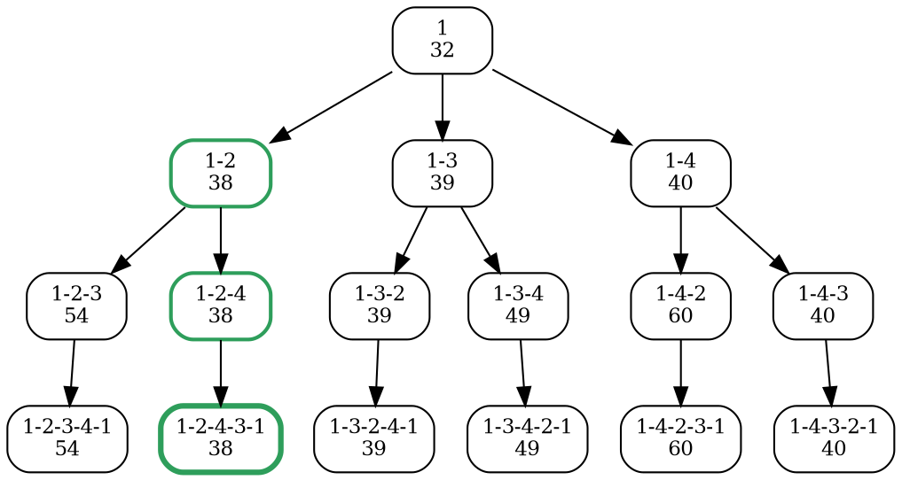

### Intuition

A salesperson must visit n cities, each exactly once, and come back to the start, travelling the least total distance. This is a **minimum-cost Hamiltonian cycle** (topic 30). With n cities there are (n − 1)! tours from a fixed start: already 3.6 million for 11 cities.

Branch and bound needs a **lower bound** on any tour that extends a partial route. A neat one comes from the **cost matrix**. Every tour leaves each city exactly once, so it uses one entry from every row. If the cheapest entry in row 1 is 10, every tour pays at least 10 to leave city 1. Subtracting each row's minimum (and then each column's, since every tour also enters each city once) gives a total that **no tour can beat**. The matrix that remains is the **reduced cost matrix**.

### How it works

**Example** (∞ means "no edge"; the matrix need not be symmetric):

| from \ to | 1 | 2 | 3 | 4 |
| --- | --- | --- | --- | --- |
| 1 | ∞ | 12 | 10 | 19 |
| 2 | 8 | ∞ | 14 | 9 |
| 3 | 11 | 7 | ∞ | 15 |
| 4 | 13 | 16 | 6 | ∞ |

**Root.** The row minima are 10, 8, 7 and 6 (total 31). After subtracting them, column 4 still has minimum 1. So the reduction is 31 + 1 = **32**, and every tour costs at least 32.

| reduced | 1 | 2 | 3 | 4 |
| --- | --- | --- | --- | --- |
| 1 | ∞ | 2 | 0 | 8 |
| 2 | 0 | ∞ | 6 | 0 |
| 3 | 4 | 0 | ∞ | 7 |
| 4 | 7 | 10 | 0 | ∞ |

**Child node: choose edge (i, j).** Starting from the parent's reduced matrix A:

1. Set row i and column j to ∞ (we leave i once and enter j once).
2. Set A[j][1] = ∞ (no going back to the start early).
3. Reduce the result; call the amount subtracted r.
4. bound(child) = bound(parent) + A[i][j] + r.

For the edge 1 → 2: A[1][2] = 2, and after blocking, row 3 has minimum 4, so r = 4. The bound is 32 + 2 + 4 = **38**. Similarly 1 → 3 gives 32 + 0 + 7 = 39, and 1 → 4 gives 32 + 8 + 0 = 40.

The full tree with every bound (leaves are complete tours, and their bound equals the exact tour cost):



**LC branch and bound** always expands the live node with the **smallest** bound: 1 (32) → 1-2 (38) → 1-2-4 (38) → tour 1-2-4-3-1 with cost **38**. The live nodes 1-3 (39) and 1-4 (40) have bounds ≥ 38, so they are pruned. Only **4** nodes are expanded.

**FIFO branch and bound** expands level by level: the root, all three level-1 nodes, all six level-2 nodes, and then the level-3 nodes in order. The first tour found is 1-2-3-4-1 (54), then 1-2-4-3-1 (38), after which every remaining node has a bound ≥ 38 and is pruned. That is **12** nodes expanded, three times as many.

The optimal tour is 1 → 2 → 4 → 3 → 1: 12 + 9 + 6 + 11 = **38**.

### Python implementation

```python
import heapq
from collections import deque

INF = float("inf")


def reduce_matrix(m):
    """Subtract each row's minimum, then each column's minimum, in place. Return the total subtracted."""
    n, total = len(m), 0
    for i in range(n):
        low = min(m[i])
        if 0 < low < INF:
            total += low
            m[i] = [x - low for x in m[i]]
    for j in range(n):
        low = min(m[i][j] for i in range(n))
        if 0 < low < INF:
            total += low
            for i in range(n):
                m[i][j] -= low
    return total


def tsp_bb(cost, fifo=False):
    """Branch and bound with reduced cost matrices, starting at city 1.
    Return (tour cost, tour with 1-based cities, nodes expanded)."""
    n = len(cost)
    root = [row[:] for row in cost]
    start = (reduce_matrix(root), 0, [0], root)            # (bound, tie-breaker, path, matrix)
    live = deque([start]) if fifo else [start]
    best, best_tour, expanded, count = INF, None, 0, 0
    while live:
        b, _, path, m = live.popleft() if fifo else heapq.heappop(live)
        if b >= best:
            continue                                        # cannot beat the best tour: prune
        expanded += 1
        if len(path) == n:
            best, best_tour = b, path + [0]                 # a complete tour; b is its exact cost
            continue
        i = path[-1]
        for j in range(n):
            if j in path or m[i][j] == INF:
                continue
            child = [row[:] for row in m]
            for k in range(n):
                child[i][k] = child[k][j] = INF             # leave i once, enter j once
            if len(path) + 1 < n:
                child[j][0] = INF                           # no early return to the start
            cb = b + m[i][j] + reduce_matrix(child)
            if cb < best:
                count += 1
                node = (cb, count, path + [j], child)
                if fifo:
                    live.append(node)
                else:
                    heapq.heappush(live, node)
    return best, [v + 1 for v in best_tour], expanded


if __name__ == "__main__":
    C = [[INF, 12, 10, 19], [8, INF, 14, 9], [11, 7, INF, 15], [13, 16, 6, INF]]
    print(tsp_bb(C))              # (38, [1, 2, 4, 3, 1], 4)
    print(tsp_bb(C, fifo=True))   # (38, [1, 2, 4, 3, 1], 12)
```

At the last step the code keeps A[j][1], so the final reduction adds the cost of the edge back to city 1, and the bound of a complete tour is its exact cost.

### Complexity

| | Work |
| --- | --- |
| try every tour | (n − 1)! tours, O(n) each |
| dynamic programming over subsets (Held–Karp) | O(2ⁿ · n²) |
| branch and bound | exponential in the worst case, each node O(n²) to reduce; usually far fewer nodes |

TSP is NP-hard (topic 34), so no method is known that is polynomial in the worst case.

### Common mistakes

- **Forgetting the column reduction.** Rows alone give a weaker bound (31 instead of 32 here).
- **Not blocking the return edge (j → 1)** before the last step, which allows a cycle that skips some cities.
- **Adding the original cost instead of the reduced entry A[i][j].** The bound uses the parent's reduced matrix.
- **Stopping at the first complete tour in FIFO order.** It is only the best so far (54 here); keep going until every live node is pruned.

### Problems

1. Reduce the matrix [[∞, 20, 30, 10, 11], [15, ∞, 16, 4, 2], [3, 5, ∞, 2, 4], [19, 6, 18, ∞, 3], [16, 4, 7, 16, ∞]] and find the root bound.
2. For the example above, compute the bound of the child 1 → 3 step by step, showing the blocked matrix and its reduction.
3. **Lab:** run `tsp_bb` in both modes on random 8-city matrices and plot the number of nodes expanded.
4. **Lab:** add a check that compares `tsp_bb` with trying all (n − 1)! tours for n ≤ 8.
5. Why is the reduced-matrix bound a valid lower bound for an asymmetric TSP as well as a symmetric one?
