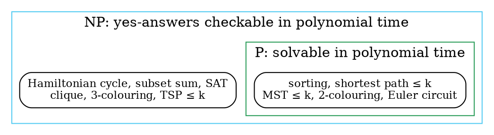

### Intuition

Finding a Sudoku solution can take a long time. **Checking** a filled-in grid takes seconds. Many hard problems share this shape: a proposed answer, called a **certificate**, is easy to verify even when it is hard to find.

- **P** is the class of problems we can **solve** quickly.
- **NP** is the class of problems whose "yes" answers we can **check** quickly.

Whether these two classes are the same, **P = NP?**, is still unknown. Most researchers believe P ≠ NP.

### How it works

**Decision problems.** Complexity classes are defined for yes/no questions. An optimisation problem has a matching decision version:

| optimisation | decision version |
| --- | --- |
| cheapest TSP tour | is there a tour of cost ≤ k? |
| largest clique | is there a clique of size ≥ k? |
| fewest colours (χ) | can G be coloured with m colours? |
| best knapsack value | is there a selection of weight ≤ W and value ≥ k? |

If the decision version can be solved in polynomial time, so can the optimisation version (for example, by binary search on k), and the other way round. So nothing important is lost.

**Deterministic vs nondeterministic.** A **deterministic** algorithm has exactly one next step at every point. A **nondeterministic** algorithm may also use three special operations:

- `choice(S)`: picks an element of S, and always picks a right one if any choice leads to success;
- `failure()`: ends this computation unsuccessfully;
- `success()`: ends this computation successfully.

The machine answers "yes" if **some** sequence of choices reaches `success`. Nondeterministic search for x in an array A[1..n]:

```text
j = choice(1 .. n)          # guess a position
if A[j] == x: success()     # O(1) to check the guess
else:         failure()
```

This takes O(1) nondeterministic time, but no real computer can guess. A deterministic machine has to **try the choices one by one**, which for a sequence of n binary choices means up to 2ⁿ branches.

**The classes:**

- **P:** decision problems solved by a *deterministic* algorithm in polynomial time, O(nᵏ).
- **NP:** decision problems solved by a *nondeterministic* algorithm in polynomial time.

Equivalently, NP is the class of problems where every "yes" instance has a certificate that a deterministic algorithm can **verify** in polynomial time. The nondeterministic machine simply guesses the certificate and then runs the verifier.

**P ⊆ NP**, because a deterministic algorithm is a nondeterministic one that never uses `choice`.



(The problems in the outer box are not known to be in P. If P = NP, the two boxes would be the same.)

### Python implementation

A polynomial-time **verifier** for subset sum, and the deterministic way of "guessing": try every certificate.

```python
from itertools import combinations


def verify_subset_sum(nums, target, cert):
    """Certificate = list of distinct indices. O(n) check."""
    return len(set(cert)) == len(cert) and all(0 <= i < len(nums) for i in cert) \
        and sum(nums[i] for i in cert) == target


def verify_ham_cycle(adj, cert):
    """Certificate = order of the vertices. O(n) check with adjacency sets."""
    return sorted(cert) == sorted(adj) and all(cert[(k + 1) % len(cert)] in adj[cert[k]] for k in range(len(cert)))


def subset_sum_search(nums, target):
    """Deterministic simulation of choice(): try all 2^n certificates."""
    for r in range(len(nums) + 1):
        for cert in combinations(range(len(nums)), r):
            if verify_subset_sum(nums, target, list(cert)):
                return list(cert)
    return None


if __name__ == "__main__":
    nums = [3, 34, 4, 12, 5, 2]
    print(verify_subset_sum(nums, 9, [2, 4]))    # True
    print(verify_subset_sum(nums, 9, [0, 1]))    # False
    print(subset_sum_search(nums, 9))            # [2, 4]
    print(subset_sum_search(nums, 100))          # None
    adj = {1: {2, 4}, 2: {1, 3}, 3: {2, 4}, 4: {3, 1}}
    print(verify_ham_cycle(adj, [1, 2, 3, 4]))   # True
```

### Complexity

| | Time |
| --- | --- |
| verify a subset-sum certificate | O(n) |
| verify a Hamiltonian-cycle certificate | O(n) |
| deterministic search over all certificates | O(2ⁿ · n) |
| nondeterministic algorithm (guess, then verify) | O(n) |

The gap between "verify in O(n)" and "search in O(2ⁿ · n)" is exactly the P vs NP question: can the search always be replaced by something polynomial?

### Common mistakes

- **Thinking NP means "not polynomial".** NP stands for *nondeterministic polynomial*. Every problem in P is also in NP.
- **Thinking a problem in NP is known to be hard.** Sorting is in NP too. "Hard" is what NP-complete means (topic 34).
- **Applying P and NP to optimisation problems directly.** The classes are defined for decision problems.
- **Treating a pseudo-polynomial algorithm as proof of P.** The O(n·W) knapsack DP does not put knapsack in P, because W can be exponential in the input length.

### Problems

1. Write the decision version of: (a) the longest common subsequence, (b) the minimum vertex cover, (c) the 0/1 knapsack.
2. Write a nondeterministic algorithm that sorts an array in O(n) time using `choice`, and explain what `failure` does in it.
3. **Lab:** write a verifier for 3-colouring: given a graph and a colour for each vertex, check it in O(V + E).
4. **Lab:** time `subset_sum_search` for n = 10, 15, 20 and 22 with a target that cannot be reached. How does the time grow?
5. Show that if the decision version of TSP is in P, the cost of an optimal tour can also be found in polynomial time.
