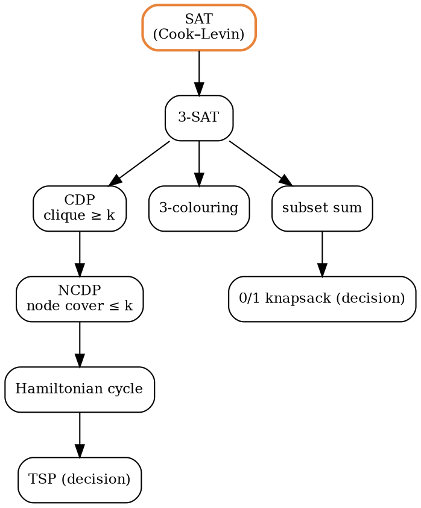
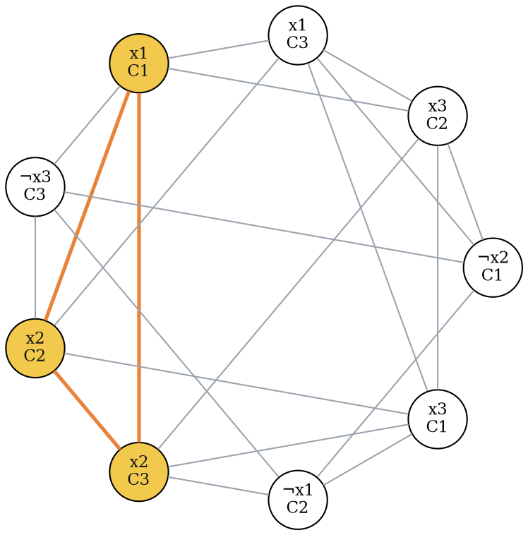

### Intuition

Suppose you could turn any instance of problem A into an instance of problem B, quickly, so that the answers match. Then a fast algorithm for B would also give a fast algorithm for A: **B is at least as hard as A**. This is a **polynomial-time reduction**, written A ≤ₚ B (Textbook 2 writes A ∝ B).

- A problem is **NP-hard** if every problem in NP reduces to it.
- A problem is **NP-complete** if it is NP-hard **and** in NP.

The NP-complete problems are the hardest problems in NP. If any one of them has a polynomial algorithm, then P = NP. Thousands of practical problems are NP-complete, and no polynomial algorithm is known for any of them.

### How it works

**Cook–Levin theorem (1971).** **SAT** is NP-complete. SAT asks: given a Boolean formula in conjunctive normal form (an AND of clauses, each an OR of literals), is there an assignment that makes it true? The proof shows that the run of *any* nondeterministic polynomial-time machine can be described by a polynomial-size formula that is satisfiable exactly when the machine says "yes".

**3-SAT** (every clause has exactly 3 literals) is also NP-complete, because any SAT clause can be split into 3-literal clauses with a few new variables.

**Proving a new problem B NP-complete** takes two steps:

1. Show B ∈ NP: give a polynomial-time verifier for certificates.
2. Pick a known NP-complete problem A and show A ≤ₚ B.

The direction matters: reduce the **known hard** problem **to** the new one.



Each arrow A → B is a reduction A ≤ₚ B, so every problem in the picture is NP-complete.

**3-SAT ≤ₚ CDP (clique decision problem).** Given a formula with k clauses, build a graph:

- one vertex for each literal in each clause;
- an edge between two vertices if they are in **different clauses** and are **not** x and ¬x.

The formula is satisfiable **if and only if** the graph has a clique of size k. A satisfying assignment makes one literal true in each clause, and those k literals never contradict each other, so they are pairwise joined. Conversely, a k-clique has one vertex per clause with no contradictions, so setting those literals true satisfies every clause.

Example: (x1 ∨ ¬x2 ∨ x3) ∧ (¬x1 ∨ x2 ∨ x3) ∧ (x1 ∨ x2 ∨ ¬x3). The graph has 9 vertices and 21 edges. The highlighted triangle (x1 from C1, x2 from C2, x2 from C3) is a 3-clique, matching the assignment x1 = x2 = true.



**CDP ≤ₚ NCDP (node cover decision problem).** A **node cover** (vertex cover) is a set of vertices touching every edge. For a graph G with n vertices, let G′ be its **complement** (an edge exactly where G has none). Then:

> G has a clique of size k ⇔ G′ has a node cover of size n − k.

If S is a clique in G, no edge of G′ lies inside S, so every edge of G′ has an end outside S: the other n − k vertices cover G′. The argument also works backwards. Building G′ takes O(n²), so this is a polynomial-time reduction.

**NP-hard but not (known to be) in NP.** Optimisation versions such as "find the cheapest tour" are NP-hard, but they are not decision problems, so they are not in NP. The **halting problem** is NP-hard and not even decidable.

| | in NP | NP-hard |
| --- | --- | --- |
| P (e.g. sorting, MST) | yes | no (unless P = NP) |
| NP-complete (SAT, 3-SAT, CDP, NCDP, Hamiltonian cycle) | yes | yes |
| optimisation TSP, halting problem | no | yes |

### Python implementation

Brute-force SAT, the two reductions, and brute-force checks that the answers agree.

```python
from itertools import combinations, product


def satisfiable(clauses, n):
    """Brute force over all 2^n assignments. Literals are ±1..±n. Return an assignment dict or None."""
    for bits in product([False, True], repeat=n):
        a = {i + 1: bits[i] for i in range(n)}
        if all(any(a[abs(l)] == (l > 0) for l in c) for c in clauses):
            return a
    return None


def sat_to_clique(clauses):
    """CNF with k clauses -> (vertices, edges, k). The formula is satisfiable iff the graph has a k-clique."""
    vertices = [(i, j, lit) for i, c in enumerate(clauses) for j, lit in enumerate(c)]   # (clause, position, literal)
    edges = {frozenset((u, v)) for u, v in combinations(vertices, 2)
             if u[0] != v[0] and u[2] != -v[2]}      # different clauses, not x and ¬x
    return vertices, edges, len(clauses)


def clique_to_vertex_cover(vertices, edges, k):
    """CDP -> NCDP: G has a k-clique iff the complement of G has a vertex cover of size n - k."""
    comp = {frozenset(p) for p in combinations(vertices, 2)} - edges
    return vertices, comp, len(vertices) - k


def has_clique(vertices, edges, k):
    return any(all(frozenset(p) in edges for p in combinations(s, 2)) for s in combinations(vertices, k))


def has_vertex_cover(vertices, edges, k):
    return any(all(e & set(s) for e in edges) for s in combinations(vertices, k))


if __name__ == "__main__":
    F = [[1, -2, 3], [-1, 2, 3], [1, 2, -3]]        # (x1 ∨ ¬x2 ∨ x3)(¬x1 ∨ x2 ∨ x3)(x1 ∨ x2 ∨ ¬x3)
    print(satisfiable(F, 3))                          # {1: False, 2: False, 3: False}
    V, E, k = sat_to_clique(F)
    print(len(V), len(E), k)                          # 9 21 3
    print(has_clique(V, E, k))                        # True
    V2, E2, k2 = clique_to_vertex_cover(V, E, k)
    print(len(E2), k2, has_vertex_cover(V2, E2, k2))  # 15 6 True
```

The SAT search is exponential (2ⁿ assignments) and so are the clique and cover checks, but both **reductions** run in polynomial time: O(k²) for building the clique graph and O(n²) for the complement.

### Complexity

| problem | best known exact algorithm | class |
| --- | --- | --- |
| 2-SAT | O(n + m) (implication graph) | P |
| 3-SAT | exponential, about O(1.3ⁿ) | NP-complete |
| clique ≥ k, node cover ≤ k | exponential in general | NP-complete |
| node cover ≤ k, k fixed | O(2ᵏ · n) | NP-complete, but fast for small k |

### Common mistakes

- **Reducing in the wrong direction.** To show B is hard, reduce a known hard problem *to* B, not B to it.
- **Forgetting the "in NP" step.** Without it you have only shown NP-hard.
- **Thinking NP-hard means "in NP and hard".** NP-hard problems need not be in NP at all.
- **Letting the reduction take exponential time.** The transformation itself must be polynomial.
- **Mixing up 2-SAT and 3-SAT.** 2-SAT is in P.

### Problems

1. Build the CDP graph for (x1 ∨ x2 ∨ x3) ∧ (¬x1 ∨ ¬x2 ∨ ¬x3) and find a 2-clique. Which assignment does it give?
2. For a graph with 6 vertices whose largest clique has size 4, what is the smallest node cover of its complement?
3. **Lab:** generate random 3-CNF formulas with 5 variables and 4 clauses, and check by brute force that `satisfiable`, `has_clique` and `has_vertex_cover` always agree after the reductions.
4. Show that the **independent set** problem is NP-complete, using CDP.
5. Explain why a polynomial algorithm for NCDP would give a polynomial algorithm for 3-SAT.
