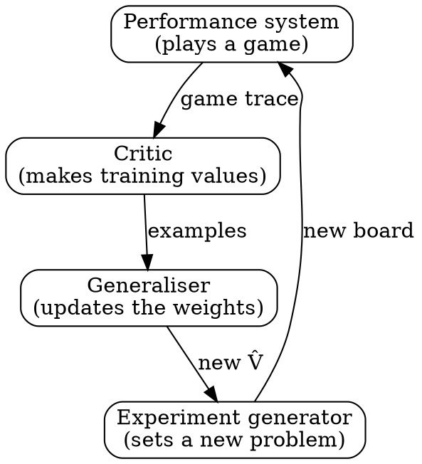

### Intuition

Suppose you want a program that learns to play checkers. "Learn checkers" is too vague to code, so you narrow it through a series of questions. What will it practise on? What exactly should it learn? How will that knowledge be stored? How will it be adjusted?

Each answer narrows the problem until only arithmetic is left.

### How it works

**Choice 1: the training experience.** Good experience has three properties:

- **Direct or indirect feedback.** Direct: "in this position, this move is best". Indirect: only the game's final result, so the learner must work out which moves deserve credit. This is the *credit assignment* problem.
- **Control.** Does a teacher choose the examples, or does the learner explore by itself?
- **Representative.** Training should look like the real test. Practising only against yourself may leave you weak against other styles.

**Choice 2: the target function.** Learning "the best move" directly is hard. A neater target is a function V that gives any board a score: +100 for a won final board, −100 for a lost one, 0 for a draw, and otherwise the score of the best final board reachable. Then play is easy: choose the move that leads to the highest V.

**Choice 3: the representation.** The exact V cannot be computed, so we learn an approximation V̂ as a weighted sum of board features:

```text
V̂(b) = w0 + w1·x1 + w2·x2 + w3·x3 + w4·x4 + w5·x5 + w6·x6

x1, x2  black pieces, red pieces
x3, x4  black kings, red kings
x5, x6  black pieces threatened by red, red pieces threatened by black
```

Learning now means only one thing: finding the seven weights.

**Choice 4: the learning algorithm.** The training value for a position is the current estimate for the position that follows it, because later positions are closer to the known result. The **LMS (least mean squares)** rule then nudges each weight to shrink the error:

```text
error = Vtrain(b) − V̂(b)
wi ← wi + η · error · xi
```

Here η is a small learning rate. A feature that is zero causes no change, and a big error causes a big change.

**The final design** has four modules that form a loop:



### Run it: the LMS rule

This program learns the weights of a scoring function from example positions. The true scorer is hidden inside `true_value`. Each position is two piece counts plus a constant term.

```python
import random

random.seed(7)

def true_value(x1, x2):           # hidden: what we hope the learner discovers
    return 3 * x1 - 2 * x2 + 5

w = [0.0, 0.0, 0.0]               # w0, w1, w2
eta = 0.005

def estimate(x1, x2):
    return w[0] + w[1] * x1 + w[2] * x2

for step in range(1, 20001):
    x1, x2 = random.randint(0, 12), random.randint(0, 12)
    error = true_value(x1, x2) - estimate(x1, x2)
    w[0] += eta * error * 1       # the constant term has feature value 1
    w[1] += eta * error * x1
    w[2] += eta * error * x2
    if step in (1, 10, 100, 1000, 20000):
        print(f"step {step:6}: w0={w[0]:6.2f}  w1={w[1]:6.2f}  w2={w[2]:6.2f}")

print("Hidden answer:   w0=  5.00  w1=  3.00  w2= -2.00")
```

**Try this:** set `eta = 0.05` and run it. The weights blow up. A learning rate that is too large overshoots further on every step.

### Common mistakes

- **Confusing the target with its approximation.** V is the ideal and V̂ is what you can actually learn.
- **Too simple a representation.** If the features cannot express the true function, no amount of training will fix it.
- **Too large a learning rate.** It can diverge, as the program shows.

### Problems

1. Do the four design choices for a program that learns to play noughts and crosses. List your board features.
2. By hand, apply one LMS step: weights (1, 2), features (3, 1), training value 10, η = 0.1. Give the new weights.
3. Why does indirect feedback make learning harder?
4. Why might self-play alone fail to prepare a program for human opponents?
5. Extend the program with a third feature whose true weight is 0. Does the learner discover that it does not matter?
