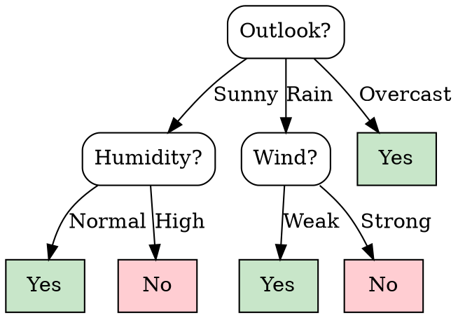

### Intuition

A decision tree is a game of twenty questions. Each internal node asks about one attribute, each branch is an answer, and each leaf gives the decision.



Each path is a rule. For example: *if Outlook = Sunny and Humidity = Normal, then play.*

**Decision trees suit problems where:**

- examples are described by attribute values;
- the target has discrete output values;
- a disjunction (an OR of conditions) may be needed;
- the training data may contain errors or missing values.

Medical diagnosis and loan risk are classic fits. A tree also explains its decision, which many models cannot.

Good questions split a mixed group into purer groups. We need a number for "how mixed", and that number is entropy.

### How it works

We use this small dataset of 14 days throughout the course:

| Day | Outlook | Temp | Humidity | Wind | Play |
| --- | --- | --- | --- | --- | --- |
| 1 | Sunny | Hot | High | Weak | No |
| 2 | Sunny | Hot | High | Strong | No |
| 3 | Overcast | Hot | High | Weak | Yes |
| 4 | Rain | Mild | High | Weak | Yes |
| 5 | Rain | Cool | Normal | Weak | Yes |
| 6 | Rain | Cool | Normal | Strong | No |
| 7 | Overcast | Cool | Normal | Strong | Yes |
| 8 | Sunny | Mild | High | Weak | No |
| 9 | Sunny | Cool | Normal | Weak | Yes |
| 10 | Rain | Mild | Normal | Weak | Yes |
| 11 | Sunny | Mild | Normal | Strong | Yes |
| 12 | Overcast | Mild | High | Strong | Yes |
| 13 | Overcast | Hot | Normal | Weak | Yes |
| 14 | Rain | Mild | High | Strong | No |

**Entropy** of a set S with a fraction p₊ of positives and p₋ of negatives:

```text
Entropy(S) = − p₊ log₂ p₊ − p₋ log₂ p₋
```

It is 0 when the set is pure and 1 when it is split evenly (for two classes). Treat 0·log₂0 as 0.

Our data has 9 Yes and 5 No:

```text
Entropy(S) = −(9/14) log₂(9/14) − (5/14) log₂(5/14) = 0.940
```

**Information gain** is the drop in entropy after splitting on attribute A:

```text
Gain(S, A) = Entropy(S) − Σ (|Sv| / |S|) · Entropy(Sv)
```

Worked for **Wind**. Weak has 8 days (6 Yes, 2 No), and Strong has 6 days (3 Yes, 3 No):

```text
Entropy(Weak)   = 0.811
Entropy(Strong) = 1.000
Gain(S, Wind) = 0.940 − (8/14)(0.811) − (6/14)(1.000) = 0.048
```

All four attributes:

| Attribute | Gain |
| --- | --- |
| **Outlook** | **0.247** |
| Humidity | 0.152 |
| Wind | 0.048 |
| Temp | 0.029 |

Outlook wins, so it becomes the root. Notice that every Overcast day is Yes, which is exactly a pure branch.

### Run it: entropy and gain

```python
from math import log2
from collections import Counter

COLUMNS = ["Outlook", "Temp", "Humidity", "Wind"]
DATA = [
    ("Sunny", "Hot", "High", "Weak", "No"), ("Sunny", "Hot", "High", "Strong", "No"),
    ("Overcast", "Hot", "High", "Weak", "Yes"), ("Rain", "Mild", "High", "Weak", "Yes"),
    ("Rain", "Cool", "Normal", "Weak", "Yes"), ("Rain", "Cool", "Normal", "Strong", "No"),
    ("Overcast", "Cool", "Normal", "Strong", "Yes"), ("Sunny", "Mild", "High", "Weak", "No"),
    ("Sunny", "Cool", "Normal", "Weak", "Yes"), ("Rain", "Mild", "Normal", "Weak", "Yes"),
    ("Sunny", "Mild", "Normal", "Strong", "Yes"), ("Overcast", "Mild", "High", "Strong", "Yes"),
    ("Overcast", "Hot", "Normal", "Weak", "Yes"), ("Rain", "Mild", "High", "Strong", "No"),
]

def entropy(rows):
    counts = Counter(r[-1] for r in rows)
    return -sum(c / len(rows) * log2(c / len(rows)) for c in counts.values())

def gain(rows, col):
    total = entropy(rows)
    for value in set(r[col] for r in rows):
        part = [r for r in rows if r[col] == value]
        total -= len(part) / len(rows) * entropy(part)
    return total

print(f"Entropy of the whole set: {entropy(DATA):.3f}")
for i, name in enumerate(COLUMNS):
    print(f"Gain({name:8}) = {gain(DATA, i):.3f}")
```

**Try this:** filter `DATA` to the Sunny days only, and find which attribute is best there. You are now doing the next step of the tree by hand.

### Common mistakes

- **Using log base 10.** Entropy in bits uses log base 2.
- **Forgetting the weights.** Each branch's entropy must be multiplied by the fraction of examples going down it.
- **Thinking low gain means a useless attribute forever.** An attribute weak at the root can matter deeper in the tree.

### Problems

1. A set has 3 positive and 1 negative example. Calculate its entropy.
2. What is the entropy of a three-class set split evenly? Why can it exceed 1?
3. Using the 5 Sunny days, calculate the gain for Humidity, Temp and Wind by hand.
4. Write the tree above as a set of if-then rules.
5. Explain why decision trees are often preferred when a decision must be justified to a person.
