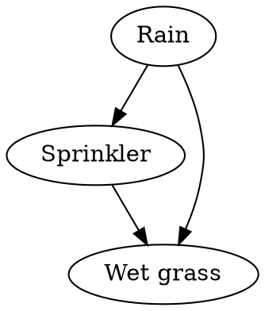

### Intuition

Grass gets wet from rain or from a sprinkler. The sprinkler is used less when it rains. If you see wet grass, how likely is it that it rained? A belief network draws these influences as arrows, and it stores small probability tables instead of one huge joint table.



### How it works

**Conditional independence.** X is conditionally independent of Y given Z if, once Z is known, Y tells us nothing more about X:

```text
P(X | Y, Z) = P(X | Z)
```

In a belief network, each variable is conditionally independent of its non-descendants given its parents. So the joint probability factors into one table per node:

```text
P(x₁, …, xₙ) = Π P(xᵢ | Parents(xᵢ))
```

**The tables for the wet-grass network:**

| Rain | P(Sprinkler = on) |
| --- | --- |
| yes | 0.01 |
| no | 0.40 |

| Sprinkler | Rain | P(Wet = yes) |
| --- | --- | --- |
| on | yes | 0.99 |
| on | no | 0.90 |
| off | yes | 0.80 |
| off | no | 0.00 |

and P(Rain = yes) = 0.2.

**A joint probability.** For rain, sprinkler off, wet grass:

```text
P(R, ¬S, W) = 0.2 × 0.99 × 0.80 = 0.1584
```

**Inference.** To find P(Rain | Wet), add the joint over the hidden variable, then normalise. With 3 Boolean variables this has 8 terms. Exact inference is NP-hard in general, so large networks use approximate methods such as sampling.

**Learning a network.** There are several cases:

| Structure | Data | How to learn |
| --- | --- | --- |
| Known | Fully observed | Count, as in naive Bayes |
| Known | Some variables hidden | Gradient ascent on the likelihood, or EM (topic 13) |
| Unknown | Fully or partly observed | Search over structures, which is much harder |

### Run it: build a network, query it and learn it

```python
import random
from itertools import product

P_rain = 0.2
P_sprinkler = {True: 0.01, False: 0.40}
P_wet = {(True, True): 0.99, (True, False): 0.90, (False, True): 0.80, (False, False): 0.0}

def joint(r, s, w):
    pr = P_rain if r else 1 - P_rain
    ps = P_sprinkler[r] if s else 1 - P_sprinkler[r]
    pw = P_wet[(s, r)] if w else 1 - P_wet[(s, r)]
    return pr * ps * pw

print(f"P(rain, no sprinkler, wet) = {joint(True, False, True):.4f}")

def query(target, evidence):
    """P(target = True | evidence) by adding up the joint table."""
    names = ["rain", "sprinkler", "wet"]
    yes = no = 0.0
    for values in product([True, False], repeat=3):
        world = dict(zip(names, values))
        if all(world[k] == v for k, v in evidence.items()):
            p = joint(*values)
            if world[target]:
                yes += p
            else:
                no += p
    return yes / (yes + no)

print(f"P(wet)                      = {query('wet', {}):.4f}")
print(f"P(rain | wet)               = {query('rain', {'wet': True}):.4f}")
print(f"P(rain | wet, sprinkler on) = {query('rain', {'wet': True, 'sprinkler': True}):.4f}")

# Learning: sample data from the network, then recover a table by counting.
random.seed(0)
data = []
for _ in range(20000):
    r = random.random() < P_rain
    s = random.random() < P_sprinkler[r]
    w = random.random() < P_wet[(s, r)]
    data.append((r, s, w))

print("\nLearned from 20,000 samples by counting:")
for r in (True, False):
    rows = [d for d in data if d[0] == r]
    print(f"P(sprinkler | rain={r!s:5}) = {sum(d[1] for d in rows) / len(rows):.3f}")
```

Seeing that the sprinkler was on makes rain *less* likely, because the sprinkler already explains the wet grass. This is called **explaining away**, and naive Bayes cannot represent it.

### Common mistakes

- **Reading arrows as proof of cause.** An arrow means direct dependence in the model. It may or may not be causal.
- **Assuming a Bayes net always saves little.** For sparse networks the saving is huge compared with a joint table.
- **Forgetting to normalise after adding up the joint.**

### Problems

1. Calculate P(no rain, sprinkler on, wet) by hand from the tables.
2. How many numbers define the full joint for 10 Boolean variables? How many for a network in which each node has at most 2 parents?
3. Draw naive Bayes as a belief network. What are the arrows?
4. Add a variable "Slippery", which depends only on Wet grass, to the program, and query P(rain | slippery).
5. In your own words, explain explaining away using an example from daily life.
