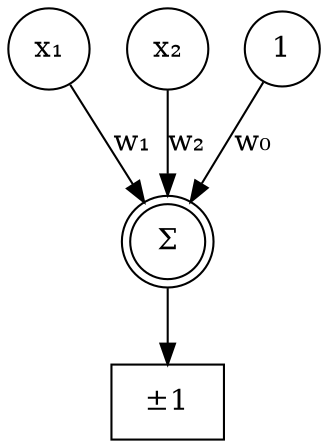

### Intuition

The brain has about 10¹¹ neurons, each connected to thousands of others, and each one slow by computer standards. Yet we recognise a face in a fraction of a second. That suggests huge parallel processing using simple units. Artificial neural networks borrow this one idea. They are not a model of the brain, but they do work very well.

### How it works

**Components of a network:**

| Part | Role |
| --- | --- |
| Input units | Hold the feature values |
| Weights | Say how strongly one unit influences another |
| Bias (threshold) | Shifts the point at which a unit fires |
| Activation function | Turns the weighted sum into the unit's output |
| Hidden units | Build intermediate features |
| Output units | Give the prediction |

**Neural network learning suits problems where:**

- instances have many attributes, possibly numeric and noisy;
- the output is discrete, real-valued or a vector;
- long training times are acceptable, but quick prediction is needed;
- people do not need to read the learned rules.

ALVINN, an early network that learned to steer a vehicle from camera images, is the classic example.

**The perceptron** takes a weighted sum and applies a threshold:

```text
o(x) = +1  if w₀ + w₁x₁ + … + wₙxₙ > 0
       −1  otherwise
```



Geometrically, this is a straight line (a hyperplane in more dimensions). Points on one side give +1, and points on the other give −1. So a perceptron can represent only **linearly separable** data.

**Choosing weights by hand**, using inputs 0 and 1:

| Gate | w₀ | w₁ | w₂ |
| --- | --- | --- | --- |
| AND | −0.8 | 0.5 | 0.5 |
| OR | −0.3 | 0.5 | 0.5 |

**XOR is impossible for one perceptron.** The points (0,1) and (1,0) are positive, while (0,0) and (1,1) are negative. No single straight line can separate them. Algebraically: firing on (0,1) and (1,0) needs w₀+w₂ > 0 and w₀+w₁ > 0, and not firing on (0,0) needs w₀ ≤ 0. Adding the first two gives 2w₀+w₁+w₂ > 0, so w₀+w₁+w₂ > −w₀ ≥ 0, which means it also fires on (1,1). That is a contradiction. Topic 16 solves this with a hidden layer.

### Run it: gates with hand-chosen weights

```python
def perceptron(w0, w1, w2, x1, x2):
    return 1 if w0 + w1 * x1 + w2 * x2 > 0 else 0

gates = {"AND": (-0.8, 0.5, 0.5), "OR": (-0.3, 0.5, 0.5), "NAND": (0.8, -0.5, -0.5)}

print("x1 x2 | " + "  ".join(gates))
for x1 in (0, 1):
    for x2 in (0, 1):
        row = [perceptron(*w, x1, x2) for w in gates.values()]
        print(f"{x1}  {x2}  | " + "    ".join(str(v) for v in row))

# Search a grid of weights for any perceptron that does XOR.
grid = [i / 10 for i in range(-20, 21)]
xor = {(0, 0): 0, (0, 1): 1, (1, 0): 1, (1, 1): 0}
found = 0
for w0 in grid:
    for w1 in grid:
        for w2 in grid:
            if all(perceptron(w0, w1, w2, *x) == y for x, y in xor.items()):
                found += 1
print(f"\nWeight settings tried: {len(grid) ** 3}. Settings that compute XOR: {found}")
```

**Try this:** find weights that make a perceptron compute "x₁ AND NOT x₂".

### Common mistakes

- **Forgetting the bias.** Without w₀, the line must pass through the origin.
- **Thinking the grid search is a proof.** It only illustrates the result. The algebra above is the proof.
- **Treating a network as a brain simulation.** Biological neurons are far more complex.

### Problems

1. Find weights for a perceptron that computes NOR.
2. With weights (−1, 2, 1), calculate the output for x = (0, 1) and x = (1, 0).
3. Plot the four XOR points and explain in one sentence why no line works.
4. Is the function "x₁ OR x₂ OR x₃" linearly separable? Give weights.
5. Give a task where a network is a poor choice because the decision must be explained.
