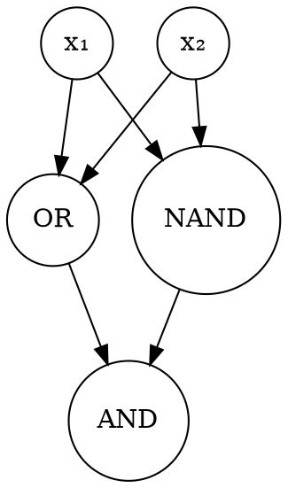

### Intuition

One perceptron draws one line. XOR needs two. So let two hidden units draw a line each, and let the output unit combine their answers. XOR is exactly "at least one input is on, but not both", which is (x₁ OR x₂) AND NOT (x₁ AND x₂).



### How it works

**XOR from hand-made units:**

| x₁ x₂ | OR | NAND | AND of those (XOR) |
| --- | --- | --- | --- |
| 0 0 | 0 | 1 | 0 |
| 0 1 | 1 | 1 | 1 |
| 1 0 | 1 | 1 | 1 |
| 1 1 | 1 | 0 | 0 |

The hidden units have remapped the inputs into a new space, where the points **are** linearly separable. This is the key idea of deep learning: learning a useful representation.

**Why not stack linear units?** A linear function of linear functions is still linear, so depth would add nothing.

**Why not stack threshold units?** A step has no useful slope, so gradient descent cannot use it.

**The sigmoid** is the smooth compromise:

```text
σ(y) = 1 / (1 + e^(−y))
dσ/dy = σ(y) · (1 − σ(y))
```

It is non-linear, differentiable and squashes any number into (0, 1). σ(0) = 0.5, σ(2) ≈ 0.881 and σ(−2) ≈ 0.119.

**The forward pass.** Each layer is calculated from the one before:

```text
net_h = w·x    h = σ(net_h)    (for each hidden unit)
net_o = v·h    o = σ(net_o)    (for each output unit)
```

**What can these networks represent?**

| Network | Can represent |
| --- | --- |
| One hidden layer, threshold or sigmoid units | Any Boolean function, though hidden units may grow exponentially with the inputs |
| One hidden layer of sigmoid units, linear output | Any bounded continuous function, to any accuracy |
| Two hidden layers | Any function, to any accuracy |

These say a network exists, not that training will find it.

### Run it: a network with one hidden layer of 2 neurons

This builds the network by hand to show the forward pass. Topic 17 teaches it to find the weights by itself. The large weights make the sigmoids nearly steps.

```python
from math import exp

def sigmoid(y):
    return 1 / (1 + exp(-y))

def forward(x1, x2):
    h1 = sigmoid(-10 + 20 * x1 + 20 * x2)     # behaves like OR
    h2 = sigmoid(30 - 20 * x1 - 20 * x2)      # behaves like NAND
    o = sigmoid(-30 + 20 * h1 + 20 * h2)      # behaves like AND
    return h1, h2, o

print("x1 x2 |  h1(OR)  h2(NAND)  output")
for x1 in (0, 1):
    for x2 in (0, 1):
        h1, h2, o = forward(x1, x2)
        print(f"{x1}  {x2}  |  {h1:6.3f}  {h2:8.3f}  {o:6.3f}")

print("\nThe sigmoid:")
for y in (-4, -2, 0, 2, 4):
    print(f"sigma({y:2}) = {sigmoid(y):.3f}")
```

**Try this:** build XNOR from the same pieces by changing only the output unit's weights.

### Common mistakes

- **Counting input nodes as a layer of units.** A "one hidden layer" network has input nodes, one hidden layer and one output layer.
- **Using a linear hidden layer.** It collapses to a single linear function.
- **Reading the capacity results as a promise of training success.** They only say that suitable weights exist.

### Problems

1. Calculate σ(1) and σ(−1). What do they add up to? Explain why.
2. Show that a stack of two linear layers is equivalent to one linear layer.
3. Choose different weights in the program that still compute XOR.
4. Calculate the forward pass by hand for x = (1, 0), using weights from the program.
5. How many weights, counting biases, has a network with 3 inputs, 2 hidden units and 1 output?
