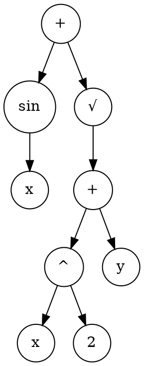

### Intuition

If evolution can search bit strings, it could also search programs. Represent a program as a tree, swap subtrees between parents, and test the children on the task. This is **genetic programming (GP)**.

### How it works

**Hypothesis space search.** A GA differs from backpropagation and from ID3:

| | Gradient descent | Genetic algorithm |
| --- | --- | --- |
| Moves | Small, smooth steps | Can jump, as offspring may differ greatly from parents |
| Tracks | One hypothesis | A population |
| Trap | Local minima | Crowding and early convergence |

**Schemas.** A schema is a pattern with wildcards, such as `0*10`, which matches 0010 and 0110. The **schema theorem** says, roughly, that short, low-order schemas with above-average fitness grow in number from generation to generation. This is the basis of the **building block** idea: good small pieces spread and combine.

**Genetic programming.** The expression `sin(x) + √(x² + y)` is a tree:



Crossover swaps a random subtree of one parent with one from another. Fitness is usually measured by running the program on test cases. Because evaluating every program is costly, populations need careful sizing. Trees also tend to grow large, known as *bloat*, so we prefer smaller programs or limit their depth.

**Remarks on GP.** It has found useful programs in tasks such as block stacking and circuit design, usually with careful choices of representation and fitness.

**Evolution and learning.** Can what you learn in your lifetime affect evolution?

- **Lamarckian evolution:** learned traits pass directly to children. This is rejected in biology, but it can work well in computer GAs.
- **The Baldwin effect:** learning is not inherited, but a creature that can learn survives better, so learning ability is selected for. This gives more time for genes to catch up with what is being learned. It also smooths the search, because near-misses can still succeed.

**Parallel GAs.** Split the population into islands (demes) that evolve separately, with occasional migration between them. This speeds up the work and helps avoid crowding, because each island stays different.

### Run it: evolving a formula

This small GP system evolves an expression tree from `x`, constants and arithmetic to match the hidden target x³ − 2x + 1.

```python
import random

random.seed(11)
OPS = {"+": lambda a, b: a + b, "-": lambda a, b: a - b, "*": lambda a, b: a * b}
POINTS = [i / 2 for i in range(-6, 7)]

def target(x):
    return x * x * x - 2 * x + 1

def random_tree(depth=3):
    if depth == 0 or random.random() < 0.3:
        return random.choice(["x", 1.0, 2.0])
    return (random.choice(list(OPS)), random_tree(depth - 1), random_tree(depth - 1))

def evaluate(tree, x):
    if tree == "x":
        return x
    if isinstance(tree, float):
        return tree
    op, left, right = tree
    return OPS[op](evaluate(left, x), evaluate(right, x))

def error(tree):
    return sum(abs(evaluate(tree, x) - target(x)) for x in POINTS)

def size(tree):
    return 1 + size(tree[1]) + size(tree[2]) if isinstance(tree, tuple) else 1

def score(tree):
    return error(tree) + 0.01 * size(tree)            # a small penalty resists bloat

def paths(tree, here=()):
    yield here
    if isinstance(tree, tuple):
        yield from paths(tree[1], here + (1,))
        yield from paths(tree[2], here + (2,))

def get(tree, path):
    for i in path:
        tree = tree[i]
    return tree

def replace(tree, path, new):
    if not path:
        return new
    parts = list(tree)
    parts[path[0]] = replace(tree[path[0]], path[1:], new)
    return tuple(parts)

def crossover(a, b):
    return replace(a, random.choice(list(paths(a))), get(b, random.choice(list(paths(b)))))

def show(tree):
    if isinstance(tree, tuple):
        return f"({show(tree[1])} {tree[0]} {show(tree[2])})"
    return str(tree)

population = [random_tree() for _ in range(200)]
for generation in range(40):
    population.sort(key=score)
    best = population[0]
    if generation % 5 == 0 or error(best) == 0:
        print(f"generation {generation:2}: error {error(best):7.2f}  {show(best)}")
    if error(best) == 0:
        break
    survivors = population[:40]
    children = survivors[:5]
    while len(children) < 200:
        child = crossover(random.choice(survivors), random.choice(survivors))
        if random.random() < 0.2:
            child = replace(child, random.choice(list(paths(child))), random_tree(2))
        if size(child) <= 40:
            children.append(child)
    population = children
```

**Try this:** change the target to x² + x, an easier one. How soon does it succeed? Try removing the size penalty to see bloat.

### Common mistakes

- **Saying Lamarckian evolution is what happens in nature.** It is not. The Baldwin effect needs no inheritance of learned traits.
- **Applying bit-string crossover directly to programs.** It would usually produce invalid programs. GP swaps whole subtrees instead.
- **Ignoring bloat.** Programs grow unless you limit or penalise size.

### Problems

1. List all strings matched by the schema `1*0*`.
2. Draw the tree for (x + 1) · (x − 2), then pick a subtree to swap with one from x · x.
3. In one paragraph, explain how the Baldwin effect can speed up evolution.
4. Explain how island models help with crowding.
5. Add a division operator to the program, guarding against division by zero.
