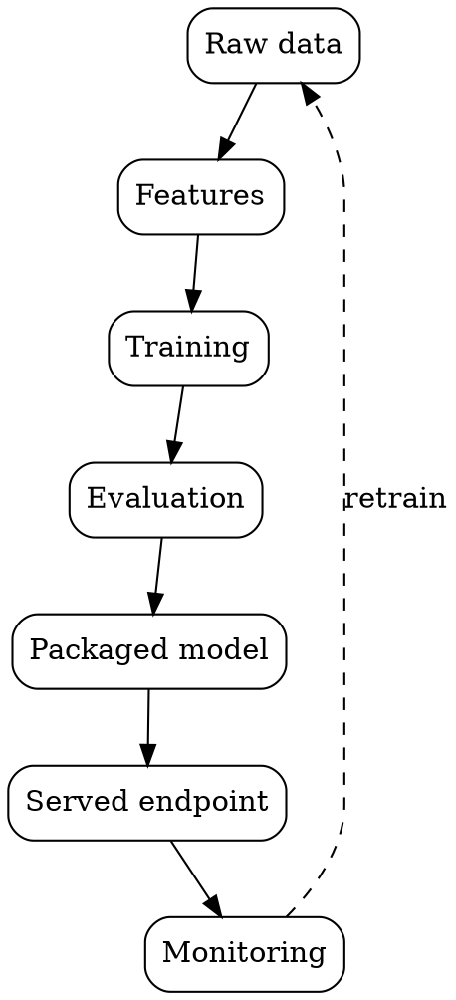

### Intuition

New learners picture ML as "fit a model". In production, the code that fits the model is a small part of the system. Most of the work is in getting clean data, serving predictions reliably, and noticing when the world changes.

### How it works



| Stage | Question it answers | PlacementPredict file | Topic |
| --- | --- | --- | --- |
| Data | Where do records come from, and are they valid? | `data_loader.py` | 4 |
| Features | How do records become numbers? | `feature_pipeline.py` | 8 |
| Training | Which model, and which weights? | `trainer.py` | 5–12 |
| Evaluation | Is it good enough, and on what data? | `evaluate.py` | 17–20 |
| Packaging | How is the model saved and moved? | `model.joblib`, `model.onnx` | 23 |
| Serving | How does an application call it? | `app.py` (FastAPI) | 23 |
| Monitoring | Is it still working? | `monitor.py` | 24 |
| Retraining | When do we update it? | `retrain.py` | 24 |

**Why a loop?** Next year's recruiters and skills differ from this year's. A model that is never updated slowly goes wrong without raising any error, so monitoring leads back to data and training.

**What each stage produces:** a dataset, a fitted feature pipeline, a trained model, a metrics report, a saved file, a running endpoint, then a stream of logs. When something fails, these outputs let you find which stage went wrong.

### Run it: the whole lifecycle in one program

Each block below is one stage, and each prints what it produced.

```python
import io
import joblib
import numpy as np
from sklearn.linear_model import LogisticRegression
from sklearn.metrics import roc_auc_score
from sklearn.pipeline import make_pipeline
from placement_predict import load_data, preprocessor, train_val_test

# 1. DATA
df = load_data()
print(f"1 Data:       {df.shape[0]} rows, {df.shape[1]} columns, {int(df.isna().sum().sum())} missing cells")

# 2. FEATURES (fitted inside the pipeline in step 3)
X_train, X_val, X_test, y_train, y_val, y_test = train_val_test(df)
features = preprocessor()
print(f"2 Features:   split into {len(X_train)} train, {len(X_val)} validation, {len(X_test)} test")

# 3. TRAINING
model = make_pipeline(features, LogisticRegression(max_iter=1000)).fit(X_train, y_train)
print(f"3 Training:   {features.get_feature_names_out().size} features became one weight each")

# 4. EVALUATION
auc = roc_auc_score(y_val, model.predict_proba(X_val)[:, 1])
print(f"4 Evaluation: validation AUC = {auc:.3f}")

# 5. PACKAGING
buffer = io.BytesIO()
joblib.dump(model, buffer)
print(f"5 Packaging:  saved model is {buffer.tell() / 1024:.1f} KB")

# 6. SERVING
buffer.seek(0)
served = joblib.load(buffer)
one = X_test.iloc[[0]]
print(f"6 Serving:    request -> P(placed) = {served.predict_proba(one)[0, 1]:.3f}")

# 7. MONITORING: compare live data against training data
live = X_test["CodingScore"].to_numpy() - 15                  # pretend coding scores fell this year
print(f"7 Monitoring: mean CodingScore {X_train['CodingScore'].mean():.1f} in training, {np.mean(live):.1f} live")

# 8. RETRAINING
if abs(np.mean(live) - X_train["CodingScore"].mean()) > 5:
    print("8 Retraining: drift is large, so schedule a new training run")
```

**Try this:** change `- 15` to `- 2`. Which stage's decision changes?

### Common mistakes

- **Thinking the job ends at a good score.** Unused models help nobody, and unwatched ones go wrong silently.
- **Keeping everything in one notebook.** Topic 21 shows why a system needs separate parts.
- **Forgetting that the loop needs fresh labels.** You only learn true outcomes after placements happen.

### Problems

1. For each failure, name the stage to inspect first: (a) a new Stream value crashes prediction; (b) accuracy fell slowly over two years; (c) the saved model will not load on the server.
2. Draw the lifecycle for a spam filter, naming what each stage produces.
3. Add a stage to the program that rejects any request with a CGPA above 10.
4. Why might the team retrain on a schedule even with no drift detected?
5. Estimate which stages take the most time in a real project, then justify your answer.
