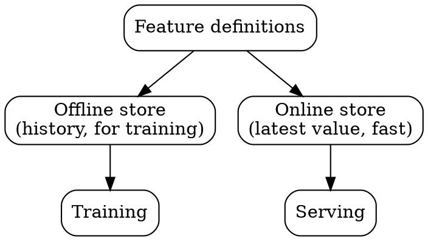

### Intuition

Topic 3's cure for skew was to ship one pipeline. Now picture ten models and fifty features, some calculated from recent activity. A **feature store** is a single place to define, calculate and fetch these features, so that training and serving always agree.

### How it works



| | Offline store | Online store |
| --- | --- | --- |
| Holds | Full history | Latest value per student |
| Speed | Seconds to minutes | Milliseconds |
| Used by | Training | Live prediction |

**Point-in-time correctness.** A training row must use each feature **as it was known at that moment**.

| Student | Mock test date | Score |
| --- | --- | --- |
| S1 | 1 Jan | 40 |
| S1 | 1 Mar | 70 |
| S1 | 1 May | 90 |

The student is labelled on 1 Apr. The correct value is **70**. The latest score, 90, comes from the future, and using it is leakage: training looks better than serving ever can.

**Feast** is a popular open-source feature store. You declare entities and feature views in Python, then fetch historical features for training with `get_historical_features`, and live features with `get_online_features`. This course treats it at the conceptual level.

**Do you need one?** With one model and simple features, a shared `ColumnTransformer` in the model file is enough. A store is worth having when several teams and models reuse time-based features.

### Run it: a point-in-time join and a mini store

```python
import pandas as pd
from placement_predict import load_data

history = pd.DataFrame({
    "student": ["S1", "S1", "S1", "S2", "S2"],
    "date": pd.to_datetime(["2026-01-01", "2026-03-01", "2026-05-01", "2026-02-01", "2026-06-01"]),
    "mock_score": [40, 70, 90, 55, 85],
}).sort_values("date")

labels = pd.DataFrame({
    "student": ["S1", "S2"],
    "label_date": pd.to_datetime(["2026-04-01", "2026-04-01"]),
    "placed": [1, 0],
}).sort_values("label_date")

naive = labels.merge(history.groupby("student", as_index=False)["mock_score"].last(), on="student")
print("Naive join, using the latest value (leaks the future):")
print(naive[["student", "label_date", "mock_score"]].to_string(index=False))

correct = pd.merge_asof(labels, history, left_on="label_date", right_on="date", by="student")
print("\nPoint-in-time join, using the value known at label_date:")
print(correct[["student", "label_date", "date", "mock_score"]].to_string(index=False))

class MiniFeatureStore:
    """One definition, two ways of reading it."""
    def __init__(self, history):
        self.history = history.sort_values("date")
    def get_historical_features(self, entity_df):
        return pd.merge_asof(entity_df.sort_values("label_date"), self.history, left_on="label_date", right_on="date", by="student")
    def get_online_features(self, student):
        row = self.history[self.history["student"] == student].iloc[-1]
        return {"student": student, "mock_score": int(row["mock_score"])}

store = MiniFeatureStore(history)
print("\nOffline (training):", store.get_historical_features(labels)["mock_score"].tolist())
print("Online (serving S1 today):", store.get_online_features("S1"))
```

**Try this:** set a label date before a student's first score. What does the join return, and how should the model handle it?

### Common mistakes

- **Joining with the latest value.** It's the classic hidden leak, and it often looks like a big accuracy gain.
- **Adopting a feature store too early.** It's a system to run, with its own costs.
- **Calculating a feature in SQL for training and in Python for serving.** That is how skew begins.

### Problems

1. A student's scores are 50 (Feb), 60 (Apr) and 80 (Jul). Which value do you use for a label on 1 May?
2. Why does a naive latest-value join boost validation scores?
3. Which features for PlacementPredict would belong in a store? Which wouldn't?
4. Add a "number of mock tests so far" feature to `MiniFeatureStore`.
5. Write down what would have to be true for you to recommend Feast to a team.
