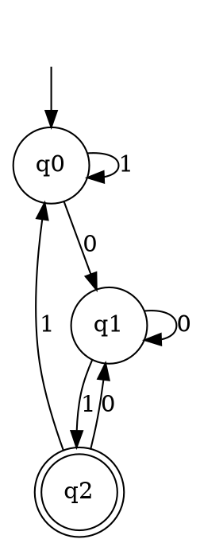

### Key ideas

**Strings and languages.** An *alphabet* Σ is a finite set of symbols, such as {0, 1} or {a, b}. A *string* is a finite sequence of symbols from Σ. The *empty string* ε has length 0. Σ\* is the set of all strings over Σ, and a *language* is any subset of Σ\*.

**A DFA is a 5-tuple** M = (Q, Σ, δ, q₀, F):

| Part | Meaning |
| --- | --- |
| Q | a finite set of states |
| Σ | the input alphabet |
| δ : Q × Σ → Q | the transition function: from each state, on each symbol, exactly one next state |
| q₀ ∈ Q | the start state |
| F ⊆ Q | the set of final (accepting) states |

**How it runs.** The machine starts in q₀, reads the input one symbol at a time, and follows δ. When the input runs out, it **accepts** if it is in a state of F and **rejects** otherwise. The *extended transition function* δ̂(q, w) gives the state reached from q after reading the whole string w:

- δ̂(q, ε) = q
- δ̂(q, wa) = δ(δ̂(q, w), a)

**The language of M** is L(M) = { w ∈ Σ\* | δ̂(q₀, w) ∈ F }. A language is **regular** if some DFA accepts it.

**Deterministic** means there is no choice: every state has exactly one move on every symbol. A DFA always finishes reading its input, and it never gets stuck.

**Dead (trap) state.** This is a non-final state whose every transition loops back to itself. Once the machine enters it, the string can no longer be accepted. Add one whenever a description leaves some moves undefined.

**Two useful constructions:**
- **Complement.** Take a complete DFA for L and swap its final and non-final states. The result accepts exactly Σ\* − L.
- **Product (intersection or union).** Run DFAs M₁ and M₂ side by side. The states are the pairs (p, q), and each symbol moves both parts of the pair at once.
  - For L₁ ∩ L₂, a pair is final when **both** p and q are final.
  - For L₁ ∪ L₂, a pair is final when **either** is.
  - With m and n states, the product has at most m·n states.

### Worked example

**Design a DFA over Σ = {0, 1} that accepts the strings ending in `01`.**

First decide what the machine must remember. Here it only needs to know how much of the pattern "01" the input has just ended with:

- q₀: the input does not end in 0 or 01 (this includes the start)
- q₁: the input ends in 0
- q₂: the input ends in 01, so accept

| δ | 0 | 1 |
| --- | --- | --- |
| → q₀ | q₁ | q₀ |
| q₁ | q₁ | q₂ |
| \* q₂ | q₁ | q₀ |

(→ marks the start state and \* marks a final state.)

**Trace on `1101`:** q₀ → q₀ (1) → q₀ (1) → q₁ (0) → q₂ (1). The machine ends in q₂, so the string is **accepted**.

**Trace on `0110`:** q₀ → q₁ (0) → q₂ (1) → q₀ (1) → q₁ (0). It ends in q₁, so the string is **rejected**, correctly, because 0110 ends in 10.

### Common mistakes

- **Missing transitions.** If a state has no move on some symbol, the drawing is not a DFA. Add a dead state for the missing moves.
- **Forgetting ε.** The DFA accepts ε exactly when q₀ is final. Check whether ε belongs to the language before you decide.
- **Complementing an incomplete DFA.** Swapping final states only works once every move is defined. Complete the DFA first, and add the dead state.
- **States with no meaning.** Write down what each state remembers. If two states remember the same thing, merge them (topic 5 makes this exact).

### Tutorial problems

Attempt these on paper before checking anything.

1. Design a DFA for L = { ank | k > 0 }, over Σ = {a}, where n is a fixed positive integer. Draw it for n = 3, then describe it for any n. Is ε in L?
2. Over {0, 1}, design a DFA for the strings in which **every substring of three symbols has at most two zeros**. For example, 001110 and 011001 are in the language, but 100010 is not. All strings shorter than 3 are in the language. (Hint: what pattern must never appear?)
3. Using the worked example, build the DFA for the strings over {0, 1} that do **not** end in 01. Trace it on ε, 1 and 01.
4. Let L₁ be the strings over {a, b} with an even number of a's, and L₂ the strings that end in b. Use the product construction to build a DFA for L₁ ∩ L₂. How many states does it have before any simplification?
5. Design a DFA over {0, 1} that accepts the binary numbers divisible by 3, reading the most significant bit first. (Hint: keep the remainder mod 3 as the state. Reading bit b turns remainder r into (2r + b) mod 3.)

### Viva questions

1. What is the role of the start state and the final states in a DFA? How do they decide whether a string is accepted? Give an example.
2. How does the transition function choose the next state from the current state and the input symbol? How does the extended transition function δ̂ follow from it?
3. Explain step by step how a DFA decides whether a string is accepted or rejected.
