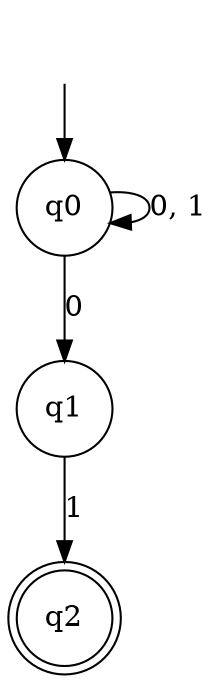

### Key ideas

**An NFA is a 5-tuple** (Q, Σ, δ, q₀, F), exactly like a DFA except for the transition function:

> δ : Q × (Σ ∪ {ε}) → 𝒫(Q)

so a move goes to a **set** of states. The set may contain several states (a choice), exactly one, or none at all (that branch dies). An **ε-move** changes state without reading any input.

**Acceptance.** An NFA accepts w if **at least one** way of reading w ends in a final state. Branches that die or end in non-final states do not matter. Two ways to picture this:

- the machine guesses the right path every time; or
- it follows all possible paths at once, keeping the set of states it could be in.

**ε-closure.** ECLOSE(q) is the set of states reachable from q using ε-moves only, and it always includes q itself. When you trace an ε-NFA, take the ε-closure after every step and once at the start.

**Subset construction (NFA → DFA).** Each DFA state is a **set** of NFA states:

1. The DFA start state is ECLOSE(q₀).
2. From a set S on symbol a, the DFA moves to ECLOSE of all the states that the members of S reach on a.
3. A set is a final state if it contains at least one NFA final state.
4. Build only the sets you can reach from the start. An n-state NFA gives at most 2ⁿ DFA states.

**Equivalence.** Every DFA is already an NFA. The subset construction turns every NFA into a DFA. So NFAs and DFAs recognise exactly the same class of languages: the **regular languages**. NFAs are not more powerful; they are often much smaller and easier to design.

### Worked example

**An NFA for the strings over {0, 1} that end in `01`, and its DFA.**

The NFA stays in q₀ while reading, and guesses when the final "01" begins:

Subset construction, starting from {q₀}:

| DFA state | on 0 | on 1 |
| --- | --- | --- |
| → {q₀} | {q₀, q₁} | {q₀} |
| {q₀, q₁} | {q₀, q₁} | {q₀, q₂} |
| \* {q₀, q₂} | {q₀, q₁} | {q₀} |

Only 3 of the 2³ = 8 possible sets are reachable. Rename them A = {q₀}, B = {q₀, q₁} and C = {q₀, q₂}. The result is exactly the 3-state DFA from topic 1. The NFA was easier to design, and the construction did the bookkeeping.

**An ε-closure example.** In the ε-NFA with q₀ —ε→ q₁ —ε→ q₂, the start set is ECLOSE(q₀) = {q₀, q₁, q₂}. The first real symbol is read from all three states at once.

### Common mistakes

- **Forgetting the ε-closure** at the start, or after a move. The DFA start state is ECLOSE(q₀), not {q₀}.
- **Treating ∅ as an error.** In the subset construction, the empty set is a legitimate DFA state: it is the dead state. Include it if it is reachable.
- **Final-state test.** A set is final if it contains **any** NFA final state, not only if all of its states are final.
- **Building all 2ⁿ subsets.** Build only the reachable ones. This saves a great deal of work.

### Tutorial problems

1. Consider the NFA with Q = {q₀, q₁, q₂}, Σ = {a, b}, start q₀ and F = {q₁, q₂}:

    | δ | a | b |
    | --- | --- | --- |
    | q₀ | {q₁} | {q₂} |
    | q₁ | ∅ | {q₁} |
    | q₂ | {q₂} | ∅ |

    Construct an equivalent DFA, showing each step. Describe the language in words.
2. Consider the ε-NFA M = ({q₀, q₁, q₂, q₃}, {a}, δ, q₀, {q₃}) with q₀ —ε→ q₁, q₁ —ε→ q₂, and δ(q₂, a) = {q₂, q₃}. What is the length of the shortest string that reaches the final state? Is ε accepted?
3. Remove the ε-moves from the ε-NFA in problem 2 to get an NFA without ε-transitions. Then convert it to a DFA.
4. Design an NFA with at most 4 states for the strings over {0, 1} whose **third symbol from the end** is 1. Convert it to a DFA. How many states does the DFA have, and why can no smaller DFA exist?
5. Give an NFA for the complement of L = {aⁿ | n is even}, over Σ = {a}.

### Viva questions

1. How does the transition function of an NFA differ from that of a DFA?
2. What is the purpose of ε-transitions in an NFA?
3. How does an NFA decide whether an input string is accepted?
4. Can an NFA have missing transitions for an input symbol? What does a missing transition mean?
5. State the equivalence theorem for NFAs and DFAs. How does it guarantee that every NFA can be converted to a DFA, and every DFA to an NFA?
6. How does a compiler's lexical analyser use the NFA → DFA conversion?
