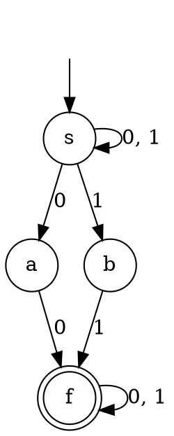

### Key ideas

**Regular expressions over Σ** are built from three base cases and three operations:

| Expression | Language |
| --- | --- |
| ∅ | the empty language { } |
| ε | { ε }, the empty string only |
| a (for a ∈ Σ) | { a } |
| R + S (also written R ∣ S) | union: L(R) ∪ L(S) |
| RS | concatenation: a string from L(R) followed by one from L(S) |
| R\* | Kleene star: zero or more strings from L(R), joined end to end |

**Precedence:** star binds tightest, then concatenation, then +. So `a + bc*` means a + (b(c\*)). R⁺ is shorthand for RR\*, one or more repetitions.

**Identities** (true for every R, S and T):

| | |
| --- | --- |
| ∅ + R = R | ∅R = R∅ = ∅ |
| εR = Rε = R | R + R = R |
| ∅\* = ε and ε\* = ε | (R\*)\* = R\* and R\*R\* = R\* |
| R(S + T) = RS + RT | (R + S)T = RT + ST |
| (R + S)\* = (R\*S\*)\* = (R\* + S\*)\* | (RS)\*R = R(SR)\* |
| R\* = ε + RR\* | (a + b)\* = a\*(ba\*)\* |

**Careful:** (RS)\* is **not** R\*S\* in general. For example, `aab` is in a\*b\* but not in (ab)\*. Likewise, (R + S)\* is not R\* + S\*.

**Kleene's theorem.** A language is regular if and only if some regular expression describes it. Both directions are constructive:

- **RE → ε-NFA (Thompson's construction).** Build a small ε-NFA for each symbol, then glue the pieces together with ε-moves:
  - **union:** a new start state with ε-moves into both machines;
  - **concatenation:** an ε-move from the first machine's final state to the second machine's start;
  - **star:** a new start/final state with ε-moves around and back.
- **FA → RE (state elimination).**
  1. Add a single new start state and a single new final state, connected by ε-moves.
  2. Remove the other states one by one. When you remove state q, every path p → q → r becomes one edge p → r labelled (in)(loop)\*(out).
  3. The label left between the start and the final state is the regular expression.
- Arden's theorem (topic 4) gives another route from an FA to an RE.

### Worked example

**A regular expression for the strings over {0, 1} in which every 0 is immediately followed by at least two 1s.**

Every 0 must come as the block `011`. Between and around these blocks, any number of extra 1s may appear. So the strings are built from the blocks `1` and `011`:

> (1 + 011)\*

Check this against small cases:

- ε is accepted, which is right: it has no 0.
- 0111 = (011)(1) is accepted.
- 01 and 0110 are rejected, because their 0s are not followed by two 1s.

Another correct answer is 1\*(0111\*)\*.

**From RE to automaton: (0 + 1)\*(00 + 11)(0 + 1)\*.** The middle part says that the string contains `00` or `11` somewhere. An NFA guesses where:

### Common mistakes

- **Using (RS)\* = R\*S\*.** It is false (see above). Test an identity on a few short strings before you rely on it.
- **Mixing up ∅ and ε.** ∅ is the language with no strings. ε is the language containing just the empty string. RS where R = ∅ gives ∅, but RS where R = ε gives S.
- **Forgetting ε.** A starred expression always contains ε. If ε must not be in the language, use R⁺ or put a required symbol in front.
- **Precedence slips.** ab\* is a(b\*), not (ab)\*.

### Tutorial problems

1. Prove that (1 + 00\*1) + (1 + 00\*1)(0 + 10\*1)\*(0 + 10\*1) = 0\*1(0 + 10\*1)\*. (Hint: factor out (1 + 00\*1), and use ε + RR\* = R\* and ε + 00\* = 0\*.)
2. Give **two** different regular expressions for the set of strings over {0, 1} in which every 0 is immediately followed by at least two 1s.
3. Prove (a + b)\* = a\*(ba\*)\* using the identities above.
4. Construct a finite automaton equivalent to (0 + 1)\*(00 + 11)(0 + 1)\*, writing each step of Thompson's construction. Then convert it to a DFA.
5. Construct a DFA with the fewest states you can for the regular expression 10 + (0 + 11)0\*1.
6. Write regular expressions over {a, b} for:
    - strings of even length;
    - strings containing at least one a;
    - strings with no two consecutive b's.

### Viva questions

1. What is the relationship between regular sets and regular expressions?
2. How can you decide whether two regular expressions are equivalent? What does equivalence mean for the automata built from them?
3. How does the ε-NFA produced by Thompson's construction mirror the structure of the regular expression?
4. How does the regular expression produced by state elimination relate to the structure of the original automaton?
