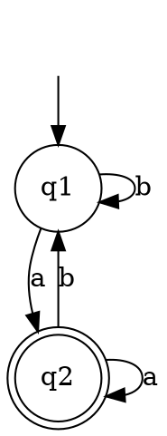

### Key ideas

**Arden's theorem.** Let P and Q be regular expressions, and suppose P does **not** contain ε. Then the equation

> R = Q + RP

has exactly one solution: **R = QP\***.

**Why it works.**

- **It is a solution.** Substitute: Q + QP\*P = Q(ε + P\*P) = QP\*.
- **It is the only one.** Unfold the equation n times: R = Q + QP + QP² + … + QPⁿ + RPⁿ⁺¹. Because ε ∉ P, every string in RPⁿ⁺¹ has length at least n + 1. So any string w of length n must already lie in Q + QP + … + QPⁿ ⊆ QP\*.
- **If ε ∈ P**, uniqueness fails. For example, R = Q + Rε is satisfied by every R that contains Q.

**From a finite automaton to a regular expression.**

1. For each state qᵢ, write one equation. qᵢ is the sum of qja over every transition qj —a→ qᵢ that **enters** qᵢ.
2. Add **+ ε** to the equation of the start state.
3. Solve by substitution. Whenever an equation has the form qᵢ = (something) + qᵢP, apply Arden's rule to get qᵢ = (something)P\*.
4. The answer is the sum of the expressions for all final states.

The equations must not have ε-moves, and an NFA without ε-moves is fine. Each unknown qᵢ stands for the set of strings that lead from the start state to qᵢ.

### Worked example

**Find a regular expression for this DFA.**

**Equations** (incoming transitions, plus ε for the start state):

- q₁ = ε + q₁b + q₂b
- q₂ = q₁a + q₂a

**Solve q₂ first.** It has the form R = Q + RP, with R = q₂, Q = q₁a and P = a. By Arden's rule, q₂ = q₁aa\*.

**Substitute into q₁:**

> q₁ = ε + q₁b + q₁aa\*b = ε + q₁(b + aa\*b)

Arden's rule again, with Q = ε: **q₁ = (b + aa\*b)\***.

**Final state q₂:** q₂ = (b + aa\*b)\*aa\*.

That simplifies to **(a + b)\*a**: the strings that end in a, which is what the DFA does.

### Common mistakes

- **Using outgoing transitions.** Each equation collects the transitions **coming into** a state.
- **Forgetting + ε** on the start state. Without it, the start state's equation describes nothing.
- **Writing PQ\* or Q\*P.** The rule is R = Q + RP ⇒ R = QP\*. The repeated part P goes on the right, starred.
- **Applying the rule when ε ∈ P.** The solution is then not unique. Remove ε-moves first.

### Tutorial problems

1. Prove Arden's theorem: show that R = QP\* satisfies R = Q + RP, and that it is the only solution when ε ∉ P.
2. Use Arden's theorem to find a regular expression for the DFA over {0, 1} with states q₁ (start) and q₂ (final). Its transitions are q₁ —0→ q₁, q₁ —1→ q₂, q₂ —0→ q₁ and q₂ —1→ q₂. Describe the language in words.
3. A finite automaton over {0, 1} has states q₁ (start, final), q₂ and q₃, and these transitions:
    - q₁ —0→ q₂ and q₁ —1→ q₁
    - q₂ —0→ q₃ and q₂ —1→ q₁
    - q₃ —0→ q₃ and q₃ —1→ q₃

    Find its regular expression and describe the language.
4. Use the method of this topic to prove (1 + 00\*1) + (1 + 00\*1)(0 + 10\*1)\*(0 + 10\*1) = 0\*1(0 + 10\*1)\*.
5. Solve the system q₁ = ε + q₁a and q₂ = q₁b + q₂b. Which strings lead to q₂?

### Viva questions

1. State Arden's theorem. Why must P not contain ε?
2. Why does only the start state's equation get the extra ε term?
3. Compare Arden's method with state elimination for converting a DFA to a regular expression.
