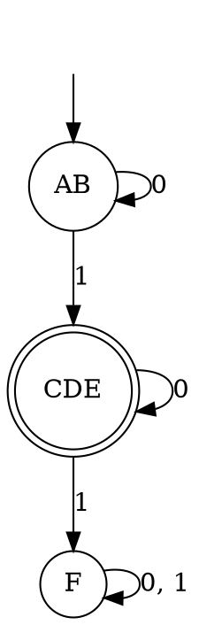

### Key ideas

**Equivalent states.** States p and q are *equivalent* (p ≡ q) if, for every string w, δ̂(p, w) and δ̂(q, w) are either both final or both non-final. Equivalent states can be merged without changing the language.

States that are not equivalent are *distinguishable*: there is a string w that leads one of them to a final state and the other to a non-final state.

**k-equivalence.** p and q are *k-equivalent* if no string of length ≤ k distinguishes them. 0-equivalence just splits the final states from the non-final ones.

**Partition method (Moore's algorithm).**

1. Remove the states that cannot be reached from the start state.
2. P₀ = { F, Q − F }.
3. Build Pₖ₊₁ from Pₖ. Two states in the same block stay together only if, on **every** symbol, their transitions go to the same block of Pₖ. Otherwise, split the block.
4. Stop when Pₖ₊₁ = Pₖ. Each block becomes one state of the minimal DFA.

**Table-filling method.**

1. List all pairs of states.
2. Mark every pair with one final and one non-final state.
3. Then repeat: mark (p, q) if, on some symbol a, the pair (δ(p, a), δ(q, a)) is already marked.
4. When nothing more can be marked, the unmarked pairs are equivalent.

**Myhill–Nerode theorem.** For a language L, call strings x and y *equivalent* if, for every z, xz ∈ L exactly when yz ∈ L.

- **L is regular if and only if this relation has finitely many classes.**
- The number of classes is exactly the number of states in the minimal DFA.
- The minimal DFA is **unique** up to the names of its states.

### Worked example

**Minimise this DFA over {0, 1}** (A is the start state; C, D and E are final):

| δ | 0 | 1 |
| --- | --- | --- |
| → A | B | C |
| B | A | D |
| \* C | E | F |
| \* D | E | F |
| \* E | E | F |
| F | F | F |

Every state is reachable. Now split, step by step:

- **P₀:** {C, D, E} and {A, B, F}, final versus non-final.
- **P₁:** look at where each state goes, block by block.
  - In {A, B, F}: on 1, A → C and B → D, both into the final block, but F → F, into the non-final block. So F splits off: {A, B} and {F}.
  - In {C, D, E}: on 0, all go to E, and on 1, all go to F. They stay together.
  - So P₁ = {A, B}, {C, D, E}, {F}.
- **P₂:** check again. A and B both go to {A, B} on 0 and to {C, D, E} on 1. Nothing splits, so P₂ = P₁, and we stop.

The minimal DFA has **3 states**: [AB] (start), [CDE] (final) and [F] (dead).

It accepts the strings with **exactly one 1**, something that was hard to see in the six-state version.

### Common mistakes

- **Skipping unreachable states.** Remove them first. Merging cannot get rid of them.
- **Splitting on the wrong thing.** Two states stay together when their transitions land in the same **block**, not when they land on the same state.
- **Stopping too early.** Keep refining until a full pass changes nothing.
- **Merging a final state with a non-final one.** They are distinguished by ε, so they can never be merged.

### Tutorial problems

1. Minimise the DFA in the worked example using the **table-filling** method. Check that you get the same three classes.
2. Minimise this DFA over {a, b} (q₀ is the start state, q₃ is final):

    | δ | a | b |
    | --- | --- | --- |
    | → q₀ | q₁ | q₂ |
    | q₁ | q₁ | q₃ |
    | q₂ | q₁ | q₂ |
    | \* q₃ | q₁ | q₂ |

    What language does it accept?
3. Without building any DFA, use Myhill–Nerode to show that a DFA for "the strings over {a, b} ending in ab" needs exactly 3 states.
4. How many states does the minimal DFA have for "the number of 0s is even **and** the number of 1s is divisible by 3"? Justify your answer.
5. Use the Myhill–Nerode theorem to show that {aⁿbⁿ | n ≥ 0} is not regular. (Hint: are ai and aj equivalent when i ≠ j?)

### Viva questions

1. What is the purpose of minimising a DFA?
2. What is the difference between distinguishable and indistinguishable pairs of states?
3. Why is the minimal DFA unique?
4. Why must unreachable states be removed separately?
