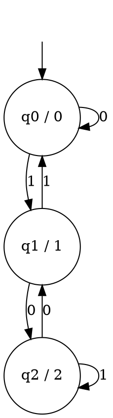

### Key ideas

**A Moore machine is a 6-tuple** M = (Q, Σ, Δ, δ, λ, q₀):

| Part | Meaning |
| --- | --- |
| Q | a finite set of states |
| Σ | the input alphabet |
| Δ | the output alphabet |
| δ : Q × Σ → Q | the transition function, as in a DFA |
| λ : Q → Δ | the output function: each **state** has an output |
| q₀ | the start state |

**How it runs.** The machine emits λ(q₀) before reading anything. After each input symbol it moves to a new state and emits that state's output. For an input of length n, the output has length **n + 1**.

**No final states.** A Moore machine is a *transducer*: it turns an input string into an output string. It does not accept or reject. Any yes/no question can still be answered as output. For example, output 1 in the states that mean "the input so far is in L".

**Drawing convention.** Write each state as **q / output**, for example q₁/1.

### Worked example

**A Moore machine that outputs the remainder mod 3 of the binary number read so far.**

Reading a bit b turns a value v into 2v + b, so a remainder r becomes (2r + b) mod 3. Use one state per remainder, and let each state output its remainder.

**Input `1010`** (ten in binary):

| Read | — | 1 | 0 | 1 | 0 |
| --- | --- | --- | --- | --- | --- |
| State | q₀ | q₁ | q₂ | q₂ | q₁ |
| Output | 0 | 1 | 2 | 2 | 1 |

The output is `01221`, five symbols for four input symbols. Its last symbol is 1, and 10 mod 3 = 1.

### Common mistakes

- **Forgetting the first output.** A Moore machine prints λ(q₀) before reading any input, so the output is always one symbol longer than the input.
- **Putting outputs on the arrows.** That is a Mealy machine (topic 7). In a Moore machine, outputs belong to states.
- **Drawing final states.** A Moore machine has none. Answer yes/no questions through the output.

### Tutorial problems

1. Design a Moore machine over {0, 1} that outputs the remainder mod 4 of the binary number read so far. Trace it on `1011`.
2. Design a Moore machine over {a, b} that outputs 1 when the input read so far ends in `ab`, and 0 otherwise. Trace it on `aabab`.
3. Design a Moore machine that counts the occurrences of `aba` (overlaps allowed) and outputs that count mod 2.
4. Over {0, 1}, design a Moore machine that outputs A when the number of 1s read so far is even, and B when it is odd. What is its output on ε?

### Viva questions

1. Why is the output of a Moore machine one symbol longer than its input?
2. How does a Moore machine differ from a DFA? Can a DFA be seen as a special Moore machine?
3. Give a real-world device that behaves like a Moore machine.
