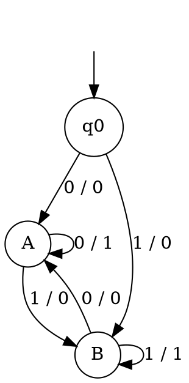

### Key ideas

**A Mealy machine is a 6-tuple** (Q, Σ, Δ, δ, λ, q₀), like a Moore machine except for the output function:

> λ : Q × Σ → Δ

The output is produced **on each transition**, and depends on both the current state and the symbol read. For an input of length n, the output has length **n**. In diagrams, label each arrow **input / output**.

**Equivalence.** A Moore machine always prints an extra first symbol, λ(q₀). So a Moore machine and a Mealy machine are called *equivalent* when, for every input, their outputs agree after that first Moore symbol is dropped.

**Moore → Mealy (same number of states).** Keep the states and transitions. Give each transition the output of the state it **enters**:

> λ′(q, a) = λ(δ(q, a))

**Mealy → Moore (states may multiply).**

1. A Moore state can have only one output. So if the transitions entering a state q carry different outputs, split q into copies q/o, one for each output o that enters it.
2. Each copy keeps all of q's outgoing transitions.
3. Every incoming arrow is redirected to the copy with the matching output.
4. The start state needs an output too. Choose any output for it (it is ignored), or add a separate start copy.

With n states and m output symbols, the Moore machine needs at most **n·m** states, plus possibly one for the start.

### Worked example

**A Mealy machine over {0, 1} that outputs 1 when the current symbol equals the previous one, and 0 otherwise.**

The states remember the previous symbol: q₀ (nothing yet), A (last was 0) and B (last was 1).

**Input `0010`:**

| Step | Move | Output |
| --- | --- | --- |
| 1 | q₀ —0→ A | 0 |
| 2 | A —0→ A | 1 |
| 3 | A —1→ B | 0 |
| 4 | B —0→ A | 0 |

The output is `0100`: four symbols for four input symbols.

**Convert to Moore.**

- **A** is entered with output 0 (from q₀ and from B) and with output 1 (from A itself). So split it into **A/0** and **A/1**.
- **B** is split the same way, into **B/0** and **B/1**.
- **q₀** becomes **q₀/0**.

The Moore machine has 5 states. On `0010` it prints `00100`: its own start symbol, then the Mealy output.

### Common mistakes

- **Moore → Mealy using the source state's output.** The transition takes the output of the state it **enters**: λ′(q, a) = λ(δ(q, a)).
- **Mealy → Moore without splitting.** If a state is entered with two different outputs, it must become two Moore states.
- **Comparing outputs of different lengths.** Drop the Moore machine's first output before you compare it with the Mealy output.

### Tutorial problems

1. Design a Mealy machine that outputs the **1's complement** of a binary input. How many states does it need?
2. Design a Mealy machine that outputs the **2's complement** of a binary number read from the least significant bit first. (Hint: copy the bits up to and including the first 1, then invert the rest.)
3. Convert the mod-3 Moore machine from topic 6 into a Mealy machine. Trace both on `1101`, and check that the outputs agree once the Moore machine's first symbol is dropped.
4. Convert the worked-example Mealy machine into a Moore machine. Draw it in full and trace it on `0110`.
5. Design a Mealy machine over {a, b} that outputs 1 exactly when the input so far ends in `aab`.

### Viva questions

1. What is the difference between Moore and Mealy machines, both in definition and in output length?
2. Why can converting Mealy → Moore increase the number of states, while Moore → Mealy never does?
3. In what precise sense are Moore and Mealy machines equivalent?
