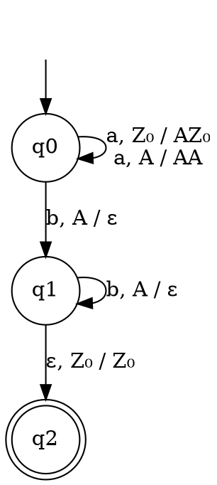

### Key ideas

**A pushdown automaton (PDA)** is a 7-tuple P = (Q, Σ, Γ, δ, q₀, Z₀, F):

| Part | Meaning |
| --- | --- |
| Q | a finite set of states |
| Σ | the input alphabet |
| Γ | the stack alphabet |
| δ | the transition function: Q × (Σ ∪ {ε}) × Γ → finite subsets of Q × Γ\* |
| q₀ | the start state |
| Z₀ ∈ Γ | the initial stack symbol, which marks the bottom of the stack |
| F ⊆ Q | the final states |

**Reading a transition.** (p, γ) ∈ δ(q, a, X) means: in state q, reading a (or ε), with X on top of the stack, the PDA may

1. pop X,
2. push the string γ, so that its **leftmost** symbol ends up on top, and
3. move to state p.

| γ | Effect |
| --- | --- |
| ε | pop |
| X | leave the stack unchanged |
| YX | push Y on top of X |

In diagrams, the arrow is labelled **a, X / γ**.

**Instantaneous description (ID).** A snapshot of a running PDA is a triple **(q, w, γ)**:

- q is the current state;
- w is the input not yet read;
- γ is the stack, with its top on the left.

One move is written (q, aw, Xβ) ⊢ (p, w, γβ) when (p, γ) ∈ δ(q, a, X). ⊢\* means zero or more moves.

**Nondeterminism.** A PDA, like an NFA, may have several possible moves, and it accepts if any branch accepts. Unlike for finite automata, **deterministic PDAs (DPDAs) are strictly weaker**. For example, even-length palindromes {wwᴿ} need a PDA that guesses where the middle is. "PDA" on its own means nondeterministic.

**Why a stack is enough for aⁿbⁿ:** push one symbol for each a, and pop one for each b. The stack is an unbounded counter that a finite automaton does not have.

### Worked example

**A PDA for L = {aⁿbⁿ | n ≥ 1}**, with Γ = {A, Z₀} and F = {q₂}:

| Transition | Meaning |
| --- | --- |
| δ(q₀, a, Z₀) = {(q₀, AZ₀)} | first a: push A |
| δ(q₀, a, A) = {(q₀, AA)} | more a's: push A |
| δ(q₀, b, A) = {(q₁, ε)} | first b: pop, switch to "b mode" |
| δ(q₁, b, A) = {(q₁, ε)} | more b's: pop |
| δ(q₁, ε, Z₀) = {(q₂, Z₀)} | bottom reached: accept |

**IDs on `aabb`:**

(q₀, aabb, Z₀) ⊢ (q₀, abb, AZ₀) ⊢ (q₀, bb, AAZ₀) ⊢ (q₁, b, AZ₀) ⊢ (q₁, ε, Z₀) ⊢ (q₂, ε, Z₀)

All the input has been read and the PDA is in the final state q₂, so the string is **accepted**.

**On `aab`:** (q₀, aab, Z₀) ⊢\* (q₁, ε, AZ₀). An A is left on top, so the move to q₂ is impossible. **Rejected.**

### Common mistakes

- **Pushing in the wrong order.** In δ(q, a, X) = (p, YX), the new top is **Y**, the leftmost symbol.
- **Forgetting that the top is always popped.** To keep X, push it back. To leave the stack unchanged, write X / X.
- **Moving without a top symbol.** Every move needs a top-of-stack symbol. If the stack is empty, the PDA halts. Keep Z₀ at the bottom so that it is never empty by accident.
- **Expecting a deterministic machine for every CFL.** Some CFLs need guessing.

### Tutorial problems

1. Construct a PDA for L = {0ⁿ1²ⁿ | n ≥ 1}. Trace it on `011` and `001111`.
2. Construct a PDA for L = {0ⁿ1ᵐ | n ≥ 1, m > n + 2}.
3. Design a PDA for {aⁿbᵐcⁿ⁺ᵐ | m, n ≥ 1}. (Hint: push for both a's and b's.)
4. Design a PDA for {wcwᴿ | w ∈ {a, b}\*}. Is your PDA deterministic? What changes for {wwᴿ}, which has no centre marker?
5. Write the sequence of IDs of your PDA from problem 3 on the input `abcc`.

### Viva questions

1. Write the instantaneous description (ID) of a PDA. What does each part mean?
2. What are the components of a PDA? How does it differ from an NFA?
3. Why are deterministic PDAs weaker than nondeterministic ones, when DFAs and NFAs are equally powerful?
4. Give real applications that rely on stack-based recognition, for example parsers and expression evaluation.
